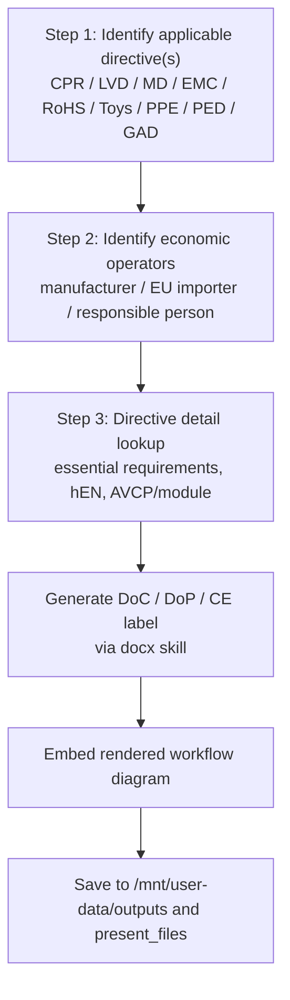

# CE Marking, DoC & DoP Generator

> **Organisation Context**: A.R.E.N.A. Vietnam is a **sourcing office**, not a manufacturer. It sources non-food consumer products from suppliers (factories) and connects them to retail partners (HAGEBAU, ITM, BCM, DEDEMAN, JUMBO/Coop) across EU-27, EEA-3, Switzerland, Canada, and US markets. Any references to manufacturing or production processes in this skill refer to **supplier/factory operations** that A.R.E.N.A. oversees, specifies, audits, and validates as part of its Supply Chain Quality & Compliance function.

Generate compliant CE marking labels and declarations for EU market access.

## Quick Reference: Document Types

| Document | Regulation | When Required |
|----------|------------|---------------|
| Declaration of Performance (DoP) | CPR 305/2011 | Construction products only |
| EU Declaration of Conformity (DoC) | Various directives | All other CE-marked products |
| CE Label | All CE directives | All CE-marked products |

## Workflow

### Step 1: Identify Applicable Directive(s)

Determine which EU directive(s) apply based on product category:

| Product Category | Directive/Regulation | Reference File |
|-----------------|---------------------|----------------|
| Construction products | CPR 305/2011 (transition to (EU) 2024/3110) | Step 3 embedded table |
| Low voltage electrical | LVD 2014/35/EU | Step 3 embedded table |
| Machinery | MD 2006/42/EC → Machinery Reg (EU) 2023/1230 (applies 20 Jan 2027 — check regime per shipment date) | Step 3 embedded table |
| EMC (electromagnetic) | EMC 2014/30/EU | Step 3 embedded table |
| Radio equipment | RED 2014/53/EU | Step 3 embedded table |
| Toys | TSD 2009/48/EC → Toy Safety Reg (EU) 2025/2509 (transition to Aug 2030) | Step 3 embedded table |
| PPE | PPE Reg 2016/425 | Step 3 embedded table |
| Pressure equipment | PED 2014/68/EU | Step 3 embedded table |
| Gas appliances | GAR 2016/426 | Step 3 embedded table |
| RoHS (hazardous substances) | RoHS 2011/65/EU | Step 3 embedded table |
| General product safety | GPSR 2023/988 | Step 3 embedded table |

**Multiple directives may apply** - e.g., an electrical radiator needs LVD + EMC + RoHS + possibly Ecodesign.

### Step 2: Identify Economic Operators

For non-EU manufacturers, identify all economic operators:

| Role | Location | CE Label Requirement |
|------|----------|---------------------|
| Manufacturer | Non-EU | `[___]` — Name + address field (leave blank; populated per order) |
| Authorised Representative | EU | `[___]` — Name + address (if appointed) |
| Importer | EU | `[___]` — Name + address + email (required under GPSR) |

> **⚠ DO NOT ask for or pre-fill supplier/manufacturer/factory names.** All economic operator fields must remain as blank `[___]` placeholders in the generated document. These are populated later in order-specific or supplier-specific workflows. The DoC/DoP/CE label defines WHAT fields are required and WHERE they appear — not WHO fills them.

**GPSR 2023/988 Requirement (effective 13 Dec 2024):**
- Products without EU manufacturer MUST have EU responsible person
- Electronic contact (email) is mandatory on labeling

### Step 3: Directive Detail (EMBEDDED)

Verify every hEN citation via `harmonised-standard-lookup` (OJ-anchored VERSION_DB) before embedding. A standard loses presumption of conformity ONLY on formal OJ withdrawal by CID — never on CEN withdrawal or the mere existence of a newer version.

| Directive / Regulation | Status (Jul 2026) | Conformity Module(s) | NB Required? | Marking Specifics |
|---|---|---|---|---|
| **CPR 305/2011** (→ (EU) 2024/3110 staged; check applicable regime per hEN/product) | Both regimes live | AVCP 1+ / 1 / 2+ / 3 / 4 | Yes for 1+/1/2+/3 (NB number on CE) | CE + DoP no. + declared performance + hEN ref |
| **LVD 2014/35/EU** (50–1000 V AC / 75–1500 V DC) | Current | Module A (internal control) | No | CE + rating plate (V/Hz/W) + model |
| **EMC 2014/30/EU** | Current | Module A (or B+C) | Optional | CE; usually co-declared with LVD/RED |
| **Machinery**: MD 2006/42/EC until 19 Jan 2027 → **MR (EU) 2023/1230 applies 20 Jan 2027** (no transition overlap — regime set by placing-on-market date; prepare dual MD/MR documents when a P.O. straddles the date). **No hEN cited under MR yet (Sep 2026)** → no Art. 20 presumption; demonstrate Annex III EHSR in technical file | Transition | MD: Annex VIII internal control (Module A) for non-Annex IV; MR: Module A for non-Annex I; Annex I Part A/B high-risk: B+C, H, or (new) G | Yes for listed high-risk | CE + data plate (MD/MR 1.7.3: name/address, designation, series/type, serial no., year) + rated load for lifting machinery (4.3.3) + importer details (MR Art. 13) + instructions (see Machinery DoC rules) |
| **Toys**: TSD 2009/48/EC → **TSR (EU) 2025/2509** (transition to Aug 2030; Digital Product Passport phased in) | Transition | Module A with full hEN coverage; else Module B+C (EU type-exam) | Yes if no/partial hEN coverage | CE + warnings ("0–3" symbol etc.) + traceability; TSR: DPP data carrier |
| **PPE Reg (EU) 2016/425** — hEN list per **CID (EU) 2026/1279** | Current | Cat I: Module A · Cat II: B+C · Cat III: B + C2 or D | Cat II & III (Cat III: NB no. after CE) | CE (+NB no. Cat III) + pictograms + EN ref + user info |
| **PED 2014/68/EU** | Current | Category I–IV → Modules A to H1 per Annex II | Cat II–IV | CE (+NB no. Cat II–IV) + max/min pressure/temp |
| **GAR (EU) 2016/426** | Current | B+C2 / B+D / B+E / B+F etc. | Yes (appliances) | CE + NB no. + gas category + country marking |
| **RED 2014/53/EU** | Current | Module A with hEN; else B+C | If no hEN | CE + frequency band / power info in instructions |
| **RoHS 2011/65/EU** | Current | Module A (internal control) | No | CE (RoHS is a CE directive); cite in DoC with other directives |
| **GPSR 2023/988** (non-CE safety net) | Current | Art. 6 risk assessment + Art. 9 file | No | No CE; manufacturer + EU RP identity + electronic contact |

Then generate the document with the **docx skill** (`/mnt/skills/public/docx/SKILL.md`) — DoP for CPR, DoC for all other CE directives, CE label artwork spec on request. Do not look for local `scripts/` — none are installed.

### Machinery DoC rules (MD → MR)

| Element | MD 2006/42/EC — Annex II 1.A (EC DoC) | MR (EU) 2023/1230 — Annex V Part A (EU DoC) |
|---|---|---|
| Title | EC declaration of conformity | EU declaration of conformity |
| Manufacturer (+ AR) name and address | `[___]` | `[___]` |
| Person authorised to compile the technical file (established in EU) | Required | Verify against Annex V |
| Product identification | Denomination, function, model, type, serial no., commercial name | Product, model, type, serial/batch (image optional) |
| Sole-responsibility statement | — | Required |
| Legislation | MD + other directives | MR + other Union harmonisation legislation |
| Standards | hEN with dates | hEN / common specifications with dates |
| NB | Only Annex IV procedures | Only Annex I procedures |
| Supply | Instructions contain DoC or document with its contents (Annex I 1.7.4.2(c)) | **Art. 21:** DoC accompanies the machinery **or** manufacturer gives the internet address where it can be accessed |

- **Module A / internal control: no NB number after CE**, and never call the evidence a
  "CE certificate" — write "DoC + accredited test report". An NB number without NB
  involvement is a NO-GO.
- **MR Art. 10(7) instructions:** digital permitted (downloadable, printable, access marked on
  the machine, online ≥ expected lifetime and ≥ 10 years); paper copy free on request within one
  month; safety information on paper where non-professional use is foreseeable — A.R.E.N.A.
  default for the DIY retail channel: paper instructions and paper DoC copy in the box.
- **Importer (MR Art. 13; Reg. (EU) 2019/1020 Art. 4; GPSR):** name, registered trade name,
  postal address and contact on the machine, or where impossible on packaging / accompanying
  document → `[___]`.
- **Watch:** Omnibus IV (provisional agreement 09/06/2026, not yet in OJ) will introduce an
  electronic DoC and digital contact point across ~20 product acts — re-check before issuing
  MR DoCs.
- **Voluntary marks:** GS (ProdSG) never appears in the DoC; it is affixed separately only under
  a valid GS certificate (process in `master-quality-compliance-guidelines`).

## Document Requirements Summary

### Declaration of Performance (DoP) - CPR Products Only

Required elements (Article 6, CPR 305/2011):
1. DoP reference number (unique, traceable)
2. Product type identification
3. Intended use(s)
4. Manufacturer name & address → `[___]`
5. System of AVCP (1+, 1, 2+, 3, 4)
6. Notified body number (if Systems 1+, 1, 2+, 3)
7. Reference to harmonised standard (hEN)
8. Declared performance table (essential characteristics)
9. Signature of responsible person → `[___]`

### EU Declaration of Conformity (DoC) - Other CE Products

Required elements (Decision 768/2008/EC):
1. Product identification (type, batch, serial)
2. Manufacturer name & registered address → `[___]`
3. EU Authorised Representative (if applicable) → `[___]`
4. Statement of conformity referencing directive(s)
5. References to harmonised standards applied
6. Notified body details (if third-party assessment required)
7. Place and date of issue
8. Signature, name, function of signatory → `[___]`

### CE Label Requirements

Minimum elements:
- CE symbol (correct proportions, min 5mm height)
- Notified body number (if applicable, adjacent to CE)
- Manufacturer identification + address → `[___]`
- EU responsible person identification + address + email → `[___]`
- Product type/model identification

## Script Parameters

All scripts accept these parameters in the code - edit before running:

> **⚠ Leave all manufacturer/importer name and address fields as placeholder tokens.** Do NOT ask the user for supplier names — these are populated per order.

```javascript
// Manufacturer details — LEAVE AS PLACEHOLDERS
const manufacturer = {
    name: "[___]",
    address: "[___]",
    country: "[___]"
};

// EU Importer details — LEAVE AS PLACEHOLDERS
const euImporter = {
    name: "[___]",
    address: "[___]",
    email: "[___]"
};

// Product details
const product = {
    type: "[PRODUCT TYPE]",
    model: "[MODEL NUMBER]",
    intendedUse: "[INTENDED USE]"
};

// Regulatory details
const regulatory = {
    standard: "[EN STANDARD:YEAR]",
    notifiedBody: "[NB NUMBER]",
    certificateRef: "[CERTIFICATE REF]"
};
```

## Critical Compliance Notes

1. **Language**: DoP/DoC in language(s) required by destination Member State
2. **Retention**: Keep documentation 10 years after last product placed on market
3. **DoP Accessibility**: Must be online or supplied with product
4. **Traceability**: Unique product/batch identification required
5. **Signature**: Person with authority to bind manufacturer
6. **Updates**: New DoP/DoC required for changes affecting declared performance

## User Interaction Checklist

When product information is incomplete, prompt for:

- [ ] Product type and model designation
- [ ] Intended use(s) and user group
- [ ] Applicable harmonised standards (EN XXXXX:YYYY)
- [ ] Test reports/certificates available
- [ ] Notified body number (if applicable)
- [ ] ~~Manufacturer legal name and registered address~~ → **DO NOT ask** — leave as `[___]`
- [ ] ~~EU importer/responsible person details~~ → **DO NOT ask** — leave as `[___]`
- [ ] Essential characteristics and declared values
- [ ] AVCP system (for construction products)

## Workflow Diagram



### Rendering the Workflow Diagram into Output

1. Save the diagram block above to a `.mmd` file.
2. Render to PNG via `mmdc` (mermaid-cli):
   `mmdc -i workflow.mmd -o workflow.png -b white -w 1400 -s 2`
   (if Chrome isn't found by default, pass `-p puppeteer_config.json` with
   `{"executablePath":"<path to chrome>","args":["--no-sandbox"]}` — locate a
   Chrome/Chromium binary already on the system first, e.g. under
   `~/.cache/puppeteer/chrome/`).
3. **.docx** — insert the PNG with `ImageRun` (docx-js), sized to the available
   page width, as its own "Workflow Overview" section directly after the cover.

**Fallback when `mmdc` is not installed** (e.g. cloud sessions): build the chart as SVG
(programmatic layout — activity boxes, gate diamonds, NO-GO boxes to the right, legend) and
screenshot it with Playwright/Chromium at deviceScaleFactor 2 (`page.setContent(svg)` →
`locator('svg').screenshot()`). Always view the PNG before embedding and fix overlapping or
overflowing text. Layout rules and the three standard MCG figures are defined in
`master-quality-compliance-guidelines` → *Process Flowcharts*.

---

## Companion Skills

| Need | Skill |
|---|---|
| Pathway determination (A/B-CPR/B/C/D/E) | `quality-compliance-pathway` |
| hEN version + OJ citation verification (mandatory preflight) | `harmonised-standard-lookup` |
| Full 8-link chain / module detail | `arena-quality-compliance-master` · `master-quality-compliance-guidelines` (Step 0 cross-check, GS process) |
| NB/TAB selection + NANDO verification | `third-party-compliance-assessment` |

> **v2.0 (2026-07-03):** rebuilt self-contained — directive detail embedded above; dead `references/` and `scripts/` removed; MD→MR (EU) 2023/1230 and TSD→TSR (EU) 2025/2509 transitions added; CPR (EU) 2024/3110 noted; PPE hEN per CID (EU) 2026/1279.

> **v2.1 (2026-10-14):** Machinery row expanded (no MR hEN citations yet; dual MD/MR documents for straddling P.O.s; data plate + rated load + importer marking); new *Machinery DoC rules* table (MD Annex II 1.A vs MR Annex V / Art. 21), Module A wording rule, MR Art. 10(7) instructions, Omnibus IV watch, GS note; rendering fallback without mmdc.
