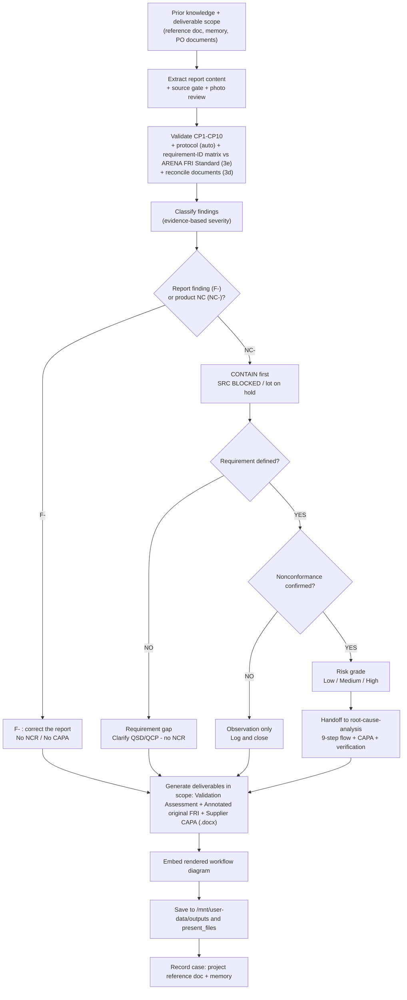

# FRI Inspection Report — Validation Assessment Skill

> **Organisation Context**: A.R.E.N.A. Vietnam is a **sourcing office**. It sources non-food
> consumer products and connects them to Allies/Buyers across EU-27, EEA-3, Switzerland,
> Canada, and US. FRI reports are submitted by third-party or in-house QC inspectors after
> Final Random Inspection at supplier factories. QS/QC Managers validate these reports before
> release to Allies or before authorising shipment.

---

## Purpose

This skill generates a **Validation Assessment** that:

1. Determines whether an FRI report can be **accepted, accepted with conditions, or rejected**
2. Identifies every **non-conformity, inconsistency, or gap** against the 10-Point Inspection standard and — when one is released for the category / PO — against the **ARENA FRI Standard checklist**, requirement ID by requirement ID, with Coverage / Conformity / Evidence scores (Step 3e)
3. Classifies each finding as **Critical / Major / Minor** with a clear required action
4. Produces a **professional .docx** output ready for QS sign-off and filing
5. Produces an **Annotated FRI Report (.docx)** — a copy of the inspector's **original** report, format unchanged, with a reviewer comment anchored at every line and photo where a finding was captured, so QC can correct the report in place (Step 7c)
6. Produces a **Supplier CAPA Request (.docx)** whenever the findings require physical action by the factory (Step 7b)

All deliverables are **Word (.docx) only**. Do not produce PDF copies unless the user explicitly asks for one.

---

## When to Use

Trigger whenever:

- An FRI report file (`.docx`, `.xlsx`, `.pdf`) is uploaded for review
- The user asks to "validate", "review", "check", "comment on", "annotate", "take notes on" or "assess" an inspection report
- A QS or QC Manager wants a second-check on a submitted report
- The overall result is "Passed" but individual checkpoint data appears inconsistent
- An Ally is requesting shipment authorisation based on an FRI report

---

## Workflow

### Step 0 — Prior Knowledge and Deliverable Scope

Before reading the report:
1. **Read what is already known about this supplier and Ally.** Look in the attached project for a reference doc named `claude/<Supplier>_<Ally>_FRI_validation_reference.md` (item master, approved artwork rules, inspection parameters, findings history, open actions) and in memory for the supplier/Ally area file. A repeat finding at the same supplier — **on any Ally's PO** — changes the risk grade (Step 5.4).
2. **Settle the deliverable scope from the request.** "Validate" = all three deliverables. "Annotated file only" = only the annotated report. "Annotated file and CAPA to the supplier if it has" = the annotated report, plus the Supplier CAPA Request only when supplier actions exist. Do not produce documents the user did not ask for; run the full analysis (Steps 2–5) regardless, because the comments depend on it.
3. **Collect every requirement document for the PO** (PO/PI, approved artwork/prepress, CE label, DoP, IM, placement approvals, warnings, test reports). If the user's computer is linked, search the supplier order folder for the PO number (see Step 2a).
4. **Look for the ARENA FRI Standard for the category and PO** (produced by `fri-report-template-generator`): the checklist `FRI_checklist_<CAT>_<PO>_(Vx).xlsx` and the guideline / template `FRI_template_<Category>…_(Vx).docx` (document ID `ARENA-FRI-STD-<CAT>-Vx` + P.O. annex) — in the uploads, the attached project, or the linked supplier-order folder. Note its version and status (Draft / Released / Incomplete). If none exists, say so in one line on the cover and continue with Steps 3–3d; offer to generate one for the category.

### Step 1 — Reference Data (EMBEDDED)

All CP1–CP10 acceptance criteria, the finding-pattern library, and the output template are embedded in this file (Steps 3, 4, 6). No external reference files are needed.

### Step 2 — Extract the Inspection Report Content

Use `pandoc` to extract text from the uploaded file:

```bash
pandoc --track-changes=all "<uploaded_file>" -o inspection_extracted.md
```

Parse and identify all of the following fields. If any are absent, flag as a finding:

| Field | Location in Report |
|-------|--------------------|
| Inspection type (FRI/DPI/PSI) | General Information table |
| Ally name | General Information table |
| PO# | General Information table |
| Supplier / Factory name | General Information table |
| Inspection date | General Information table |
| Product description + ref | Sampling details table |
| Shipment qty / Packed qty | "Table of shipment items and sampling details" — **the order (shipment) q'ty is the AQL lot size**; packed q'ty is used only for the ≥80% FRI-validity check (Step 3a, ARENA sampling method) |
| Order of work | **Read the FRI report first** and record what it states (shipment q'ty, items, sample sizes, packing) — never overwrite a report value with a document value. Then compare it with the documents provided (P.O. / P.I., artwork, …), the master file filling only what they do not give. A value the report does not state is "not stated" (Step 2 finding), not copied from the P.O. |
| Source priority for order data (the reference) | **1. the P.O. / P.I. and the approved artwork provided** (item lines, order q'ty, EAN / ITF-14, packaging) → **2. the master file** (Orders Data / Order Fulfill) only for an item or a value the documents do not give. State the source of each line. Where the master file differs from the P.O. / P.I. (q'ty, EAN, item missing either side) the P.O. / P.I. is used and an `OB-` asks QS to update the master file |
| Packaging method per item | Summarise in its own table (item · order q'ty · FRI report · P.O. / P.I. · artwork · status). From the P.O. / P.I. packing columns (pcs per inner, pcs per carton, number of cartons, packing type: polybag, colour / gift box, master carton ply, pallet…) and from the artwork carton marks (e.g. "6 PCS/CTN"). P.O. / P.I. ≠ artwork → `RG-` (approved documents conflict; hold the next carton print). Report packing (CP2) ≠ P.O. / P.I. (or artwork when the P.O. / P.I. is silent) → `F-` Major, `NC-` once the goods are confirmed packed differently. Not stated anywhere → record "not stated" |
| P.O. order qty | **Total of ALL item rows of the P.O. lot** (P.O. / P.I. first, master file otherwise) in the master file (Orders Data Q'ty summed) — never the first row only. **When one FRI report covers several P.O.s, the order qty is the sum over ALL those P.O. lots** (every P.O. named in the report / its sampling table); compare that sum with the report's total shipment q'ty |
| EAN per item | From the master file Orders Data — the column must hold **valid GTINs** (8 / 12 / 13 / 14 digits, GS1 check digit) and must not equal the item / Ally ref; if the "EAN code" column holds other data, use the column that does and say which |
| P.O.s covered by the report | List every P.O. / lot the report covers (header PO# field, PO# column of the sampling table, P.O. numbers in the text). Reconcile **each** P.O. against the master file (Ally, supplier, gates, inspection date / result, ETD, SRC, status) and the items of **all** P.O.s; the validation verdict and shipment status apply to every P.O. listed — an open `NC-` blocks the SRC of each of them. **The SRC is still issued separately for each P.O. / lot — one certificate per P.O., never one SRC for the group** |
| Item lines of the sampling table | One row per item: PO#, Ally ref, supplier ref, description, brand, shipment q'ty, packed q'ty, sample size General (II) and Special (S3); totals row (Σ shipment, Σ packed, n General, Σ n Special, packed %); "Acceptance major / minor defects" rows (AQL + Ac at n) |
| Sample sizes (Level II + Special S3 or S1) | Sampling details table — verify Special level matches product template |
| AQL levels (Critical / Major / Minor) | General Information table |
| Inspector + Reviewer names | General Information table |
| QC Pack document list | General Information table |
| CP1–CP10 results | Inspection Result Summary table |
| Overall result | Overall Result box |
| Defect tally (Cr / Ma / Mi found + accepted) | Defects table |
| AQL result (Pass/Fail per class) | Defects table |
| Measurement data (all dimensions, weights, barcodes) | Product measurement data table |
| Disposal data table | Section 8 |
| On-site test rows (clause, method, sample size, result) | CP7 rows |
| Photo captions | Photo section |

### Step 2a — Source Completeness Gate (original report with photos)

Many findings depend on the photos: barcode scans, batch codes, hardness readings, calibration labels, drop tests and golden-sample comparisons. Before classifying, confirm you have the **original report file with its embedded photos** (.docx, or a PDF with images).
- **Only a text/markdown export, or a PDF without images?** Ask the user for the original file before classifying. If it cannot be provided, proceed, but mark every finding that photos could confirm or clear (e.g. "scan not recorded", "no batch code", "no hardness value", "no golden sample") as **PROVISIONAL — photos not reviewed**, cap such findings at MAJOR, and say so on the cover.
- **Never use photos that are not part of this report as evidence for this PO.** This includes a project photo library, approved-sample photo sets and earlier reports. Use them only if their brand, item and PO match is confirmed, and label them as such. A mismatched reference image (e.g. a different brand's approved samples) leads to wrong findings.
- **When the original arrives after an issue based on an export:** re-run Steps 2b–5 on the photos and re-issue all three deliverables as the next revision (Rev.n). The revision line states which findings changed and why.
- **Finding the original on the user's computer:** when the computer is linked, search the A.R.E.N.A. supplier-order folders (e.g. `…\Supllier Order information (Quality)\<Country>\<Year>\<Supplier>\<Ally>\PO# <PO>\FRI report, SRC\`) for the PO number. Folder names containing `#` or other symbols cannot be granted from a permission prompt — ask the user to attach the file (or add the folder from the "+" menu) instead of retrying. The same folder usually holds the **SRC** (shipment release, i.e. the lot was released/shipped — this decides containment and risk grade) and FRIs for other lots; note them.

### Step 2b — Extract Embedded Evidence Photos

```bash
unzip -o -q "<uploaded_file>" -d src_unpack
ls src_unpack/word/media/
```

Build a photo index: for each `imageN.jpeg|png`, identify its caption or the nearest label/SKU/photo-ref text in the surrounding table cell (use `pandoc -t html` + BeautifulSoup on the converted document to keep image-to-cell association, since the flattened markdown/plain-text extraction loses table position). Typical anchors: `Photo ref: <SKU>`, per-SKU "Overview / Barcode sticker / Product dimension / Net weight / Compare golden sample" photo grids, and Section 7 on-site test photos. Keep this index (image path → caption/SKU/checkpoint) available for Step 7.

**Caption position:** in FRI photo tables the caption can sit **above or below** the photo row, and this can change from one table to the next. The defect-photo table often has captions above the photos, while the general photo grid has them below. Confirm the mapping by checking photo content against the caption (e.g. a socket photo under "Dent … L-Socket Wrench") before using it.

**Review the photos as evidence — do not just index them.** Upscale low-resolution images (often 320–360 px wide) to read them, and check at least:

| Photo type | What to read / verify |
|---|---|
| Barcode scan views | Decoded EAN-13 / ITF-14 value = PO EAN / logistics GTIN for that SKU |
| Main shipping mark / side marks | P.O. no., SAP/item code, GTINs, pieces per inner/outer, **batch / lot code**, carton numbering (C/NO. / total cartons), brand |
| Hang card / label back | Recycling marking (e.g. Triman / Info-tri for France), GPSR Art. 9 operator name and address, EAN = PO, date/batch code, language |
| Golden-sample comparison | Brand and approval tag on the sample (must match the PO brand), side-by-side layout, light condition (D65 booth or ambient) |
| Hardness / test instrument displays | Readings (e.g. HRC values), plus the calibration label: calibrated-on date, next-due date, validity on the inspection date |
| Gauging (GO / NO-GO) | Sizes covered |
| Drop test | Height, impact sequence (corner/edges/faces), carton and contents condition after the drop (opened flaps, crushed corners) |
| Defect photos | One photo per defect line; defect type and SKU match the tally |
| Scale / instrument displays (weights, dimensions) | Read every displayed value and compare it with the value **recorded** in the report — recorded values that do not appear on any photo are a finding (pattern #15). Check the tare: a frame or stand left on the platform must be tared. Compare packed (gross) weights with the carton / shipping-mark declaration, not only with the report's "claimed" column |
| Photo timestamp and geotag | Date must be the inspection date — a photo dated another day is evidence from another inspection (pattern #16). A geotag at another site (another factory or street) must be explained. Timestamps of a test sequence show its duration — e.g. a 1 h load hold photographed over 2 min is not evidenced (pattern #21) |
| Duplicate photos | Map every `imageNN` to its `r:embed` rId; the same media file used under two different captions is a reused photo, not evidence of the second check (pattern #17) |
| Pallet / wood-packaging mark | Full ISPM 15 code (country-producer-treatment: HT, MB, KD); moisture-meter reading |
| Label placement | Label on the product at the approved position (photo background is the product, not a board or table) — a label photographed off the product does not evidence placement |
| CE label / carton CE block / DoP in IM | Name and address of the manufacturer, DoP number, standard and declared class, batch, EAN — compare the three against each other (Step 3d) |
| Logo on product | Brand logo fired/printed on the product where the Ally requires it (e.g. "stil") |

Record what each photo proves. Step 4 uses this to tell "not recorded" apart from "not done".

### Step 3 — Validate Each Checkpoint

Work through all 10 checkpoints using the embedded criteria:

| CP | Checkpoint | Acceptance Criteria | Auto-flag if… |
|---|---|---|---|
| CP1 | Quantity | 100% carton count vs P.O.; **Σ packed qty ≥80% of Σ order (shipment) qty** for FRI validity; **order qty = AQL lot size** (Step 3a) | Sample sizes not computed on the order qty per the ARENA method; packed <80% without waiver |
| CP2 | Packing | L1/L2/L3 packing vs export packaging spec; shipping marks complete; ISPM 15 mark on solid-wood pallets | Missing ISPM 15 photo when wood pallets declared; carton spec mismatch |
| CP3 | Artwork & labelling | All levels vs **RELEASED** print files; EAN-13/ITF-14 scan PASS; language completeness; GPSR Art. 9 identity + contact | Barcode not scanned; released-file version not cited | batch code + number carton
| CP4 | Sample comparison | Product conforms to golden/reference sample (material, colour, construction) | No golden-sample reference recorded |
| CP5 | Weight & dimensions | ≥5 cartons weighed + measured; deviation ≤ **±3%** vs QSD spec | >±3% marked PASS (Critical); <5 cartons measured |
| CP6 | Workmanship | AQL tally: Cr 0 / Ma 2.5 (1.0 outdoor furniture) / Mi 4.0; Ac/Re per GIL-II | Found > Ac but class marked PASS (Critical); tally ≠ defect photos |
| CP7 | On-site tests | Department test rows executed at S3 (S1 outdoor furniture); clause + method + n + result recorded | Row blank/"NOT TESTED" without justification |
| CP8 | Disposal data | Packaging weight + material type per SKU recorded (PPWR data feed) | Table absent or partial |
| CP9 | Other requirements | Ally-specific + QSD watch-outs checked; QC Pack document list verified (AVAILABLE/EXPIRED status) | Expired document marked AVAILABLE |
| CP10 | Close meeting | Findings communicated; supplier representative acknowledgement signed | No signature/acknowledgement record |

### Step 3a — Cross-Check Declared Sampling Plan Against the Report's Own Checkpoint Table and the Product Template

An FRI report can be internally self-contradictory before any external template is even consulted. Always compare **three** independent sources of sampling-level truth, in this order:

1. **Header claim** — the "Sampling plan for shipment" field (e.g., "General inspection: Level I; Special inspection: S1").
2. **The report's own checkpoint/"Inspection Details" table** — the "Sample size" column printed against each of CP2–CP7 (e.g., a row reading `S3` or `II`). This is embedded in the report itself and is not an external source — a mismatch here is a self-contradiction, not a template lookup.
3. **The product-specific FRI template** for the category (fetch from the project's `Inspection_report__*.docx` template matching the product, if available) — its own header "Sampling plan for shipment" field is the authoritative default for that category.

If (1) disagrees with (2) — the header says one level, the checklist body requires another — this is a **CRITICAL** finding: the AQL basis of the entire report cannot be trusted, because it is not even consistent with itself. If (1)/(2) agree with each other but disagree with (3), classify per Finding Pattern #6 (Major).

**Then verify the Ac/Re numbers actually used are keyed to the sample size actually drawn**, not to a different sample-size row:
- Source Ac/Re strictly from `Quality_matrix_and_inspection_sampling_tool_2.xlsx`, sheet **"Range"**: columns B/D = lot bracket, E/F/G = General Level I/II/III sample size, H/I/J = Special S1/S2/S3 sample size, L = sample-size code, M/N/O = Ac at AQL 1.5/2.5/4.0 for that code. When the tool is not available, use ISO 2859-1 Table 1 (code letter) and Table 2-A (normal, single sampling) directly and say so.

**ARENA sampling method — lot size, single vs combined items (confirmed by QS, 10 Nov 2026; replaces the "packed qty = lot size" rule):**

| Situation | General level (workmanship, CP6) | Special level (tests / measurements, CP5–CP7) | Ac / Re |
|---|---|---|---|
| **One item** on the P.O. / inspection | **Normal single sampling: General II** on the item's **order (shipment) q'ty** | **S3** (S1 outdoor furniture) on the item's order q'ty | At the General II n of the item |
| **Several items** (one P.O. or across P.O. lots inspected together in one report) | **General II on the combined lot = Σ order q'ty of all items of all P.O.s in the report** → one n; allocate it per item: **n_item = round(n × item order q'ty ÷ Σ order q'ty)** (round half up; the rounded allocations may total n ± a few — the report states n) | **S3 per item**, each on its **own order q'ty** (Σ special = sum of the per-item n) | At the **combined** General II n (e.g. n 200 → Ma 2.5 Ac 10 · Mi 4.0 Ac 14) |

- **Packed q'ty is never the lot size.** It is recorded per item and checked only for FRI validity: **Σ packed ≥ 80 % of Σ order q'ty** (the report prints this % under the totals).
- Worked example — DEDEMAN P.O. 87-2027-1 (9 items): Σ order 7 006 → General II code L, **n = 200**; allocation by order q'ty = 23 · 26 · 29 · 23 · 20 · 29 · 29 · 16 · 7; S3 per item = 13 × 8 items + 8 (item of 250 pcs) = **112**; Ac Ma 2.5 = **10**, Mi 4.0 = **14**; Σ packed 5 644 = 80.6 % ✓. (On packed q'ty the 480-pc item would get S3 n 8 instead of 13 and the allocation 28 / 17 instead of 29 / 16 — that is the error to catch.)
- Check every item row of the sampling table against this method (allocated General n and per-item S3 n). A row that does not follow it → pattern #5 (General) / #6 (Special), Major. Ac/Re that do not belong to the combined n → pattern #14, Critical.
- The "AQL single quantity item" (Level I/S1) tabulation is **not** used for ARENA FRIs unless the product template or Ally protocol requires it explicitly — record that requirement source when it does.
- Take the sample size **n** that the defects were actually tallied from (sum of units actually inspected), look up Ac/Re for that exact `n` (or the nearest lower standard code: 2, 3, 5, 8, 13, 20, 32, 50, 80, 125, 200, 315, 500, 800, 1250, 2000), and compare against the Ac/Re the report states it used.
- If the report's stated Ac/Re numbers correspond to a **different** sample-size row than the one actually inspected (e.g., a combined "Level I total" row used to accept defects that were actually tallied from a smaller Special-level sample), this is a **CRITICAL** finding — the acceptance threshold is not the one that applies to the evidence, and the AQL verdict must be recomputed and re-stated (it may reverse Pass → Reject).

**Key rules:**

- A checkpoint marked **PASS** in the report must be confirmed against the underlying data
- A checkpoint with **blank, "?", or missing** data must be flagged as Critical or Major
- A checkpoint with a result that **contradicts the data** (e.g., a measurement outside tolerance marked PASS) is a **Critical finding**
- **AQL consistency**: verify header AQL = Critical 0 / Major 2.5 / Minor 4.0 (or the product-template-specific AQL if it differs — e.g. stainless steel plumbing fixtures uses Minor 2.5), and apply Step 3a's Ac/Re-by-sample-size rule above. Do not use flat-percentage shortcuts (e.g. "sample = shipment × 2%") — sample sizes come only from the Quality Matrix "Range" sheet lookup.

### Step 3b — Checkpoint Requirement Compliance Matrix (CP1–CP10)

Before classifying findings, build one row per checkpoint (CP1 through CP10, always all ten, regardless of how many the report marked N/A) comparing the report against an independent requirement source. This is the audit trail that guarantees no checkpoint was silently skipped — a checkpoint's own printed "Passed"/"N/A" does not exempt it from this row; the matrix re-derives the verdict independently.

**Requirement source, in priority order:**
0. **The Released ARENA FRI Standard checklist for this PO** (category standard + P.O. annex, Step 0.4). When it exists, Step 3e builds the requirement-ID matrix from it and this CP1–CP10 matrix is derived from the IDs (each ID carries its CP). A Draft or Incomplete checklist is still used, but its undefined rows follow the incomplete-standard gate in Step 3e.
1. **An uploaded QC Pack document for this exact PO** — search the project/uploads for a QC Pack file referencing the PO#. If found, its CP-by-CP requirements are authoritative for this specific shipment (it may carry PO-specific tolerances, waivers, or Ally-specific watch-outs the generic template doesn't).
2. **The product-specific FRI template** for the category (`Inspection_report__*.docx` matching the product) — used when no QC Pack exists for this PO. Its blank Method/Requirement/Sample-size columns are the category default.
3. **The submitted report's own printed Method/Requirement column** — last resort only, when neither (1) nor (2) is available. Using this alone is weaker evidence (the report could have printed its own, uncorroborated requirement text) — flag as Minor ("no independent requirement source available for this checkpoint") whenever this is the sole source.

**For each CP, record:**

| Column | Content |
|---|---|
| CP # / name | CP1 Quantity … CP10 Close meeting |
| Requirement source used | QC Pack / Product template / Report's own text — name the specific document |
| Requirement stated | The method, tolerance, sample size, or acceptance criterion from that source, in one line |
| What the report shows | The actual recorded result and the specific data behind it (not just "Passed" — the number/photo/field that supposedly supports it) |
| Compliance verdict | **Compliant** / **Not Compliant** / **Cannot Confirm** (data missing or ambiguous) / **N/A** (checkpoint genuinely doesn't apply at this inspection stage — e.g. CP2 Packing or CP8 Disposal data on an In-line Inspection where packing isn't complete yet) |

**Order of precedence when sources conflict:** law and the harmonised / designated standard cited for the destination market (edition and status from the **Step 3f Standards live check**, never from memory) → Ally protocol / QC Pack → ARENA FRI Standard → inspector practice. The ARENA FRI Standard never relaxes a higher-level requirement; a conflict between them is an `RG-` item for QS + Compliance, not an `F-` against the inspector.

Every **Not Compliant** or **Cannot Confirm** row must produce at least one `F-` or `NC-` item in Step 4 — if a row in this matrix doesn't trace to a finding, either the matrix is wrong or a finding is missing. Conversely, do not mark a checkpoint N/A just because the report marked it N/A — confirm that N/A is actually appropriate for the declared inspection type before accepting it (e.g. CP7 On-site tests being N/A is normal for an In-line Inspection but would itself be a Critical gap on a Final Random Inspection).

### Step 3c — Apply a Project / Ally Inspection Protocol Automatically

Before building the matrix, check **without asking** whether an inspection protocol beyond CP1–CP10 is in scope. Look in, in this order:
1. **The attached project's instructions** (e.g. a numbered list of inspection phases such as "Phase 1: Base AQL & Sampling … Phase 6: Master Packaging, Barcodes & Traceability").
2. **Project docs / uploads** named or described as an inspection protocol, QC guideline, Ally CI or inspection checklist for this supplier, Ally or product family.
3. **The QC Pack for the PO**, if it defines phases or mandatory checks beyond CP1–CP10.

**If a protocol is found, apply it automatically. Do not ask for confirmation.**
- **Matrix structure:** the protocol's phases/sections become the **primary compliance matrix** (Section 1 of the Validation Assessment). Use one row per phase with these columns: protocol requirement · source · what the report shows · verdict · CP reference · findings. Keep a compact **CP1–CP10 cross-reference table** directly under it, so all ten checkpoints are still re-derived (Step 3b rules still apply) and mapped to the phases.
- **Mandatory checks become requirements:** every explicit requirement in the protocol counts as a requirement for this inspection. Examples: "side-by-side comparison under D65 lighting", "verify metallurgy against the technical file", "tool performs safely under maximum human force", "traceability".
  - Not evidenced in the report → an `F-` finding, default **MAJOR**.
  - Not evidenced, but the report marks that check or its CP as Passed → **CRITICAL** (pattern #1 / #3).
  - The protocol makes it mandatory, but the acceptance value (e.g. HRC range, torque value) is not defined in any available document → also log a **requirement gap** in Step 5.2 (no NCR).
- **Severity escalation:** a check the protocol calls mandatory is never graded below MAJOR, even where the CP1–CP10 default (e.g. pattern #7) is lower.
- **Grouping:** group the finding cards by protocol phase (cross-phase items such as CP9/CP10 last). Add a phase column to the Action Register. Tag each finding's checkpoint label as `Phase n · CPx`.
- **Propagate to the other deliverables:**
  - In the Supplier CAPA Request, tag each "Items to prepare for re-inspection" row with its protocol phase, and add the protocol as a row in the mismatch-evidence table.
  - In the Annotated FRI Report, comment text uses `F-xx (Phase n · CPx, Severity)`.
- **Record the basis:** state the protocol name and source on the cover ("Basis: <protocol name>") and in the requirement-source statement above the matrix.
- **Re-issue:** if the protocol appears or changes after a validation was already issued for the same PO, re-issue all three deliverables as the next revision (Rev.n). Add a revision line that states what changed (e.g. finding count by severity before and after) and keep the previous files.

**If no protocol is found:** use the CP1–CP10 matrix (Step 3b) as the primary structure, unchanged.

**ARENA FRI Standard checklist:** it is not handled here as a free-text protocol — Step 3e applies it ID by ID. When an Ally / project protocol also exists, keep the protocol-phase matrix and map each phase to the requirement IDs it covers.

### Step 3e — Requirement-ID Matrix against the ARENA FRI Standard (Coverage / Conformity / Evidence)

Apply whenever an ARENA FRI Standard checklist exists for the category / PO (Step 0.4). Read the checklist sheet `Requirements` (columns: ID · layer STD/ANNEX · CP · guideline step · requirement EN/VI · method · sample size · accept limit · reject class · evidence required · source · mandatory Y/N · status Defined / QS to fill) and build **one row per ID**:

| Column | Content |
|---|---|
| ID · CP · requirement | From the checklist (keep the EN text; VI not needed in the matrix) |
| Done? | **Done** / **Not done** / **N/A** — N/A only with a justification that the checklist allows (e.g. "only if factory rig", SKU not concerned) |
| Value recorded vs limit | **Conform** / **Not conform** / **Cannot confirm** (no value, value without unit/SKU, limit undefined); write the recorded value(s) and the worst value |
| Evidence | **Present** (photo no. / document cited and it shows what the ID requires) / **Missing** / **Not matching** (photo shows something else, other date, reused file — Step 2b rules) |
| Finding | `F-` / `NC-` / `RG-` reference, or "—" |

**Report formats:**
- **ARENA template reports** carry the IDs in their rows — map directly.
- **Third-party reports** (DEKRA, SGS, Intertek, Bureau Veritas …) — build a short mapping table first: report section / table / photo → requirement ID(s). Map by content, not by heading. A mandatory ID with no matching content is **Not done** (pattern #22 / #25).

**Scores (shown on the cover and in Section 2a of the Validation Assessment):**
- **Coverage %** = mandatory IDs Done or justified N/A ÷ mandatory IDs.
- **Conformity %** = IDs Conform ÷ IDs with a value required and recorded.
- **Evidence %** = IDs with evidence Present ÷ IDs whose checklist row requires evidence.
- Report non-mandatory IDs separately; they never lower the scores but can raise Minor findings.

**Acceptance rules:**
- Coverage of mandatory IDs must be **100 %** for the report to be accepted (PASS / PASS WITH NOTES). Any gap produces a finding per pattern #22 / #25.
- Any **Not conform** value is an `NC-` (goods) — and an `F-` Critical too when the report marked it Passed (pattern #1).
- **Verdict logic check:** apply the checklist's verdict rules (guideline step 13 — Failed / Pending / Passed conditions) to the evidence and compare with the inspector's overall result. A verdict that does not follow those rules = pattern #24.

**Incomplete-standard gate:** a checklist row with status **QS to fill** (limit not yet defined — e.g. EN 14411 Annex G values pending), or a checklist marked **Incomplete / Draft**:
- the IDs concerned are rated **Cannot confirm — standard incomplete**; this is never an `F-` against the inspector and never a PASS;
- log one `RG-` item for QS ("define the limit for <IDs> before validation") — Step 5.2 applies (no NCR);
- shipment status: **AUTHORISATION WITHHELD** for the affected SKU unless QS signs a documented waiver (record name/date in the revision line);
- state on the cover: "Basis: ARENA-FRI-STD-<CAT>-Vx (status) — n IDs not assessable".

**Propagation:** finding cards and the Action Register carry the requirement ID (`Phase n ·` prefix kept when Step 3c also applies); the CP1–CP10 matrix (Step 3b) is filled from the ID matrix so the two never disagree.

### Step 3d — Reconcile the Requirement Documents with Each Other and with the Evidence

Approved documents for one PO can disagree with each other, and the report usually copies one of them. Before classifying, reconcile:

| Chain | Check | If it fails |
|---|---|---|
| PO / PI lines | Read every PO line before raising a packaging or code NC — old and new codes (e.g. pallet pack vs 1 pc/carton) can run **in parallel** on one PO; each code needs its own FRI record | Observation only when the PI confirms the inspected code |
| Weight chain | Unit spec ↔ carton/shipping-mark net and gross ↔ measured unit weights ↔ measured packed weights ↔ Section 8 packaging totals. Gross ≈ (units × unit weight) + packaging weight | Measured outside tolerance → `NC-`; declared carton/shipping-mark weight understated → part of the same `NC-`; report finding copied from the claim → `F-` (pattern #18) |
| Declared performance ↔ CP7 | Every class declared in the DoP / CE label (e.g. overflow CL 15, load resistance) needs its test at the FRI | Test N/A while CP7 marked Passed → Critical `F-` (pattern #19) |
| CE-marking identity | Manufacturer name and address on the product CE label, the carton CE block, the DoP and the IM must be the same legal entity | Conflict **between approved documents** → `RG-` requirement conflict for QS + Compliance (not a supplier NC); in the CAPA, tell the supplier to hold the next print run until confirmed |
| Standard edition | FRI method text vs QC Pack / FRI template vs DoP / DoC / CE label vs the edition and status from the **Step 3f Standards live check** | See the Step 3f finding table (F- / RG- / OB-) |
| Artwork revision | Several revisions of the same artwork with conflicting content or implausible file dates | `OB-`: confirm with QS which revision is current before judging conformity |
| Disposal data (CP8) | Values in the right columns (a strap weight entered as "# sale units per transport unit" is misplaced); weights reconcile with the photos | `F-` (Major if it hides missing data) |
| EAN / barcode chain | Master-file EAN (valid GTIN, Step 2) ↔ barcode **decoded** from the approved artwork (EAN-13 / UPC-A on product labels, ITF-14 on cartons — read the barcode itself, not only printed digits: artwork digits are often outlined) ↔ barcode scan photo in the report. An ITF-14 matches its item when it packs the item's GTIN-13 (indicator digit + same 12 digits + new check digit) | Invalid / missing master EAN → `RG-` to QS (correct Orders Data), artwork comparison held; artwork GTIN not on the P.O. → `NC-` High, SRC blocked; item GTIN not found in the artwork → `OB-` (upload the item artwork or check visually) |
| AQL lot basis | ARENA method (Step 3a): lot size = order (shipment) q'ty; one item → General II + S3 on the item; several items → General II on Σ order q'ty allocated per item by order q'ty, S3 per item on its order q'ty; Ac/Re at the combined n; packed q'ty only for the ≥80 % check. When `Quality_matrix_and_inspection_sampling_tool_2.xlsx` is not available, use ISO 2859-1 Tables 1 and 2-A directly and say so | Pattern #5 / #6 for item sample sizes not per the method; pattern #14 if Ac/Re do not match the n inspected |

### Step 3f — Standards Live Check (mandatory, every validation – ARENA rulebook §0, §3, §4.2)

No standard, edition, OJ citation, coexistence date or regulation date is judged or written from memory or from this skill.

1. **List** every standard and edition cited:
   - in the FRI report: method text, CP7 on-site tests, the sampling standard ISO 2859-1;
   - in the QC Pack / ARENA FRI Standard / FRI template;
   - in the DoP / DoC / CE label / IM;
   - in any test report referenced.
2. **Look up** each one, highest source first:
   - **Regulatory Register:** an entry marked **V** and verified ≤ 30 days ago may be used (canonical copy, or the Drive mirror after checking its "synced" date).
   - **Otherwise, live check:**
     - EU / EEA / CH / NI: OJ / EUR-Lex hEN list (the CID and its amendments) → Commission hEN summary list → CEN / ISO catalogue for non-hENs (e.g. EN 581-2/-3, ISO 2859-1) → accredited-lab bulletins.
     - GB: DBT / OPSS Notice of Publication → BSI.
   - Say plainly when the register could not be read, and update it afterwards.
3. **Assign a status:**
   - **CURRENT:** OJ-cited / GB-designated edition.
   - **PASS-COEX:** older edition still cited until a date. Accept; never block.
   - **WATCH:** newer edition published, not cited. Gap test only; never inject.
   - **BLOCKED:** citation withdrawn, cited replacement exists.
   - **SoA:** no edition cited; the current CEN / ISO edition is state of the art.
   - **UNVERIFIED:** could not be confirmed. Say so; never block or guess.
4. **Raise findings from the result:**

| Situation | Finding |
|---|---|
| Inspector's method / CP7 test cites an edition other than the requirement (QC Pack / FRI template / cited hEN) | `F-` Minor (report) |
| QC Pack, ARENA FRI Standard or FRI template cites a BLOCKED edition, an older edition past its coexistence date, or an outdated SoA edition | `RG-` for QS (+ Compliance): requirement document out of date; the inspection result stands only for the parts unaffected by the edition change |
| DoP / DoC / CE label / IM cites a non-cited edition | `OB-` to QS; BLOCKED edition → `RG-` |
| Test evidence only to a newer, non-cited edition (WATCH) | `OB-`: gap test only; evidence to the cited edition is still needed |
| SoA standard tested to an older edition (e.g. EN 581-2/-3) | `OB-`: accepted only with the Ally's written acceptance (rulebook §3, §9); otherwise new testing to the current edition |
| Status UNVERIFIED | `OB-` "edition status not verified"; never blocks the verdict |

5. **Document the result:**
   - The Validation Assessment carries a dated **Standards check** table (Standard · Edition cited where · Edition to use · Status · Reference / source URL · date checked) after the CP matrix.
   - Annotated-report comments name the status.
   - The reply lists the date checked and the sources.
   - A check older than 30 days is re-run before reuse.

### Step 4 — Classify Findings

**Embedded finding-pattern library (default severities):**

| # | Pattern | Default |
|---|---|---|
| 1 | Measurement outside tolerance but CP marked PASS | CRITICAL |
| 2 | AQL defects found > Ac number but class marked PASS | CRITICAL |
| 3 | Mandatory field blank / "?" (AQL level, lot size, inspector, overall result) | CRITICAL |
| 4 | Safety/regulatory mark (CE, GPSR Art. 9, warnings) absent in CP3 evidence | CRITICAL |
| 5 | Lot size / General sample not computed on the order (shipment) q'ty per the ARENA method (single item: General II on the item; several items: II on Σ order q'ty, allocated per item by order q'ty) — e.g. packed q'ty used as lot size | MAJOR |
| 6 | Special inspection level (S3/S1) doesn't match product template | MAJOR |
| 7 | CP7 test row blank or NOT TESTED without justification | MAJOR |
| 8 | Defect tally inconsistent with defect photos/descriptions | MAJOR |
| 9 | Expired/COPY ONLY document marked AVAILABLE | MAJOR |
| 10 | Photo caption missing or doesn't match checkpoint | MINOR |
| 11 | Reviewer name absent (inspector present) | MINOR |
| 12 | Rounding/format errors not affecting verdict | MINOR |
| 13 | Declared sampling plan (header) contradicts the report's own checkpoint/"Inspection Details" sample-size column (self-contradiction, not merely vs. an external template) | CRITICAL |
| 14 | AQL Ac/Re number used corresponds to a sample size other than the one the defects were actually tallied from | CRITICAL |
| 15 | Recorded measurement differs from the value shown on the photographed scale/instrument | CRITICAL if it supports a Passed verdict, else MAJOR |
| 16 | Evidence photo dated outside the inspection date, or geotagged at another site without explanation | MAJOR |
| 17 | Same photo file reused under a different caption | MINOR |
| 18 | "Finding" equals the specification/claim with no measured value (copied), e.g. pallet or carton weight | MAJOR; CRITICAL when the photos show it out of tolerance |
| 19 | Test for a performance declared in the DoP / CE label marked N/A or not done while CP7 is Passed | CRITICAL |
| 20 | Data entered in the wrong table column (e.g. CP8 disposal data) | MINOR; MAJOR if it hides missing data |
| 21 | Test duration/condition not evidenced (timestamps span less than the required hold; load ≠ method value) | MAJOR |
| 22 | Mandatory requirement ID of the ARENA FRI Standard not done / not reported (Step 3e) | MAJOR; CRITICAL when the report or its CP is marked Passed |
| 23 | Evidence required by the checklist missing or not matching (photo no. / document) | MINOR; MAJOR when it is the only evidence for a critical point (special check list, safety test, CE / identity marking) |
| 24 | Overall verdict not given according to the checklist's verdict rules (guideline step 13) | CRITICAL |
| 25 | Third-party report: no content can be mapped to a mandatory requirement ID | MAJOR (as #22) |
| 26 | Checklist row "QS to fill" / standard incomplete | No `F-`: `RG-` to QS + "Cannot confirm — standard incomplete" (Step 3e gate) |

Apply this rule:

| Severity | Definition | Verdict Impact |
|----------|-----------|----------------|
| **CRITICAL** | Data directly contradicts the reported result; or mandatory field is blank/missing; or a measurement/test definitively fails the stated criterion | Report **BLOCKED** — cannot be accepted until resolved |
| **MAJOR** | Inconsistency, gap, or undocumented deviation that prevents complete validation; could change the verdict if investigated | Report **CANNOT BE ACCEPTED** — must correct before acceptance |
| **MINOR** | Procedural gap, documentation quality issue, or deviation requiring justification or note | Correct **before file close** — does not block acceptance on its own |

**Overall Verdict:**
- Any **Critical** finding → **CANNOT CONFIRM — REPORT REQUIRES CORRECTION**
- No Critical but ≥1 **Major** → **CONDITIONAL PASS — CORRECTIONS REQUIRED**
- Only **Minor** findings → **PASS WITH NOTES**
- Zero findings → **PASS — ACCEPTED**

**Evidence-based severity rule (apply after the Step 2b photo review):**

| Situation | Severity |
|---|---|
| Check **evidenced in the report photos and conforming**, but the result is not written in the report (template text left unselected, blank result cell) | **MINOR**: record-only correction |
| Mandatory check (CP or protocol) **evidenced but incomplete**: readings without SKU link, no acceptance range, no result stated | **MAJOR** |
| Check **not evidenced anywhere** (text or photos) | **MAJOR** (mandatory protocol check) |
| Check **not evidenced anywhere** while the report marks it Passed, or the data contradicts the stated Pass | **CRITICAL** |

When QS/the user explicitly accepts photo evidence as sufficient for a finding (e.g. artwork conformity seen on hang-card photos), downgrade it accordingly. Record the acceptance with its date in the revision line, and re-issue all three deliverables as the next revision.

### Step 4b — Separate REPORT findings from PRODUCT nonconformances

This skill validates the **report**. It must not silently merge the two different things an FRI can reveal:

| Type | Prefix | Meaning | Destination |
|---|---|---|---|
| **Report finding** | `F-` | The report is incomplete, inconsistent, or contradicts its own data (blank field, tally mismatch, missing photo, wrong lot size) | Corrected by QC/QS inside this validation cycle. No NCR, no CAPA. |
| **Product nonconformance** | `NC-` | The **goods** fail a defined requirement (AQL reject, measurement out of tolerance, missing CE/GPSR marking, failed on-site test, wrong artwork version) | Containment + NCR + `root-cause-analysis` 9-step flow |
| **Requirement gap / conflict** | `RG-` | The requirement is undefined, or two approved documents contradict each other (e.g. carton CE block vs CE label/DoP manufacturer) — the supplier followed an approved document | QS + Compliance clarify with the Ally; no NCR; supplier told to hold the affected print/production until confirmed |
| **Observation** | `OB-` | Worth recording, no requirement breached (packaging design risk, standard-edition query, artwork revision currency) | Logged for QS; no action from the supplier unless the Ally decides |

A single line in the report can generate both: e.g. a measurement out of tolerance marked PASS = `NC-` (goods fail) **and** `F-` (inspector's verdict contradicts the data).

List `NC-` items in their own register. Never close an `NC-` by correcting the report.

### Step 5 — Containment & Escalation Triage (applies the 9-Step Quality Decision-Making Flow, gates 2–5)

Run this **before** building the document, and apply the results inside it. Sequence is fixed: **contain first, analyse second.**

**5.1 — Contain the impact (Flow Step 2, mandatory whenever ≥1 `NC-` or any Critical `F-` exists)**

| Trigger | Containment action | Owner |
|---|---|---|
| Any `NC-` (goods fail a requirement) | **SRC BLOCKED**; lot placed on hold at factory; no loading, no booking release | QS |
| AQL reject on any class | Hold full packed qty; supplier to sort/rework 100%; re-inspection required | QC + supplier |
| Safety/regulatory `NC-` (CE, GPSR Art. 9, warnings, failed safety test) | SRC BLOCKED + notify Ally + check whether earlier shipments of the same ref are affected (read-across) | QS + Compliance Director |
| Critical `F-` only (report defect, goods not proven non-conforming) | Shipment authorisation **withheld** pending corrected report — this is a decision hold, not a product hold | QS |

Record for each containment: action, quantity affected, owner, timestamp, and how effectiveness was confirmed. Containment stays active until the effectiveness verdict in the RCA (Flow Step 8) is **Effective**, or a documented risk acceptance is signed.

**5.2 — Requirement defined? (Flow Step 3)**

For every `NC-`, name the requirement source: QSD section, QCP row, ECT acceptance limit, hEN clause, DoC/DoP declared performance, P.O. spec, released artwork version, or Ally CI.

- **NO / ambiguous** → do **not** raise an NCR. Reclassify as a **requirement gap**, issue a Requirement Clarification action to QS, and state in the validation document that the criterion was undefined at inspection date. Fix the QSD/QCP before the next P.O.
- **YES** → proceed.

**5.3 — Nonconformance exists? (Flow Step 4)**

Compare observed condition against the confirmed requirement. Not every deviation is a nonconformance — a value inside tolerance, a cosmetic variation accepted on the golden sample, or an Ally-approved deviation is an **observation**, logged and closed. No NCR, no CAPA. Only confirmed nonconformances continue.

**5.4 — Risk assessment & response grade (Flow Step 5)**

| Grade | Condition | Response |
|---|---|---|
| **Low** | Isolated minor defect, within AQL, no safety/regulatory impact | Correction + observation log; short-form 5 Why |
| **Medium** | AQL reject, major defect class, measurement out of tolerance, repeat finding within 12 months | Full 9-step RCA + CAPA + effectiveness verification |
| **High** | Safety, regulatory non-compliance (CE/GPSR/DoP/labelling), Ally claim, goods already shipped or at DC | **8D report**, mandatory ICA, dual-branch RCA, Ally notification, SRC BLOCKED until D6 verified |

A repeat of the same finding at the same supplier automatically escalates one grade — **including a repeat on another Ally's PO** (same factory, same product family, within 12 months). Treat such repeats as one systemic cause: one RCA covering all affected POs, and name the other order in the CAPA mismatch table without disclosing commercial details.

**5.5 — Handoff**

For every Medium/High item, hand off to `root-cause-analysis` with: `NC-` reference, requirement source, defect data, detection point, containment record, and response grade. The RCA must produce **two** root-cause branches: why the defect occurred, and why it escaped detection — where the non-detection branch usually points back at the QCP inspection matrix, the FRI checklist, or the AQL level applied.

### Step 6 — Read the DOCX Skill

```
read /mnt/skills/public/docx/SKILL.md
```

### Step 7 — Build the Validation Assessment Document

Build a `.docx` using `docx` (npm). Follow the structure below:
Cover → Verdict Banner → Checkpoint Requirement Compliance Matrix → Requirement Coverage (ARENA FRI Standard, when Step 3e applies) → Report Findings (one card per finding) → Product Nonconformance Register → Containment & Escalation → AQL Verification → Action Register → Sign-Off.

**Colour palette** (use consistently):

| Purpose | Hex |
|---------|-----|
| Section headers | `#F4811F` (orange) |
| Table header background | `#1B3A5C` (navy) |
| Table header text | `#FFFFFF` |
| Critical fill / text | `#FADBD8` / `#C0392B` |
| Major fill / text | `#FDEBD0` / `#F39C12` |
| Minor fill / text | `#F2F3F4` / `#707070` |
| Pass fill / text | `#D5F5E3` / `#1E8449` |
| Alternate row | `#EEEEEE` |

**Reference code format:** `ARENA-FRIVAL-[DEPT]-[YEAR]-[SEQ]`
Example: `ARENA-FRIVAL-DECO-2026-001`

**Document structure (7 sections — always in this order; 8 with Section 2a when Step 3e applies):**

| Section | Content |
|---------|---------|
| Cover + Verdict Banner | Meta table (Ally, PO#, Supplier, Product, Inspector, Date, **Basis: ARENA-FRI-STD-<CAT>-Vx + status** when Step 3e applies) + colour-coded verdict banner with finding count, **Coverage / Conformity / Evidence %** (Step 3e) + **shipment status line** (SRC RELEASED / SRC BLOCKED / AUTHORISATION WITHHELD) |
| Requirement Coverage (Section 2a — only when Step 3e applies) | Basis line (standard ID, version, status) · score table (Coverage / Conformity / Evidence %, mandatory IDs total / done / not done / not assessable) · list of mandatory IDs not done or not assessable · verdict-logic check result. The full ID matrix goes to an appendix at the end of the document (landscape table, one row per ID) |
| Checkpoint Requirement Compliance Matrix | When a protocol applies (Step 3c): the protocol-phase matrix first, then the CP1–CP10 cross-reference. Otherwise the Step 3b table: all 10 CPs, requirement source used, requirement stated, what the report shows, compliance verdict. State which requirement source (QC Pack / product template / report's own text) was used, up front, before the table |
| Report Findings | One finding card per `F-` finding — severity badge, title, plain-language explanation, found-in-report, required action, responsibility |
| Product Nonconformance Register | One row per `NC-`: description, requirement source (QSD/QCP/hEN/artwork ref), evidence, risk grade (Low/Medium/High), RCA reference to be opened. Omit the section entirely if no `NC-` exists, and state "No product nonconformance identified — report findings only". Follow it with the `RG-` register (conflict, documents involved, owner QS + Compliance) and the `OB-` list |
| Containment & Escalation | Containment actions taken (action, qty affected, owner, timestamp, effectiveness confirmed), gate outcomes (requirement defined Y/N, nonconformance confirmed Y/N), response grade, RCA/8D handoff reference |
| AQL Verification | 5-row table: AQL levels, sampling level, defects found, acceptance numbers, AQL verdict |
| Action Register + Sign-Off | Compact action table (all `F-` and `NC-` items) + sign-off block + severity legend |

**Verdict banner rule:** the report verdict (PASS / CONDITIONAL / CANNOT CONFIRM) and the shipment status are **independent**. A report can be *accepted as an accurate report* while the goods are *blocked* — say both explicitly. Never let "PASS — ACCEPTED" imply shipment release when an `NC-` is open.

**Finding card content (Section 3 — core of the document):**

Each finding is a two-column table row:
- Left column: severity badge (⛔/⚠/ℹ), Finding ID, checkpoint reference
- Right column: **title** → **plain-language explanation** (what was checked, what was wrong, why it matters) → **"Found in report:"** (exact location + value) → **"Required action:"** (direct instruction) → **"Responsibility:"**

No Courier New blocks, no SOURCE/FOUND/EXPECTED/STATUS labels, no sub-tables per finding.

**Evidence photo embedding:** Immediately below the "Responsibility:" line of a finding card, embed the report's own reference photo(s) for that finding when the Step 2b photo index has a match (matched by SKU/photo-ref/checkpoint named in "Found in report:"). Use `ImageRun` sized to fit inside the card (≈1.8–2.2in wide so it doesn't overrun the two-column layout — insert it as its own paragraph spanning the right-hand cell, not squeezed into the text column). If a finding has no corresponding photo in the index (e.g., a blank field, a missing signature, an arithmetic/tally error, a header-vs-checklist contradiction with nothing to photograph), print the line **"Reference photo: none available in the report."** instead — never substitute an unrelated image, and never fabricate a caption. A finding may cite more than one photo (e.g., a defect found on the same SKU photographed from two angles); embed all matched photos, each on its own line. Caption each photo as "Report photo imageNN — <what it shows>", using the image number from the report's `word/media` folder, so the supplier and QC can find it in the original report.

### Step 7b — Generate the Supplier CAPA Request (live, built from the findings)

The Supplier CAPA is generated **live from the validation's open findings at the moment of export**. Re-export after any change: a new report, uploaded document or edited finding.

**Nothing is fixed:**
- no content from a reference or example (the JUMBO / Thiên Minh PI 7212146930 file defines the layout only);
- no fixed number of rows or photos;
- no placeholder text.

**When to produce it:**
- At least one supplier action exists: an open `NC-` (product nonconformance), or any open finding whose Responsibility is `Supplier` / `QC + supplier` or that needs a physical factory action.
- An `RG-` on the same checkpoint as a supplier `NC-` travels with that `NC-`.
- Otherwise say plainly "no Supplier CAPA is needed (no NC- and no finding with supplier responsibility)" and still deliver the Annotated report.
- Findings that are purely internal (report corrections owned by QC, Ac/Re recomputation, QS document waivers, RCA paperwork) never create a CAPA row.

**Grouping:** one action row per checkpoint group: findings grouped by checkpoint and the report paragraph they anchor to.

**Format** (reference layout):
- Calibri; navy `153650` text and table headers; teal `0C6863` section headings; band `F0F5F8` / white rows; no table borders; A4 portrait, margins 979 / 893.
- **Header:** `A.R.E.N.A.  /  QUALITY ASSURANCE  •  SUPPLIER CAPA REQUEST • REV n`.
- **Footer:** `<ALLY>  •  <PI n | PO n>  •  <date>  •  <page>`.

**Structure** (in this order):

| Section | Content |
|---|---|
| Title | "Supplier corrective action request" (underlined rule) |
| Order line | `<ALLY> / <SUPPLIER SHORT NAME>  •  <PI n or PO n>  •  <PRODUCT>`. Each part only when known; never empty separators |
| Intro | Return the completed response and records to the responsible QS before release review; QS confirms the deadline and disposition; inspection date; P.O. / P.I. ETD |
| **Status banner** | `Shipment status: <SRC BLOCKED / AUTHORISATION WITHHELD / SRC RELEASED> — <reasons>` (e.g. "1 open NC-; 4 Critical/Major report finding(s)"). Red fill for BLOCKED, amber for WITHHELD. Same status as the validation |
| Action table | Header **Action · Required response and closure evidence**. Per group: left cell = finding IDs (`NC-01 / RG-02`) + checkpoint name. Right cell, in order: (1) one line per finding `<ID> · <severity / class>: <what is wrong, with the measured values>. <required action>`; (2) **Evidence:** the sources behind each finding (report text, P.O. / P.I., master file, artwork, decoded barcode), each ≤ 180 characters with the value; (3) the closing sentence "Identify the affected lots and quantities, record containment and correction, and submit traceable evidence (photos, counts, re-verification records). Explain the cause and the preventive action." |
| Photos | Under each group's row: **all** report photos linked to that group's findings (Step 2b), three per row, no cap. Each photo appears once in the document. Caption: `Photo NN · <what it shows>`. No linked photo → no photo row; the evidence line carries the values. Never an unrelated photo |
| Supplier response | Teal heading "Supplier response". Blank table **Field · Supplier to complete**: Owner and target date · Affected lot and quantity · Containment and correction · Root cause and prevention · Verification and evidence references |

**Finding IDs are shown** in the CAPA (reference format), so the supplier's response can refer to them.

**What still never goes to the supplier:**
- QS-only actions (waivers, document sign-off, requirement clarifications);
- Ally-internal regulatory discussion;
- another Ally's commercial details.

An `RG-` reaches the supplier only as the physical instruction, e.g. "do not print the next carton run until A.R.E.N.A. confirms the CE-marking block".

**Language:** English, unless the user asks otherwise.

**File name:** `Supplier_CAPA_<ALLY>_<SUPPLIER>_<PO>.docx`, dropping any part that is unknown (no double underscores).

**Check before delivering:**
- every supplier finding ID appears;
- the photo count = the number of unique linked photos;
- the banner = the validation's shipment status;
- no empty separators;
- headings keep-with-next.

### Step 7c — Generate the Annotated FRI Report (reviewer comments in the report itself)

Always produce this third deliverable. It is the inspector's report with a Word comment anchored at **each place in the report where a finding was captured**, so the inspector and QS see every `F-`/`NC-` item in context and can correct the report line by line. It complements — never replaces — the Validation Assessment.

**Format rule — the annotated file is the inspector's original report with comments added, nothing else.** Same header, tables, fonts, layout, photos and text; the only change is Word reviewer comments (as delivered for GRIPWELL PO 26-217-138 and Sonet PO 4500004206 / PX3810/2026). Never retype, reformat, re-layout or "clean up" the report, and never deliver a rebuilt report when the original can be obtained.

**Source to annotate (priority order):**
1. **Original `.docx` report available** (uploaded, attached later, or found on the linked computer per Step 2a) → annotate a **copy** of it in place. Never modify the upload itself.
2. **Only a text/markdown export, PDF or .xlsx available** → **ask for the original `.docx` first** (and look for it on the linked computer). Rebuild only when the user confirms the original cannot be provided; then rebuild the report as `.docx` first, reproducing the content unchanged, and put a short note at the top: *"ANNOTATED COPY — reconstructed from the [format] export of the report received. Content reproduced unchanged; original photos and layout not included. Comments follow [validation ref]."* Then tell the user that sending the original `.docx` would let the comments sit next to the photos.

**Rebuild recipe (text/markdown export):**
- Strip bold markers (`**`, `^^`) that are fragmented across cells.
- **Normalise every pipe table before conversion**: pad every row to the widest row's column count and rebuild the `|---|` separator line. FRI exports often have a 1-column header over 3–8-column rows, and pandoc silently **drops** cells beyond the header width, which loses report data.
- `pandoc -f markdown-simple_tables-multiline_tables-grid_tables -t docx report.md -o base.docx`
- Post-process `word/document.xml`: give each table full width (`<w:tblW w:type="pct" w:w="5000"/>`) and single-line `tblBorders` so the tables read like the original form.
- Check that key values survived the conversion (e.g. `pandoc base.docx -t plain | grep` for the PO#, total quantity, inspector name and a few measurement values).

**Comment insertion:**
- Unpack the `.docx`, then run `merge_runs.py` so anchor text is findable.
- If the document already contains a `comments.xml` (pandoc creates an empty one), add the missing `w14`/`w15`/`w16cid`/`w16cex` namespace declarations to its root before calling the docx skill's `scripts/comment.py`. Otherwise the script fails with "unbound prefix".
- Create each comment with `comment.py <unpacked> "<text>" --author "<validator name> (A.R.E.N.A. IQA)" --initials <XX>`, then wrap the **whole anchor paragraph** in `commentRangeStart` / `commentRangeEnd` + `commentReference` (markers must be direct children of `w:p`).
- Find each anchor by matching paragraph text in document order. Use an exact-match option for short values (e.g. `PASSED`, `Barcode`, a single weight value) and an "after" context anchor when the same value appears more than once (e.g. a net weight that also appears as a quantity).
- **Robust method for original reports (preferred):** list every `<w:p>` with its index, text and embedded image (`imageNN` via `r:embed` → rels). Pin each comment to a paragraph **index**, and assert that the paragraph still contains the expected text before inserting (e.g. `tp("Passed", 46)` for the CP3 summary result). For photos use the image number, with an occurrence index when the same image file appears twice (`img(9, 1)` = second use of image9). Pass `--id <n>` to `comment.py` so comment IDs follow the list order. A run style `CommentReference` on the reference run is optional.
- **Anchor comments on evidence photos as well as on text.** Find the paragraph whose drawing has `r:embed="<rId>"` for the image (map imageNN → rId from `word/_rels/document.xml.rels`) and wrap that paragraph. Comment at least on: each defect photo (SKU, class, action), the photos that clear or support a finding (barcode scan, shipping mark with batch code, hang card back, hardness reading, calibration label, golden-sample comparison), and any photo showing a new issue (e.g. a carton opened after the drop test).
- **Comments cannot be placed in headers or footers.** Content in the page header (conclusion box "PASSED", "Page x of y", form number) is commented on the first body heading (e.g. "I. GENERAL INFORMATION"), and the comment names the header field.
- When annotating the original `.docx`, validate with `validate.py <out> --original <orig>`. No new errors are allowed. The validator's "Paragraphs: N → M" line counts differently between the original and the output and is **not** proof of damage — prove integrity instead with (a) the `<w:p` tag count in `document.xml` unchanged, (b) `pandoc -t plain | wc -w` identical for original and output, (c) media files byte-identical.
- Insert markers from the last paragraph to the first so character offsets stay valid. Then rezip and validate. Errors that already exist in pandoc's `styles.xml`/`numbering.xml`/`settings.xml` are pre-existing and acceptable; no new error may appear in `document.xml` or `comments.xml`.

**Where to place comments (minimum set):**

| Anchor in the report | Comment content |
|---|---|
| Overall conclusion / result box | Validation verdict, finding count by severity, NC refs, shipment status |
| Each Inspection-Summary line marked Passed but contradicted | `F-` ID, severity, why the PASS is not supported |
| The exact field/value of every `F-` finding (blank field, wrong value, unexplained remark, template text left unselected) | `F-` ID · checkpoint/phase · severity · what is wrong · required action |
| The exact measured value behind every `NC-` | `NC-` ID · requirement source + value · deviation % · containment (SRC blocked, qty) |
| Defect lines whose classification or closure is in question | Classification issue / rework-closure requirement |
| Photo captions of tests photographed but not recorded | Which readings are missing |
| Factory representative / close-meeting field | Acknowledgement status |
| Every evidence photo that proves, clears or raises something | What the photo actually shows: the reading on the display, the decoded EAN, the batch/DoP/manufacturer on the label, the date/geotag when it is wrong, "same image as …" for reused photos, and whether the check conforms |
| First body heading (for page-header fields) | Summary: validation ref + Rev, verdict, counts by severity, `NC-`/`RG-` refs, and that the header "Result: Passed" is not supported |

**Comment text format:** `F-xx (CPx / phase, Severity): <what is wrong>. <required action>.` When Step 3e applies, lead with the requirement ID: `F-xx (<REQ-ID> · CPx, Severity): …` (e.g. `F-03 (TIL-D09-03 · CP5, Major)`). Keep each comment to 1–3 sentences. Use the same IDs, severities and wording as the Validation Assessment — the two documents must never disagree. Every `F-` and `NC-` item must appear in at least one comment. If a finding has no physical location (e.g. a section missing entirely from the form), anchor it on the nearest related section heading.

**Verify:** count `commentReference` in `document.xml` = `w:comment` count in `comments.xml`, and every finding ID appears in at least one comment. To check placement visually, export to PDF with comments in the margin (`soffice --convert-to 'pdf:writer_pdf_Export:{"ExportNotesInMargin":{"type":"boolean","value":"true"}}'`) for **your own check only**. Do not deliver that PDF.

Save as `<original file name>_ANNOTATED.docx` (Rev.n suffix on re-issue), e.g. `FRI_report_PX3810-2026_Wash_Basin_ANNOTATED.docx`.

### Step 8 — Save and Present

```bash
cp /home/claude/FRI_Validation_PO[PO#]_[YYYYMMDD].docx /mnt/user-data/outputs/
cp "/home/claude/<original file name>_ANNOTATED.docx" /mnt/user-data/outputs/
cp /home/claude/Supplier_CAPA_Request_PO[PO#].docx /mnt/user-data/outputs/   # when Step 7b applies
```

Present all Word deliverables together (`present_files` / the session's file-delivery tool). **Word files only. Do not deliver PDF renderings** (they are for internal render checks only), unless the user asks for a PDF.

When the validation is re-issued (e.g. Rev.1 after a new requirement basis), regenerate the deliverables in scope with the same revision reference, and keep the previous revision's files unless the user says to overwrite them. Deliver only the deliverables in scope (Step 0); if the user asked only for the annotated file, say in one line which other deliverables are still at the previous revision.

### Step 9 — Record the Case for Repeat and Similar Items

After delivery, write or update the project reference doc `claude/<Supplier>_<Ally>_FRI_validation_reference.md` (link sibling docs for the same supplier with other Allies) with: the ARENA FRI Standard basis (ID, version, status) and the Coverage / Conformity / Evidence scores of this report, by inspection body (KPI trend per supplier and per inspector / inspection company); supplier/Ally identity and file locations; item master (codes, EANs, packing, carton/pallet size, declared net/gross, DoP and test-report numbers); approved artwork and placement rules (label content, batch, logo, positions, warnings); inspection parameters (n, Ac/Re, tolerances, mandatory EN tests and their method values); findings history with the photo evidence; open actions and CAPA due dates. Update the memory area file for the supplier in one or two lines. Text docs only — Word deliverables cannot be stored in project docs.

---

## Finding ID Convention

Two independent sequences — never mix them:

```
F-01, F-02, F-03 ...    report findings (report is wrong/incomplete)
NC-01, NC-02, NC-03 ... product nonconformances (goods fail a defined requirement)
RG-01, RG-02 ...        requirement gaps / conflicts between approved documents (QS + Compliance)
OB-01, OB-02 ...        observations (no requirement breached; logged for QS / Ally)
```

Reference `F-` IDs in the finding cards and `NC-` IDs in the Product Nonconformance Register; both appear in the Action Register table (Column: "Ref"). Each `NC-` also carries the RCA reference opened for it (`ARENA-RCA-YYYY-NNN` or `ARENA-8D-YYYY-NNN`).

---

## Responsibility Assignment

When assigning responsibility in the Required Actions table:

| Who | When |
|-----|------|
| **QC** | Inspector must re-inspect, complete a blank field, or correct a photo/caption |
| **QS** | QS Manager must issue a waiver, update a document, or confirm document receipt |
| **QC + QS** | Both must collaborate — e.g., root cause + policy correction |
| **QS + Compliance Director** | Safety/regulatory `NC-`, Ally notification, SRC block/release decision, risk acceptance signature |
| **Supplier** | Containment execution (sort, rework, 100% screen), CAPA implementation, evidence supply |

---

## Workflow Diagram



### Rendering the Workflow Diagram into Output

1. Save the diagram block above to a `.mmd` file.
2. Render to PNG via `mmdc` (mermaid-cli):
   `mmdc -i workflow.mmd -o workflow.png -b white -w 1400 -s 2`
   (if Chrome isn't found by default, pass `-p puppeteer_config.json` with
   `{"executablePath":"<path to chrome>","args":["--no-sandbox"]}` — locate a
   Chrome/Chromium binary already on the system first, e.g. under
   `~/.cache/puppeteer/chrome/`).

3. **.docx** — insert the PNG with `ImageRun` (docx-js), sized to the available
   page width, as its own "Workflow Overview" section directly after the cover.

4. **.xlsx** — insert the PNG on a dedicated "Workflow" (or Cover/Dashboard) sheet
   using `openpyxl.drawing.image.Image`:
   ```python
   from openpyxl.drawing.image import Image as XLImage
   img = XLImage("workflow.png")
   img.width, img.height = 300, int(300 * <png_h>/<png_w>)
   ws.add_image(img, "A3")
   ```
## Companion Skills

| Skill | Use |
|---|---|
| `qc-pack-excel-generator` | Generates the upstream QC Pack this skill validates |
| `arena-quality-compliance-master` | 8-link chain context; SRC release conditions (Link 8) |
| `root-cause-analysis` | **Downstream** — receives every `NC-` at Medium/High grade; runs the 9-step flow, CAPA and effectiveness verification |
| `qsd-qcp` / `qcp-excel-generator` | Requirement source for Step 5.2; updated at RCA close-out when the non-detection branch points to the inspection matrix |
| `fri-report-template-generator` | **Upstream** — produces the ARENA FRI Standard (template + guideline, document ID `ARENA-FRI-STD-<CAT>-Vx`) and the requirement checklist `.xlsx` that Step 3e applies; checklist and guideline updated at RCA close-out when the FRI form failed to capture the defect |

> **v3.6 (2026-11-12):** live Supplier CAPA — **Step 7b rewritten** to match the IQS output:
> - built only from the open findings at export (no template content, no fixed rows or photo limit);
> - produced only when a supplier action exists (NC- or supplier responsibility; RG- on the same checkpoint travels with its NC-);
> - status banner with shipment status and reasons;
> - one action row per checkpoint group: finding IDs + severity, measured values, required action, document evidence lines;
> - all linked report photos, three per row, each once;
> - supplier response table;
> - order line, footer and file name without empty parts.
>
> Finding IDs are now shown to the supplier (reference format); QS-only actions and Ally-internal matters still are not.
> **v3.5 (2026-11-11):** standards live check — new **Step 3f**: every standard / edition cited (report, QC Pack / ARENA FRI Standard / FRI template, DoP / DoC / CE label / IM, test methods, ISO 2859-1) is checked per rulebook §4.2 and given a status CURRENT / PASS-COEX / WATCH / BLOCKED / SoA / UNVERIFIED (never from memory); finding table (F- Minor for the inspector's wrong edition, RG- for out-of-date requirement documents, OB- for DoP / label editions, WATCH-only tests and SoA older editions; UNVERIFIED never blocks); dated Standards check table in the Validation Assessment and the reply; precedence line and Step 3d edition row point to Step 3f. Aligned with the IQS FRI page and the tcf-status-action-plan skill.
> **v3.4 (2026-11-11):** order of work — the FRI report is read first and its values stay as stated; the provided documents (P.O. / P.I. › master file) are the reference it is compared with; report qty not stated → finding; a "Packaging method per item" table (FRI report × P.O. / P.I. × artwork, status per item) in the Validation Assessment.
> **v3.3 (2026-11-11):** source priority — P.O. / P.I. and artwork provided first, master file only for what they do not give (per line, source stated; differences → OB- to update the master file); packaging method per item from the P.O. / P.I. and the artwork; packaging conflicts P.O. / P.I. ↔ artwork → RG-, report ↔ P.O. / P.I. → F- Major (CP2).
> **v3.2 (2026-11-10):** one FRI report can cover several P.O.s — order qty = sum over all P.O. lots in the report (combined lot for General II across P.O.s); each P.O. reconciled against the master file; verdict / shipment status (SRC block) apply to every P.O. listed; the SRC itself is issued separately per P.O. / lot (one certificate each, never grouped).
> **v3.1 (2026-11-10):** P.O. order qty = total of all item rows of the lot (master file); EAN per item must be a valid GTIN from the master file (content-checked column); new Step 3d row "EAN / barcode chain": decode the artwork barcodes (EAN-13 / UPC-A / ITF-14), ITF-14 ↔ item GTIN-13 equivalence, findings RG- (invalid master EAN) / NC- (artwork GTIN not on P.O.) / OB- (item GTIN not in artwork).
> **v3.0 (2026-11-10):** ARENA sampling method confirmed by QS (worked example DEDEMAN P.O. 87-2027-1).
> - **Lot size = order (shipment) q'ty**, not packed q'ty; packed q'ty only for the Σ packed ≥ 80 % FRI-validity check (Step 2 fields, CP1, Step 3d AQL lot basis).
> - **One item → normal single sampling, General II + S3** on the item; **several items (one P.O. or across P.O. lots) → General II on Σ order q'ty**, allocated per item round(n × item order q'ty ÷ Σ order q'ty), **S3 per item** on its order q'ty, **Ac/Re at the combined n** (Step 3a table and example).
> - New Step 2 field: item lines of the "Table of shipment items and sampling details" (per-item order / packed / General n / Special n, totals, acceptance rows) — checked row by row.
> - Pattern #5 redefined (sample not computed on the order q'ty per the method); per-item Special n not per the method = pattern #6; the "AQL single quantity item" (Level I/S1) tabulation only when the product template / Ally protocol requires it.
> **v2.9 (2026-10-17):** the ARENA FRI Standard becomes the practical benchmark for every FRI report.
> - **Step 0.4:** look for the category standard + P.O. annex checklist (`FRI_checklist_<CAT>_<PO>_(Vx).xlsx`) and note version / status.
> - **Step 3b:** the Released checklist is requirement source #0; order of precedence law / hEN → Ally protocol / QC Pack → ARENA FRI Standard → inspector practice; conflicts = `RG-`.
> - **New Step 3e:** requirement-ID matrix (Done / value vs limit / evidence), third-party report mapping, Coverage / Conformity / Evidence scores, 100 % mandatory coverage for acceptance, verdict-logic check against guideline step 13, incomplete-standard gate (Cannot confirm, `RG-`, authorisation withheld unless QS waiver).
> - **Patterns #22–#26** (mandatory ID not done; evidence missing; verdict not per rules; unmapped third-party content; standard incomplete).
> - **Step 7:** Section 2a Requirement Coverage + ID-matrix appendix; cover basis line and scores. **Step 7b / 7c:** requirement IDs in CAPA items and comments. **Step 9:** scores recorded per supplier and inspection body.
> **v2.8 (2026-10-14):** lessons from Sonet Sanitaryware — HGB PO 4500004206 Lot 1 (FRI 260522-3) and PEVEX PO PX3810/2026 (FRI 260415-1).
> - **New Step 0:** read the supplier × Ally reference doc and memory first; set the deliverable scope from the request (all three / annotated only / annotated + CAPA "if it has"); collect all requirement documents.
> - **Step 2a:** find the original report on the linked computer (supplier-order folder); paths with `#` cannot be granted — ask for the file; use the SRC in the same folder for shipment status.
> - **Step 2b photo table:** scale displays vs recorded values and tare; photo date/geotag integrity; test duration from timestamps; duplicate-photo detection via `r:embed`; ISPM 15 code; label placement on the product; CE label / carton CE block / DoP comparison; logo on product.
> - **New Step 3d:** reconcile PO lines (parallel codes), the weight chain (unit spec ↔ declared net/gross ↔ measured ↔ packaging totals), declared DoP performance ↔ CP7 tests, CE-marking manufacturer identity across documents, standard edition, artwork revision currency, CP8 column alignment, AQL lot basis (ISO 2859-1 fallback).
> - **Patterns #15–#21** added (recorded value ≠ photographed display; photo from another date/site; reused photo; copied finding; declared-performance test N/A while CP7 Passed; wrong-column data; test duration not evidenced).
> - **New ID types** `RG-` (requirement gap/conflict) and `OB-` (observation). Step 5.4: repeats on another Ally's PO at the same supplier escalate one grade and share one RCA.
> - **Step 7b** renamed Supplier CAPA Request: status banner, numbered issue table, photos three per row, mismatch table, blank CAPA response table (containment / root cause occurrence + non-detection / corrective / preventive / owner-date), 5-working-day deadline, sign-off; produced only when supplier actions exist; English for non-VN suppliers.
> - **Step 7c:** the annotated file is the original report with comments only — format unchanged; ask for the original before any rebuild; index-pinned anchors with text assertions; photo comments state what the photo shows; integrity proof by `<w:p>` count, word count and media identity (validator paragraph line is not proof of damage).
> - **New Step 9:** record each case in a project reference doc per supplier × Ally plus memory, for repeat and similar items.
> **v2.7 (2026-10-14):** lessons from PO 26-217-138 (GRIPWELL / BCM).
> - **New Step 2a, source completeness gate:** ask for the original report with photos when only a text export is supplied. Otherwise mark photo-dependent findings as PROVISIONAL, capped at Major. Never use photos from outside the report (project photo libraries, other brands' approved samples) as evidence for the PO. Re-issue as Rev.n when the original arrives.
> - **Step 2b, photo review:** a table of what to read in each photo type (barcode scan values, shipping-mark batch and GTINs, hang-card Triman/GPSR/EAN, golden-sample brand and lighting, HRC readings and calibration dates, gauging, drop-test carton condition, defect photos). Caption-above vs caption-below check.
> - **Step 4, evidence-based severity rule:** evidenced but not recorded = Minor; evidenced but incomplete = Major; not evidenced = Major; not evidenced and marked Passed = Critical. User/QS acceptance of photo evidence is recorded in the revision line.
> - **Step 7, photo captions:** finding-card photos are captioned "Report photo imageNN".
> - **Step 7c, annotated report:** comments are also anchored on evidence photos via `r:embed`. Header-only content is commented on the first body heading. Annotated originals are validated against the original.
> - **Workflow diagram:** updated.
> **v2.6 (2026-10-14):** added Step 3c. A project- or Ally-specific inspection protocol (from the project instructions, project docs or the QC Pack) is now detected and applied **automatically**, without asking. Its phases become the primary compliance matrix, with a CP1–CP10 cross-reference kept underneath. Its mandatory checks become requirements: not evidenced = Major, not evidenced but marked Passed = Critical, mandatory checks are never graded below Major, and undefined acceptance values are logged as requirement gaps. Findings, the Action Register, the Supplier CAR preparation items and the annotated-report comments are tagged by phase. The cover states the protocol basis, and a protocol introduced after issue triggers a Rev.n re-issue of all three deliverables.
> **v2.5 (2026-10-14):** added Step 7c — an **Annotated FRI Report (.docx)** as a mandatory third deliverable: the inspector's own report (a copy of the original .docx, or a rebuilt .docx when only a text/markdown export is available) with a Word reviewer comment anchored at every place a finding was captured. Each comment carries the same `F-`/`NC-` ID, checkpoint/phase, severity and action as the Validation Assessment. Includes the rebuild recipe (pipe-table column normalisation so pandoc does not drop cells, table borders), the comments.xml namespace fix for `comment.py`, anchor-matching rules and a verification count. Deliverables are Word-only: PDF renderings are for internal checks and are not delivered unless asked. Description and Step 8 updated accordingly.
> **v2.4 (2026-09-06):** added Step 3b — a mandatory Checkpoint Requirement Compliance Matrix covering all 10 checkpoints (not just sampling level), each compared against an independent requirement source in priority order: (1) an uploaded QC Pack for the exact PO, (2) the product-specific FRI template, (3) the report's own printed Method/Requirement text as a last resort (flagged Minor when it's the only source). Every Not-Compliant/Cannot-Confirm row must trace to an `F-`/`NC-` item, and N/A rows must be checked against the declared inspection type rather than accepted at face value — this is the audit trail proving no checkpoint was silently skipped. Document structure extended to 7 sections with the matrix as its own section, placed right after the Verdict Banner. Also removed a stale leftover AQL formula (`ROUND(shipment×5.1%,0)`) in the Step 3 key rules that Step 3a had already superseded but which remained in the text.
> **v2.3 (2026-09-06):** added Step 7b — a separate, external-facing Supplier Corrective Action Request `.docx`, generated alongside the Validation Assessment whenever any finding/NC carries Supplier or QC+supplier responsibility. Filters out internal-only items (report corrections, Ac/Re recomputation, QS waivers/RCA paperwork) and keeps only physical factory actions. Always carries the Step 2b evidence photos next to the relevant defect/deviation (with an explicit "no photo evidence exists" note where none applies — never a substituted image), plus a plain-language 3-row mismatch-evidence table (report header vs. report's own checklist vs. product template) whenever a Step 3a sampling-level or requirement mismatch was found, so the supplier sees the basis for the correction in writing, not just the instruction. Closes with a dated written-confirmation request.
> **v2.2 (2026-09-06):** added Step 2b (extract embedded evidence photos from the uploaded report's `word/media/` folder and index them by caption/SKU/checkpoint) and embedding of matched reference photos under each finding card in Step 7 (state "Reference photo: none available in the report." when no match exists — never substitute an unrelated image). Added Step 3a: cross-check the declared sampling plan against (a) the report's own checkpoint/"Inspection Details" sample-size column — a self-contradiction here is Critical even before any external template is consulted — and (b) the product-specific FRI template; also verify AQL Ac/Re numbers are keyed to the sample size actually inspected, sourced from `Quality_matrix_and_inspection_sampling_tool_2.xlsx` sheet "Range" (not the superseded `ROUND(shipment×5.1%,0)` / `MIN(MAX(INT(packed×1%),3),5)` approximations). Finding-pattern library extended with #13 (header vs. own-checklist sampling-level contradiction, Critical) and #14 (Ac/Re keyed to wrong sample size, Critical).
> **v2.1 (2026-07-25):** added Step 4b (`F-` report findings vs `NC-` product nonconformances) and Step 5 Containment & Escalation Triage applying gates 2–5 of the 9-Step Quality Decision-Making Flow; containment now precedes analysis; document extended to 6 sections with independent shipment-status line; handoff to `root-cause-analysis` formalised.
> **v2.0 (2026-07-03):** rebuilt self-contained — CP1–CP10 criteria and finding-pattern library embedded; dead `references/` removed.