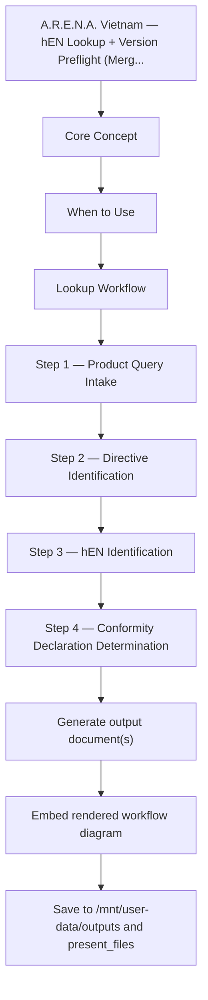

# Harmonised Standard Authority
## A.R.E.N.A. Vietnam — hEN Lookup + Version Preflight (Merged Skill v2.0)

> **Organisation Context**: A.R.E.N.A. Vietnam is a **sourcing office**, not a
> manufacturer. It sources non-food consumer products from suppliers across South
> and Southeast Asia and connects them to retail partners (HAGEBAU, ITM/Bricomarche,
> BCM, DEDEMAN, JUMBO/Coop, PEVEX) across EU-27, EEA-3, Switzerland, Canada, US.

> **Merge Note (May 2026)**: This skill consolidates `harmonised-standard-lookup`
> v1.0 (hEN identification) and `harmonised-standards-version-monitor` v1.0
> (version preflight gate) into a single authoritative reference. The
> `harmonised-standards-version-monitor` skill file now redirects here.

> **Authority**: CID (EU) **2026/901** (17 Apr 2026) is the current active GPSR
> standards instrument. CID (EU) **2025/2519** (16 Dec 2025) updated EN 71-3 and
> EN 71-13 — see VERSION_DB and Watch-Out items 9 and 10 below.
> CID (EU) **2026/1279** (16 Jun 2026) is the current PPE Regulation (EU) 2016/425
> hEN instrument — repeals CID (EU) 2023/941 and all its amendments. See VERSION_DB
> PPE section and Watch-Out items 11 and 12 below.
> CEN published **EN 581-2:2026** and **EN 581-3:2026** (outdoor furniture) on
> 20 May 2026 — CEN-level publication only, NOT YET OJ-cited as of this update
> (2026-08-07). See VERSION_DB FURNITURE section and Watch-Out item 13 below.

---

## Table of Contents

- **PART I — LOOKUP**: Identify which standard, directive, DoC or DoP
  1. Core Concept
  2. When to Use
  3. Lookup Workflow
  4. Step 1 — Product Query Intake
  5. Step 2 — Directive Identification
  6. Step 3 — hEN Identification
  7. Step 4 — Conformity Declaration Determination
  8. Step 5 — Verification via Web Search
  9. Step 6 — Output Delivery
  10. Key Principles
  11. Example Interactions

- **PART II — VERSION PREFLIGHT**: Block stale versions, inject current OJ-cited
  12. Version Preflight Purpose
  13. Preflight Protocol
  14. VERSION_DB — Master Version Table (OJEU-verified June 2026)
  15. Watch-Out Intelligence (10 items)
  16. Preflight Check Script (Python)
  17. Maintenance Protocol

- **APPENDIX**
  18. Product Category Master Reference
  19. Registered Integration Skills (12 skills)
  20. Companion Skills
  21. Revision History

---

# PART I — HARMONISED STANDARD LOOKUP

## Core Concept

EU product compliance under the New Legislative Framework (NLF) relies on
**harmonised European standards (hEN)** — standards adopted by CEN, CENELEC, or
ETSI whose references are published in the Official Journal of the EU (OJEU). When
a product conforms to an hEN, the manufacturer benefits from a **presumption of
conformity** with the essential requirements of the directive under which the
standard is harmonised.

### DoC vs DoP — The Critical Distinction

| Declaration | Full Name | When Required | Source |
|---|---|---|---|
| **DoC** | EU Declaration of Conformity | ALL CE-marked products EXCEPT construction products | Decision 768/2008/EC |
| **DoP** | Declaration of Performance | ONLY construction products under CPR | CPR 305/2011 Art. 4 |

**Rule 1**: CPR 305/2011 product → **DoP** (DoC does NOT apply).
**Rule 2**: Any other CE directive → **DoC**.
**Rule 3**: CPR + another directive → **DoP** for CPR part + **DoC** for all other directives.

---

## When to Use

Trigger this skill when:
- Asked which harmonised standard applies to a product or product category
- Checking whether a product needs CE marking and which hEN to apply
- Determining if a DoC or DoP is required for a specific product
- Looking up the directive linkage of a specific EN standard number
- Identifying the AVCP system for a construction product under CPR
- Verifying whether a standard is superseded, withdrawn, or restricted in the OJ
- Any other skill needs to look up an applicable hEN during document generation
- A standard version string needs verification against the current OJ citation

---

## Lookup Workflow

```
User Query (product name, EN standard number, or product category)
     |
     v
Step 1: Product Query Intake — extract characteristics
     |
     v
Step 2: Directive Identification — match product to directive(s)
     |
     v
Step 3: hEN Identification — identify applicable EN standard
     |
     +-- Match found --> Step 4
     +-- No match -----> Pathway B (directive, no hEN) or Pathway C (GPSR)
     |
     v
Step 4: Conformity Declaration Determination — DoC or DoP
     |
     v
Step 5: Version Verification — cross-check VERSION_DB (Part II)
         + web search confirmation if needed
     |
     v
Step 6: Output Delivery — chat table or .docx report
```

---

## Step 1 — Product Query Intake

| Input | Description | Extraction Method |
|---|---|---|
| Product name / description | What the product is | Direct from query |
| Product function | Intended use | Infer or ask |
| Power source | None / Mains / Battery / Gas / Solar | Infer or ask |
| Voltage / pressure | Determines directive scope thresholds | Ask if critical |
| Construction use? | Permanently incorporated into works | Infer or ask |
| User group | Consumer / Professional / Both | Infer or ask |
| A.R.E.N.A. department | GARDEN / DIY / DECO / AUTO / BUILDING | Infer from product |
| EN standard number | If user provides a specific number | Direct from query |

If the user provides an EN standard number directly, skip to Step 3.

---

## Step 2 — Directive Identification

### Directive Scope Decision Matrix

| Directive / Regulation | Scope Trigger | CE Marking | Declaration |
|---|---|---|---|
| **LVD** 2014/35/EU | Electrical equipment 50-1000V AC / 75-1500V DC | YES | DoC |
| **EMC** 2014/30/EU | Equipment with electrical/electronic components | YES | DoC |
| **MD** 2006/42/EC | Machinery, power tools, manual lifting assemblies (placed on market until 19 Jan 2027) | YES | DoC |
| **MR** (EU) 2023/1230 | Machinery (from 20 Jan 2027 — replaces MD). **No hEN citation decision under MR published as of Sep 2026** — MD citations do not give presumption under MR Art. 20 (Watch-Out 14) | YES | DoC |
| **RED** 2014/53/EU | Radio equipment (Wi-Fi, Bluetooth, NFC, RF) | YES | DoC |
| **RoHS** 2011/65/EU | Electrical and electronic equipment (all EEE) | YES | DoC |
| **TSD** 2009/48/EC | Toys designed for play by children under 14 | YES | DoC |
| **PPE Reg** (EU) 2016/425 | Personal protective equipment Cat I/II/III | YES | DoC |
| **CPR** 305/2011 | Construction products with hEN or ETA | YES | **DoP** |
| **PED** 2014/68/EU | Pressure equipment PS > 0.5 bar | YES | DoC |
| **SPVD** 2014/29/EU | Simple pressure vessels 0.5-30 bar | YES | DoC |
| **GAR** (EU) 2016/426 | Gas-burning appliances | YES | DoC |
| **ATEX** 2014/34/EU | Equipment for explosive atmospheres | YES | DoC |
| **Ecodesign** 2009/125/EC | Energy-related products — lighting: **SLR (EU) 2019/2020** | YES | DoC |
| **ELD** (EU) 2017/1369 | Energy labelling — lighting: **ELR (EU) 2019/2015** | n/a | EPREL + label (light sources sold alone) |
| **MDR** (EU) 2017/745 | Medical devices | YES | DoC |
| **Batteries** (EU) 2023/1542 | Batteries and waste batteries | YES (from 2027) | DoC |

### Scope Exclusions — Common Traps

- **SLR / ELR exclude**: light sources in battery-operated products — SLR Art. 2(44), Annex III 1(c) / ELR Annex IV 1(c). USB-while-connected and adapter-fed products are **not** battery-operated. Exclusion covers SLR/ELR only (RoHS, EMC, WEEE remain)
- **LVD excludes**: <50V AC / <75V DC, batteries not connected to mains, 12V automotive
- **MD excludes**: Simple hand tools without moving parts below the risk threshold
- **MD/MR INCLUDES manual lifting**: assemblies intended for lifting loads whose only power source is directly applied human effort (e.g. hand pallet trucks, hydraulic jacks) are machinery — not GPSR-only
- **CPR does NOT give DoC**: Always DoP — single most common error in compliance planning
- **RoHS applies to ALL EEE**: Including luminaires, garden power tools, battery chargers

---

## Step 3 — hEN Identification

Search the harmonised standard database by:
1. **Product name**: Match by intended use and product type
2. **EN number**: Direct lookup if user supplies the standard number
3. **Directive**: Filter all standards cited under a specific directive
4. **Department**: Use product category taxonomy (Appendix) to narrow scope

**If no match found:**
- Product may be **Pathway B** (directive applies, but no hEN cited in OJ)
- Product may be **Pathway C** (no harmonised directive applies — GPSR only)
- Standard may be very recent — proceed to Step 5 web search

> After identifying the standard number, immediately cross-check the version against
> the VERSION_DB in Part II before using the citation in any document.

---

## Step 4 — Conformity Declaration Determination

```
Is the product covered by CPR 305/2011?
|
+-- YES --> Declaration of Performance (DoP) required
|           +-- Identify AVCP system from standard citation
|           +-- NB involvement: Systems 1+, 1, 2+, 3
|           +-- System 4: manufacturer self-assessment only
|
+-- NO ---> Is the product covered by any other CE directive?
            |
            +-- YES --> EU Declaration of Conformity (DoC) required
            |           +-- Identify conformity assessment module(s)
            |           +-- NB required: Modules B, C2, D, E, F, G, H
            |           +-- Module A: manufacturer self-declaration only
            |
            +-- NO ---> No CE marking required
                        +-- GPSR (EU) 2023/988 applies as safety net
                        +-- Internal risk analysis; no DoC/DoP required
```

### Multi-Directive Example (Luminaire)

| Directive | hEN | Module | NB? | Declaration |
|---|---|---|---|---|
| LVD 2014/35/EU | EN 60598-1:2015+A1:2018 | A | No | DoC |
| EMC 2014/30/EU | EN 55015 | A | No | DoC (combined) |
| RoHS 2011/65/EU | EN IEC 63000:2018 | A | No | DoC (combined) |
| Ecodesign — SLR (EU) 2019/2020 | measurement per SLR Annex II/IV (verify cited method before use) | A | No | DoC (combined) |
| Energy labelling — ELR (EU) 2019/2015 | — | — | — | EPREL registration; no label on the luminaire (containing product) |

Multiple directives may be referenced on a single combined DoC document (Decision 768/2008/EC).

---

## Step 5 — Verification via Web Search

Always verify with web search to confirm:
1. Standard is currently listed in the OJEU: `"EN [number]" site:eur-lex.europa.eu harmonised standard`
2. Standard has not been superseded: `"EN [number]" superseded OR withdrawn OR replaced`
3. Coexistence period status — some standards have a Date of Cessation of PoC
4. Restriction notes — some hEN citations carry clause-level restrictions

| Source | What to Check |
|---|---|
| EUR-Lex (eur-lex.europa.eu) | OJ publication, Commission Implementing Decisions |
| CEN Standards (standards.cen.eu) | Standard status, supersession chain |
| NANDO (ec.europa.eu/growth/tools-databases/nando) | Notified Bodies per directive |
| EU Single Market Standards (single-market-economy.ec.europa.eu) | Current hEN summary lists |

---

## Step 6 — Output Delivery

### Quick Response (Chat)

```
Product: [Product Name]
Department: [GARDEN/DIY/DECO/AUTO/BUILDING]
Pathway: A (Harmonised + hEN)

| Directive | hEN (Current OJ Version) | Module | NB? | Declaration |
|---|---|---|---|---|
| [Dir]     | EN XX:YYYY               | [A/B]  | Y/N | DoC or DoP  |

OJ Reference: CID (EU) YYYY/XXX
Status: Active | Coexistence end: [date if applicable]
VERSION_DB: PASS / SUBSTITUTED [old -> new]
```

### Full Report (.docx)

Read /mnt/skills/public/docx/SKILL.md first, then generate .docx with:
1. Cover Page
2. Product Identification
3. Directive Stack with scope justification
4. Harmonised Standard Matrix — hEN per directive with OJ-verified current version
5. Conformity Declaration Summary — DoC and/or DoP
6. Conformity Assessment Route — modules, NB requirements
7. OJ References — full CID numbers and publication dates
8. Standard Status Notes — supersession, withdrawal, coexistence periods
9. Preflight Log — VERSION_DB substitution record
10. Next Steps — companion skills

**Formatting**: A4 Portrait, 1" margins, Arial 11pt/9pt for tables.
Header #1F4E79 dark blue. DoC badge #2E7D32 green. DoP badge #1565C0 blue.
No CE badge #757575 grey. Version substitution amber #E65100.
Footer: "CONFIDENTIAL — A.R.E.N.A. Vietnam" + page number.
Validate: python /mnt/skills/public/docx/scripts/office/validate.py

---

## Lighting products — SLR / ELR screen

*Added 2026-09-30 · aligned with `cptp-generator` rev 1.6 §7.3a. Applies to every
product that contains a light source: string lights, lanterns, luminaires,
illuminated décor, garden and solar lights, lit mirrors, products with an
integrated torch.*

**Instruments**
- **SLR** — Commission Reg (EU) 2019/2020, ecodesign for light sources and
  separate control gears, as amended by (EU) 2021/341. Implementing measure under
  Directive 2009/125/EC; remains in force under the ESPR (EU) 2024/1781
  transitional provisions. CE legislation — cited on the DoC.
- **ELR** — Delegated Reg (EU) 2019/2015, energy labelling of light sources,
  under Framework Reg (EU) 2017/1369. Not CE — evidence is EPREL registration and
  the label.
- Both applied from 1 Sep 2021. Exemptions: SLR Annex III · ELR Annex IV.

**Supply-mode rule — SLR Art. 2(44).** *Battery-operated* = operates **only** on
DC from a source contained in the same product, without being connected directly
or indirectly to the mains.

| Supply mode (confirm from P.I. / spec / sample) | SLR / ELR |
|---|---|
| Primary cells only, battery box integral to the product | **Exempt** — SLR Annex III 1(c) · ELR Annex IV 1(c) |
| Solar panel + integral rechargeable cell | **Exempt** — solar-powered garden lamps named in Annex III 1(c) |
| Rechargeable cell, product cannot light while charging | Exempt — keep the charging-mode check as evidence |
| USB / rechargeable product that can light while connected | **In scope** — indirect mains connection |
| External adapter / transformer (e.g. 24 V / 31 V strings) | **In scope** — indirect mains connection |
| Direct mains (plug or hard-wired) | **In scope** |

If the supply mode is not stated, **ask** — never default to exempt. The product
title ("battery string light") does not decide it.

**When in scope**
- **SLR Annex II** — maximum on-mode power (efficacy); functional requirements
  (CRI ≥ 80 unless excepted, flicker P<sub>st</sub>LM ≤ 1.0, stroboscopic SVM ≤ 0.4,
  displacement factor, lumen maintenance and survival factor); standby and
  networked standby ≤ 0.5 W; information requirements on product, packaging and
  website. Headline values are for LED mains light sources at full load — confirm
  against the consolidated Annex II. Verification tolerances: Annex IV.
- **Containing product** — light sources and separate control gear replaceable
  with commonly available tools without permanent damage, **or** a justification
  in the technical documentation; replaceability statement in user instructions.
- **ELR** — a light source sold on its own carries the A–G label on its packaging,
  a product information sheet and an **EPREL registration before placing on the
  market**. A containing product (string light with integrated LEDs, luminaire)
  carries **no energy label**; the energy class of the contained light source(s)
  is declared in the user documentation.

**When exempt** — record the exemption basis (Annex point), the supplier's
supply-mode declaration and, for rechargeables, the charging-mode check. The
exemption covers **SLR/ELR only**: GPSR, RoHS 2011/65/EU (CE + DoC), WEEE,
EMC where electronic controls are present, RED where radio is present, and
Battery Reg (EU) 2023/1542 still apply.

**Counterparts** — CH: Energy Efficiency Ordinance EnEV SR 730.02. GB: GB
lighting ecodesign and energy information regulations (SI 2021/1095 — verify
before citing); GB-format label; EPREL does not serve GB. NI: EU SLR/ELR and
EPREL apply. CA / US: screen NRCan Energy Efficiency Regulations 2016 and DOE
10 CFR 430 for regulated lamp types; for decorative and containing products
record "no equivalent obligation identified".

**Common errors**
1. Treating "battery-powered" in the title as exempt — USB, rechargeable-while-
   connected and adapter-fed products are in scope.
2. Raising a non-conformity for a missing energy label on a containing product —
   none is required.
3. Treating the exemption as "no CE" — RoHS, and EMC where applicable, still
   require CE marking and a DoC.

**Application in this skill**
- Step 2 directive identification: apply the supply-mode rule before listing Ecodesign / ELD.
- Preflight: SLR measurement methods are verified against the OJ before any standard is cited in a CPTP, QCP or QSD; if no OJ-cited method is confirmed, cite "SLR Annex II / IV" and flag.
- Multi-Directive Example (Luminaire) updated with SLR and ELR rows.

---

## Key Principles

1. **CPR = DoP, everything else = DoC.** Construction products under CPR 305/2011
   declare performance, not conformity. Single most important rule.

2. **hEN not equal to EN.** Only standards whose references are published in the OJEU
   under a specific directive give presumption of conformity.

3. **Version verification is mandatory.** The VERSION_DB in Part II is the single
   source of truth. Never cite a version without checking it.

4. **OJ withdrawal not equal to CEN withdrawal.** A standard loses presumption of
   conformity ONLY when its OJ citation is formally withdrawn by Commission
   Implementing Decision. CEN/national withdrawal alone does NOT remove hEN status.

5. **Restrictions matter.** Some hEN citations carry clause-level restrictions.
   Check the OJ text for restriction notes.

6. **Coexistence periods.** During coexistence, both old and new OJ-cited versions
   give presumption of conformity. After the cessation date, only the new version applies.

7. **Multi-directive stacking.** A single product can need multiple hEN across
   different directives. Each directive's hEN is independent.

8. **Module A dominance.** For A.R.E.N.A. consumer product categories, most
   directives allow Module A. NB involvement mainly for PPE Cat II/III, high-risk
   machinery, pressure equipment, and CPR Systems 1+/1/2+/3.

9. **Swiss market nuance.** Switzerland recognises EU hEN under MRA/Cassis de Dijon,
   but has separate market surveillance and responsible person requirements.

10. **Regulation-anchored.** Every standard citation must reference the specific
    directive and OJ/CID publication. Never cite a standard as harmonised without
    specifying the directive and CID reference.

---

## Example Interactions

**User: "What harmonised standard applies to garden secateurs?"**
- Hand-held cutting tool; no power source; MD does NOT apply
- No CE directive covers non-powered hand tools
- Pathway C (GPSR Safety Net) — no hEN; GPSR (EU) 2023/988 applies
- Voluntary standard EN ISO 7384 may be referenced for presumption of safety under GPSR

**User: "Is there an hEN for wood screws? DoC or DoP?"**
- EN 14592:2008+A1:2012 (Timber structures, Dowel-type fasteners) under CPR 305/2011
- AVCP System 3 — NB performs initial type testing
- Response: Declaration required is DoP (NOT DoC). AVCP System 3.

**User: "EN 60598 — what directive, DoC or DoP?"**
- EN 60598-1:2015+A1:2018 = Luminaires under LVD 2014/35/EU
- Module A, no NB. VERSION_DB: base :2015 BLOCKED → inject :2015+A1:2018
- Also requires EMC (EN 55015) and RoHS (EN IEC 63000) — both DoC

---

# PART II — VERSION PREFLIGHT GATE

## Version Preflight Purpose

This section maintains a VERSION_DB of current vs. withdrawn/superseded harmonised
European standard versions. It is a mandatory preflight gate for all 12 registered
generation skills in the A.R.E.N.A. ecosystem.

**What it does:**
1. Intercepts any standard version string in a document under generation
2. Looks it up in the VERSION_DB
3. BLOCKS the withdrawn/stale version from appearing in the output
4. INJECTS the current OJ-cited replacement version
5. Logs the substitution in a preflight report embedded in the document footer

**What it does NOT do:**
- Does not assess technical equivalence between versions
- Does not generate test plans or conformity assessment routes

---

## Preflight Protocol

```
FOR EACH standard reference in the document under construction:
  1. Extract standard number and version year/amendment
  2. Check COEXISTENCE register for this version string
  3. IF in coexistence:
       PASS with note — old version still gives PoC until cessation date
       LOG: "COEXISTENCE: [version] valid until [date]"
  4. IF not in coexistence, look up in VERSION_DB:
     a. IF found AND version_in_document != current_version:
          BLOCK the stale version string
          INJECT current_version from VERSION_DB
          LOG: "SUBSTITUTED: [stale] -> [current] | Reason: [reason]"
     b. IF found AND version_in_document == current_version:
          PASS — no action
     c. IF not found in VERSION_DB:
          FLAG as UNVERIFIED — do NOT block; note in preflight log
  5. After all references: embed preflight summary in document footer
```

**Preflight Log Format:**

```
STANDARDS VERSION PREFLIGHT | [doc_ref]
Skill: harmonised-standard-lookup v2.2 (merged)
Result: [PASS / SUBSTITUTIONS MADE / FLAGS RAISED]
Substitutions: [N] | Coexistence: [N] | Watch: [N] | Flags: [N] | Verified: [N]
  SUBSTITUTED: EN 71-3:2019+A1:2021 -> EN 71-3:2019+A2:2024 | A2:2024 cited Dec 2025
  COEXISTENCE: EN 71-3:2019+A1:2021 valid until 16 Jun 2027 (if on existing test report)
  WATCH: EN 581-3:2026 | CEN-published 20 May 2026, OJ citation pending — cite EN 581-3:2017 instead
  UNVERIFIED: EN XXXXX:20XX | Not in VERSION_DB — manual OJ check required
```

---

## VERSION_DB — Master Version Table

> Last updated: 2026-08-07 against CID (EU) 2026/901 (GPSR, 17 Apr 2026),
> CID (EU) 2025/2519 (Toys, 16 Dec 2025), CID (EU) 2026/1279 (PPE, 16 Jun 2026),
> current OJEU summary lists, and web-verified CEN publication of
> EN 581-2:2026 / EN 581-3:2026 (20 May 2026, OJ citation pending — see Watch-Out 13).
> CURRENT = cite this version. BLOCKED = do not use (withdrawn/stale).
> COEX = old version still in coexistence — see COEXISTENCE register in script.
> WATCH = new edition published outside the OJ; do not inject until OJ-cited.

### FURNITURE — Outdoor / Garden (GARDEN dept.)

> **WATCH (2026-08-07): EN 581-2:2026 and EN 581-3:2026 published by CEN on
> 20 May 2026.** National standards bodies have 6 months to adopt (~20 Nov 2026);
> old CEN editions (EN 581-2:2015+A1:2022/AC:2016 and EN 581-3:2017) will then be
> withdrawn at CEN/national level. Per Key Principle 4, CEN withdrawal does NOT by
> itself remove hEN status — presumption of conformity requires OJ citation via a
> Commission Implementing Decision, which has NOT yet been confirmed for these 2026
> editions as of this update. CURRENT columns below still reflect the last
> OJ-anchored versions; treat the 2026 editions as UNVERIFIED/pending until an OJ
> citation is confirmed, then re-run this lookup. See Watch-Out item 13.

| Standard No. | BLOCKED (stale) | CURRENT (inject — last OJ-cited) | Notes |
|---|---|---|---|
| EN 581-1 | :2006 | **:2017** | Outdoor seating — 2006 withdrawn Dec 2017. A revision addressing finger entrapment (informed by CEN/TR 17202) is under CEN development but NOT published as of 2026-08-07 — no EN 581-1:2026 confirmed. Current OJ version remains :2017. |
| EN 581-2 | :2015 | **:2015+A1:2022** | Outdoor furniture seating — A1:2022 is current OJ-cited version. CEN published EN 581-2:2026 (20 May 2026, new stability/definitions, deckchair test methods) — CEN edition only, pending OJ citation. Do not cite :2026 as hEN until confirmed. |
| EN 581-3 | — | **:2017** | Outdoor furniture tables (non-domestic) — :2017 current OJ-cited version. CEN published EN 581-3:2026 (20 May 2026, revised glass-top test, surface area threshold 0.25→0.30 m², new cantilever/pedestal impact tests) — CEN edition only, pending OJ citation. Do not cite :2026 as hEN until confirmed. |
| EN 1728 | :2000 | **:2012** | Seating test methods — 2000 withdrawn |
| EN 12520 | :2000 | **:2015** | Seating strength and durability — 2000 withdrawn |
| EN 12521 | :2009 | **:2015** | Tables strength and durability — 2009 withdrawn |
| EN 14703 | :2005 | **:2019** | Outdoor furniture linking units — 2005 withdrawn |
| EN 16139 | — | **:2013** | Non-domestic seating strength and durability — current |
| EN 1022 | — | **:2018** | Domestic seating stability — current |

### FURNITURE — Indoor / Domestic (DECO dept.)

| Standard No. | BLOCKED | CURRENT | Notes |
|---|---|---|---|
| EN 12227 | :1999 | **:2014** | Domestic playpens — safety requirements |
| EN 716-1 | :2008 | **:2017** | Children's cots safety — 2008 withdrawn |
| EN 716-2 | :2008 | **:2017** | Children's cots test methods — 2008 withdrawn |
| EN 747-1 | :2012 | **:2012+A1:2015** | Bunk beds safety — A1:2015 is current |
| EN 747-2 | :2012 | **:2012+A1:2015** | Bunk beds test methods — A1:2015 is current |
| EN 1725 | — | **:1998** | Domestic beds and mattresses — old but not superseded in OJ |
| EN 14072 | :2003 | **:2019** | Storage furniture test methods — 2003 withdrawn |

### CHILD BIKES / CYCLES (DIY / GARDEN dept.)

| Standard No. | BLOCKED | CURRENT | Notes |
|---|---|---|---|
| EN 14765 | :2005 base alone | **:2005+A1:2008** | Child cycles — must always cite with A1:2008 |
| EN ISO 8098 | :2002 | **:2014** | Bicycles for young children — 2002 withdrawn |
| EN 14764 | :2005 | **:2006** | City and trekking cycles (adult) — 2005 withdrawn |
| EN 15194 | :2008 | **:2017** | EPAC electrically power-assisted cycles — 2008 withdrawn |

### TOYS — Toy Safety Directive 2009/48/EC (DECO / GARDEN dept.)

| Standard | BLOCKED | CURRENT | COEX Until | Notes |
|---|---|---|---|---|
| EN 71-1 | :2011 | **:2014+A1:2018** | — | Toys mechanical — 2011 withdrawn |
| EN 71-2 | :2006 | **:2011+A1:2014** | — | Toys flammability — 2006 withdrawn |
| EN 71-3 | :2013 and earlier | **:2019+A2:2024** | A1:2021 valid to 16 Jun 2027 | UPDATED — A2:2024 cited Dec 2025 per CID 2025/2519. See Watch-Out 9. |
| EN 71-4 | :2009 | **:2020** | — | Experimental chemistry sets — 2009 withdrawn |
| EN 71-5 | — | **:2015** | — | Chemical toys (other than experimental) — current |
| EN 71-7 | :2014 | **:2014+A1:2020** | — | Finger paints — A1:2020 is current |
| EN 71-8 | :2011 | **:2018** | — | Activity toys for domestic use — 2011 withdrawn |
| EN 71-9 | :2005 base | **:2005+A1:2007** | — | Organic chemical compounds — cite with A1:2007 |
| EN 71-13 | :2021+A1:2022 | **:2021+A2:2024** | A1:2022 valid to 16 Jun 2027 | UPDATED — A2:2024 cited Dec 2025 per CID 2025/2519. See Watch-Out 10. |
| EN 71-14 | — | **:2018** | — | Trampolines for domestic use — current |

### ELECTRICAL / LVD (DIY dept.)

| Standard | BLOCKED | CURRENT | Notes |
|---|---|---|---|
| EN 60950-1 | any | **EN IEC 62368-1:2020+A11:2022** | AV/ICT — 60950-1 FULLY WITHDRAWN; 62368-1 mandatory |
| EN 60065 | any | **EN IEC 62368-1:2020+A11:2022** | Audio/video — 60065 FULLY WITHDRAWN; 62368-1 replaces |
| EN 60335-1 | :2012+A11:2014+A13:2017+A1:2019+A14:2019+A2:2019 | **:2012 + all amendments to +A15:2021** | Always include A15:2021 |
| EN 60335-2-3 | :2002+amendments | **:2016+A1:2020+A11:2020** | Electric irons — current |
| EN 60598-1 | :2015 | **:2015+A1:2018** | Luminaires general requirements — A1:2018 is current |
| EN 62031 | — | **:2020** | LED modules for general lighting — current |
| EN IEC 63000 | — | **:2018** | RoHS technical documentation — current |
| EN 301 489-1 | V1.x | **V2.2.3** | EMC for radio equipment — V1.x withdrawn |
| EN 300 220-2 | V3.1.1 | **V3.3.1** | SRD 25 MHz-1 GHz — V3.1.1 withdrawn Jun 2025; V3.2.1 coexistence to Jun 2027 |
| EN 18031-1 | — | **:2024** | Cybersecurity internet-connected radio equipment — OJ Jan 2025 |
| EN 18031-2 | — | **:2024** | Cybersecurity privacy protection — OJ Jan 2025 |
| EN 18031-3 | — | **:2024** | Cybersecurity fraud prevention — OJ Jan 2025 |

### PPE — Personal Protective Equipment (DIY / GARDEN dept.)

| Standard | BLOCKED | CURRENT | Notes |
|---|---|---|---|
| EN 420 | :2003+A1:2009 | **EN ISO 21420:2020+A1:2024** | General gloves — EN 420 SUPERSEDED Sep 2020 |
| EN 388 | :2003 | **:2016+A1:2018** | Mechanical risk gloves — 2003 withdrawn |
| EN 374-1 | :2016 | **:2016+A1:2018** | Chemical risk gloves — A1:2018 is current |
| EN ISO 20345 | :2011 | **:2022** | Safety footwear — 2011 withdrawn |
| EN ISO 20346 | — | **:2014** | Protective footwear — current |
| EN 166 | — | **:2002** | Eye protection — current; no supersession in OJ yet |
| EN ISO 11612 | :2015 | **:2015+A1:2018** | Heat and flame protective clothing — A1:2018 current |

### CONSTRUCTION PRODUCTS — CPR 305/2011 (BUILDING dept.)

| Standard | BLOCKED | CURRENT | AVCP | Notes |
|---|---|---|---|---|
| EN 13241 | :2003+A1:2011 | **:2003+A2:2016** | 3 | Industrial/commercial/garage doors — A2:2016 current |
| EN 14351-1 | :2006+A1:2010 | **:2006+A2:2016** | 3 | Windows and external doorsets — A2:2016 current |
| EN 13830 | :2003 | **:2015** | 3 | Curtain walling — 2003 withdrawn |
| EN 13162 | — | **:2012+A1:2015** | 1 | Mineral wool insulation — current |
| EN 13163 | — | **:2012+A1:2015** | 1 | EPS insulation — current |
| EN 197-1 | :2011 | **:2011+A1:2019** | 1+ | Cement — A1:2019 is current |
| EN 12004-1 | :2017 | **:2017+A1:2022** | 3 | Adhesives for tiles — A1:2022 current |
| EN 13813 | — | **:2002** | 3 | Screed material — current |
| EN 14592 | — | **:2008+A1:2012** | 3 | Dowel-type fasteners (wood screws, nails) — current |

### MACHINERY (DIY dept.)

| Standard | BLOCKED | CURRENT | Notes |
|---|---|---|---|
| EN 60745-1 | :2009+A11:2010 | **EN IEC 62841-1:2021** | Hand-held motor-operated tools — 60745-1 being phased out |
| EN ISO 11684-1 | :1995 | **:2007** | Safety signs on machinery — 1995 withdrawn |
| EN 474-1 | :2006+A4:2013 | **:2006+A5:2018** | Earth-moving machinery — A5:2018 is current |
| EN 13218 | — | **:2002+A1:2004** | Fixed abrasive tools — current; verify sub-parts |
| EN ISO 10218-1 | — | **:2011** | Robots — current until ISO 10218-1:2023 is OJ-cited |
| EN ISO 3691-5 | :2015 (without A1) | **:2015+A1:2020** (+AC:2016) | Pedestrian-propelled industrial trucks (hand pallet trucks) — base :2015 reference withdrawn by CID (EU) 2021/377; ISO 3691-5:2014 confirmed 2021 |
| EN 16307-5 | — | **:2013** (verify OJ) | Supplementary requirements, pedestrian-propelled trucks — **WATCH**: CEN edition :2023 supersedes :2013 at CEN level (CEN withdrawal 29/12/2023); OJ citation of :2023 not confirmed (Watch-Out 15). New test reports should also cover :2023 |

### GARDEN POWER TOOLS (GARDEN dept.)

| Standard | BLOCKED | CURRENT | Notes |
|---|---|---|---|
| EN 836 | :1997+A1+A2 | **Withdrawn — use EN ISO 5395-1:2013** | Lawn mowers — EN 836 fully withdrawn |
| EN ISO 5395-1 | — | **:2013** | Combustion-engine lawn mowers — current |
| EN ISO 5395-2 | — | **:2013** | Ride-on mowers combustion engine — current |
| EN ISO 5395-3 | — | **:2013** | Ride-on mowers with seat — current |
| EN ISO 11684-3 | :2001 | **:2007** | Safety sign pictograms — 2001 withdrawn |

### ABRASIVES (DIY dept.)

| Standard | BLOCKED | CURRENT | Notes |
|---|---|---|---|
| EN ISO 6344-1 | :1998 | **:2021** | Coated abrasives grain analysis (macro) — 1998 withdrawn |
| EN ISO 6344-2 | :1998 | **:2021** | Coated abrasives grain analysis (micro) — 1998 withdrawn |
| EN ISO 6344-3 | :1998 | **:2021** | Coated abrasives grain analysis (super-micro) — 1998 withdrawn |
| EN 13743 | :2003 | **:2017** | Bonded abrasives marking system — 2003 withdrawn |
| EN ISO 9044 | — | **:1999** | Woven wire cloth for industrial screens — current |

### CHEMICAL / REACH / HORIZONTAL

| Standard | BLOCKED | CURRENT | Notes |
|---|---|---|---|
| EN 14362-1 | :2003 | **:2017** | Azo dyes in textiles — 2003 withdrawn |
| EN ISO 17075-1 | :2008 | **:2017** | Chromium VI in leather — 2008 withdrawn |
| EN ISO 105-E04 | — | **:2013** | Colour fastness to perspiration — current |
| EN 1811 | :2011+A1:2015 | **:2023** | Nickel release — 2011 version withdrawn |
| EN ISO 105-X12 | — | **:2016** | Colour fastness to rubbing — current |
| EN ISO 25101 | — | **:2009** | Water quality PFAS/PFOS/PFOA — current (method reference) |

### GPSR — GENERAL PRODUCT SAFETY (all departments)

| Instrument | BLOCKED | CURRENT | Notes |
|---|---|---|---|
| GPSR standards CID | Decision (EU) 2019/1698 | **CID (EU) 2026/901 (17 Apr 2026)** | Repeals 2019/1698; all GPSR citations reference 2026/901 |
| GPSR legal instrument | GPSD 2001/95/EC | **GPSR (EU) 2023/988** | Directive repealed 13 Dec 2024; Regulation now applies |

---

## Watch-Out Intelligence

15 high-risk version traps encountered in A.R.E.N.A. supplier and competitor documents.

**1. EN 60950-1 and EN 60065 — fully withdrawn.** Any document citing either for
AV/ICT equipment is non-compliant. Replacement EN IEC 62368-1:2020+A11:2022 has
been mandatory for new products since December 2020. Block on sight, no exceptions.

**2. EN 71-3 version trap.** Multiple versions exist: 2013, 2013+A1, 2013+A2,
2019+A1:2021, and now 2019+A2:2024. Only EN 71-3:2019+A2:2024 is the latest
OJ-cited version (Dec 2025). Reports to 2013 or any 2013+Ax are non-compliant.
Reports to 2019+A1:2021 remain valid in coexistence until 16 June 2027 but new
reports should reference 2019+A2:2024.

**3. EN 14765 must always cite A1:2008.** The base standard alone
(EN 14765:2005 without the amendment) is insufficient. The OJ citation is
:2005+A1:2008. Block the base-only version.

**4. EN 581-1:2006 — withdrawn December 2017.** Still frequently seen in
supplier test reports for garden furniture. Current version: EN 581-1:2017. A
test report citing only :2006 does not provide presumption of conformity.

**5. CID (EU) 2026/901 — current GPSR standards instrument.** As of 17 April 2026,
all GPSR harmonised standard citations reference the new CID. Documents referencing
Decision (EU) 2019/1698 are stale.

**6. EN 420 superseded by EN ISO 21420:2020+A1:2024.** Any DoC or test report for
protective gloves referencing EN 420 is non-compliant. EN 420 was withdrawn
September 2020. Current citation: EN ISO 21420:2020+A1:2024.

**7. EN ISO 6344 series — 2021 revision.** All three parts updated in 2021.
Abrasive product ECTs and QSDs citing the 1998 versions should be updated to
:2021. New lab reports must reference :2021.

**8. EN 1811:2023 — Nickel release.** The 2011+A1:2015 version was withdrawn. New
nickel release testing must reference EN 1811:2023. The standard citation in DoCs
and QSDs must be updated to :2023.

**9. NEW — EN 71-3:2019+A2:2024 (December 2025 update, CID 2025/2519).** The
Commission published CID (EU) 2025/2519 on 16 December 2025, adding
EN 71-3:2019+A2:2024 as the current OJ-cited version. EN 71-3:2019+A1:2021 is
now in coexistence and will be removed from the OJ on 16 June 2027. Key technical
changes in A2:2024: removal of dewaxing pre-treatment step, revised composite
material testing, updated Cr(III)/Cr(VI) migration rationale, and new references
to EN 71-15 through EN 71-18 for formamide, chlorinated phosphorus flame
retardants, isothiazolinones, and phenol in toy materials. New test reports issued
after December 2025 should reference EN 71-3:2019+A2:2024.

**10. NEW — EN 71-13:2021+A2:2024 (December 2025 update, CID 2025/2519).** The
same CID (EU) 2025/2519 also added EN 71-13:2021+A2:2024 (Olfactory board games,
cosmetic kits and gustative games) as the current OJ-cited version. EN
71-13:2021+A1:2022 is in coexistence until 16 June 2027. A2:2024 adds reference
to CEN/TS 17973:2023 for slime toy categorisation, ISO 8124-8 for age grading,
and defines options for child-resistant containers (EN ISO 8137 or Annex A/B
closure test requirements).

**11. NEW — CID (EU) 2026/1279 (June 2026) — PPE hEN instrument fully replaced.**
CID (EU) 2026/1279, published 16 June 2026, repeals CID (EU) 2023/941 and all its
amendments. It is now the sole active PPE Regulation (EU) 2016/425 hEN instrument.
Any supplier DoC for PPE that references the old instrument 2023/941 is technically
stale — the substantive standard citations still hold if the standard version is
current, but the governing CID reference in the DoC should be updated to 2026/1279.

**12. NEW — EN 397:2025 restriction (industrial safety helmets).** EN 397:2025 is
the current OJ-cited version replacing EN 397:2012+A1:2012 (deferred withdrawal).
However, EN 397:2025 carries a formal restriction in the OJ: clause 4.2.7.5.2.5
contains a cross-reference error ("5.13" should read "5.13.5"), and the link
between clause 4.2.7.4 and EHSR 3.6.1 of Annex II to Regulation (EU) 2016/425
is missing. Compliance with clause 4.2.7.4 is explicitly stated by the Commission
to provide PoC with EHSR 3.6.1, but testers must be aware of the clause numbering
error. Flag in any QSD or QCP for industrial safety helmets. New hEN in scope:
EN ISO 10256-1/2/3/4:2024 (ice hockey), EN 17961:2025 (mountaineering load sharing
devices), EN 18100:2025 (ski mountaineering helmets). Also: EN ISO 21420:2020+A1:2024
now the OJ-cited version for protective gloves general requirements (replaces EN 420
and supersedes EN ISO 21420:2020 base).

**13. NEW — EN 581-2:2026 / EN 581-3:2026 (CEN published 20 May 2026, outdoor
furniture) — OJ citation pending.** CEN published new editions of EN 581-2
(seating) and EN 581-3 (tables) on 20 May 2026. National bodies have six months
to adopt (~20 Nov 2026), after which the current CEN editions
(EN 581-2:2015+A1:2022/AC:2016 and EN 581-3:2017) will be withdrawn at CEN
level. **This is a CEN-level publication, not an OJ/hEN citation** — as of this
update (2026-08-07) no Commission Implementing Decision citing EN 581-2:2026 or
EN 581-3:2026 has been confirmed, so the last OJ-cited versions
(EN 581-2:2015+A1:2022 and EN 581-3:2017) remain the versions that give
presumption of conformity under GPSR/the applicable NLF directive. Key changes
in the 2026 editions: EN 581-2 references EN 1022:2023 for stability and adds
deckchair/folding-lounger test methods; EN 581-3 revises glass-top testing,
raises the surface-area threshold from 0.25 m² to 0.30 m², and adds
cantilever/pedestal-table impact and vertical-durability tests. Do not inject
:2026 as the CURRENT version in any QSD/QCP/DoC until OJ citation is verified —
re-run this lookup closer to generation time and check EUR-Lex directly. EN 581-1
is NOT part of this 2026 batch; a separate revision (finger entrapment, informed
by CEN/TR 17202) is under discussion but unpublished — :2017 remains current.

---

**14. NEW — Machinery Regulation (EU) 2023/1230: no hEN citations yet (status Sep 2026).**
MR applies from 20 Jan 2027 to machinery placed on the market from that date (MD
2006/42/EC until 19 Jan 2027 — regime set by placing-on-market date, no overlap). The
Commission has announced a first Implementing Decision citing hENs under MR (expected
end-2026, mostly carrying over MD citations), but none was published as of September 2026.
Standards cited only under MD do **not** give presumption of conformity under MR Art. 20.
Until MR citations exist: apply the same standards as technical solution and demonstrate the
Annex III EHSR directly in the technical file; flag every DoC/QSD for products arriving in the
EU from 20 Jan 2027. Re-check EUR-Lex before each generation.

**15. NEW — EN 16307-5:2023 (pedestrian-propelled trucks, supplementary requirements).**
CEN edition :2023 supersedes :2013 at CEN level (2013 CEN-withdrawn 29 Dec 2023). OJ
citation of :2023 under MD not confirmed as of 2026-10-14. Per Key Principle 4, presumption
follows the OJ-cited edition — keep citing the last OJ-cited version for presumption, but
require new test reports to cover :2023 as state of the art. Pair always with
EN ISO 3691-5:2015+A1:2020 (base :2015 blocked).

---

## Preflight Check Script

```python
# harmonised_standard_lookup/preflight_check.py
# Merged v2.4 — October 2026 (adds EN ISO 3691-5 / EN 16307-5; WATCH check generalised to any CEN edition)
# Usage: pass list of (standard_number, version_string) tuples.
# Returns: list of (standard_number, action, correct_version, note) tuples.
# Actions: PASS, COEXISTENCE, BLOCK_AND_INJECT, UNVERIFIED, WATCH

VERSION_DB = {
    # Furniture outdoor
    "EN 581-1":          ("2006",                    "2017",                         "Outdoor seating — 2006 withdrawn Dec 2017. Revision (finger entrapment) unpublished as of 2026-08-07."),
    "EN 581-2":          ("2015",                    "2015+A1:2022",                 "Seating — A1:2022 is last OJ-cited version. CEN edition :2026 published 20 May 2026, OJ citation PENDING — do not inject until verified (Watch-Out 13)."),
    "EN 581-3":          ("—",                       "2017",                         "Tables — :2017 is last OJ-cited version. CEN edition :2026 published 20 May 2026, OJ citation PENDING — do not inject until verified (Watch-Out 13)."),
    "EN 1728":           ("2000",                    "2012",                         "Seating test methods — 2000 withdrawn"),
    "EN 12520":          ("2000",                    "2015",                         "Seating strength — 2000 withdrawn"),
    "EN 12521":          ("2009",                    "2015",                         "Tables strength — 2009 withdrawn"),
    # Furniture indoor
    "EN 716-1":          ("2008",                    "2017",                         "Childrens cots — 2008 withdrawn"),
    "EN 716-2":          ("2008",                    "2017",                         "Childrens cots test — 2008 withdrawn"),
    "EN 747-1":          ("2012",                    "2012+A1:2015",                 "Bunk beds — A1:2015 is current"),
    "EN 747-2":          ("2012",                    "2012+A1:2015",                 "Bunk beds test — A1:2015 is current"),
    # Child bikes
    "EN 14765":          ("2005",                    "2005+A1:2008",                 "Child cycles — always cite with A1:2008"),
    "EN ISO 8098":       ("2002",                    "2014",                         "Young child cycles — 2002 withdrawn"),
    "EN 14764":          ("2005",                    "2006",                         "Adult cycles reference — 2005 withdrawn"),
    "EN 15194":          ("2008",                    "2017",                         "EPAC — 2008 withdrawn"),
    # Toys — UPDATED Dec 2025 per CID (EU) 2025/2519
    "EN 71-1":           ("2011",                    "2014+A1:2018",                 "Toys mechanical — 2011 withdrawn"),
    "EN 71-2":           ("2006",                    "2011+A1:2014",                 "Toys flammability — 2006 withdrawn"),
    "EN 71-3":           ("2013",                    "2019+A2:2024",                 "Toys chemical — 2013 withdrawn; A1:2021 coexistence to 16 Jun 2027; A2:2024 current per CID 2025/2519"),
    "EN 71-8":           ("2011",                    "2018",                         "Activity toys — 2011 withdrawn"),
    "EN 71-9":           ("2005",                    "2005+A1:2007",                 "Organic chemicals — cite with A1:2007"),
    "EN 71-13":          ("2021+A1:2022",            "2021+A2:2024",                 "Olfactory board games — A1:2022 coexistence to 16 Jun 2027; A2:2024 current per CID 2025/2519"),
    # Electrical / LVD
    "EN 60950-1":        ("any",                     "EN IEC 62368-1:2020+A11:2022", "FULLY WITHDRAWN — mandatory replacement"),
    "EN 60065":          ("any",                     "EN IEC 62368-1:2020+A11:2022", "FULLY WITHDRAWN — mandatory replacement"),
    "EN 60335-1":        ("2012+A11:2014+A13:2017+A1:2019+A14:2019+A2:2019",
                                                      "2012+A11:2014+A13:2017+A1:2019+A14:2019+A2:2019+A15:2021",
                                                                                       "Always include A15:2021"),
    "EN 60598-1":        ("2015",                    "2015+A1:2018",                 "Luminaires — A1:2018 is current"),
    "EN 300 220-2":      ("V3.1.1",                  "V3.3.1",                       "SRD — V3.1.1 withdrawn Jun 2025"),
    # PPE — updated per CID (EU) 2026/1279 (16 Jun 2026) which repeals CID 2023/941
    "EN 420":            ("any",                     "EN ISO 21420:2020+A1:2024",    "SUPERSEDED — EN 420 withdrawn; new OJ citation EN ISO 21420:2020+A1:2024 per CID 2026/1279"),
    "EN ISO 21420":      ("2020",                    "2020+A1:2024",                 "Protective gloves general — A1:2024 now OJ-cited per CID 2026/1279; :2020 alone is coexistence"),
    "EN 388":            ("2003",                    "2016+A1:2018",                 "Mechanical gloves — 2003 withdrawn"),
    "EN 397":            ("2012+A1:2012",            "2025",                         "Industrial safety helmets — :2012 deferred withdrawal; :2025 current per CID 2026/1279; RESTRICTION on clause 4.2.7.5.2.5 and 4.2.7.4/EHSR 3.6.1 link"),
    "EN 12492":          ("2012",                    "2025",                         "Helmets for mountaineers — :2012 deferred withdrawal; :2025 current per CID 2026/1279"),
    "EN ISO 12312-1":    ("2013",                    "2022+A11:2024",                "Sunglasses — :2013 and :2013/A1:2015 deferred withdrawal; :2022+A11:2024 current per CID 2026/1279"),
    "EN 17353":          ("2020",                    "2020+A1:2025",                 "Enhanced visibility equipment — :2020 deferred withdrawal; :2020+A1:2025 current per CID 2026/1279"),
    "EN ISO 20345":      ("2011",                    "2022",                         "Safety footwear — 2011 withdrawn"),
    "EN ISO 11612":      ("2015",                    "2015+A1:2018",                 "Protective clothing — A1:2018 current"),
    # CPR
    "EN 14351-1":        ("2006+A1:2010",            "2006+A2:2016",                 "Windows — A2:2016 is current"),
    "EN 13241":          ("2003+A1:2011",            "2003+A2:2016",                 "Doors — A2:2016 is current"),
    "EN 13830":          ("2003",                    "2015",                         "Curtain walling — 2003 withdrawn"),
    "EN 197-1":          ("2011",                    "2011+A1:2019",                 "Cement — A1:2019 is current"),
    "EN 12004-1":        ("2017",                    "2017+A1:2022",                 "Tile adhesives — A1:2022 current"),
    # Abrasives
    "EN ISO 6344-1":     ("1998",                    "2021",                         "Coated abrasives — 1998 withdrawn"),
    "EN ISO 6344-2":     ("1998",                    "2021",                         "Coated abrasives — 1998 withdrawn"),
    "EN ISO 6344-3":     ("1998",                    "2021",                         "Coated abrasives — 1998 withdrawn"),
    "EN 13743":          ("2003",                    "2017",                         "Bonded abrasives marking — 2003 withdrawn"),
    # Chemical
    "EN 14362-1":        ("2003",                    "2017",                         "Azo dyes — 2003 withdrawn"),
    "EN ISO 17075-1":    ("2008",                    "2017",                         "Cr VI leather — 2008 withdrawn"),
    "EN 1811":           ("2011+A1:2015",            "2023",                         "Nickel release — 2011 version withdrawn"),
    # Garden machinery
    "EN 836":            ("any",                     "EN ISO 5395-1:2013",           "Lawn mowers — EN 836 withdrawn; use ISO 5395 series"),
    # Machinery
    "EN 60745-1":        ("2009+A11:2010",           "EN IEC 62841-1:2021",          "Hand-held tools — 60745-1 being phased out"),
    "EN ISO 11684-1":    ("1995",                    "2007",                         "Safety signs on machinery — 1995 withdrawn"),
    "EN 474-1":          ("2006+A4:2013",            "2006+A5:2018",                 "Earth-moving machinery — A5:2018 is current"),
    "EN ISO 3691-5":     ("2015",                    "2015+A1:2020",                 "Hand pallet trucks — base :2015 withdrawn by CID 2021/377; cite +A1:2020 (+AC:2016)"),
    "EN 16307-5":       ("—",                       "2013",                         "Pedestrian-propelled trucks suppl. — :2013 last OJ-cited (verify); CEN :2023 in WATCH (Watch-Out 15)"),
    # GPSR
    "Decision 2019/1698": ("any",                   "Decision (EU) 2026/901",        "GPSR standards list — 2019 decision repealed Apr 2026"),
}

# COEXISTENCE REGISTER — versions still giving PoC during transition
COEXISTENCE = {
    "EN 71-3:2019+A1:2021":      "16 June 2027",   # CID (EU) 2025/2519
    "EN 71-13:2021+A1:2022":     "16 June 2027",   # CID (EU) 2025/2519
    "EN 300 220-2 V3.2.1":       "June 2027",       # CID 2025/893
    # PPE coexistence per CID (EU) 2026/1279 — deferred withdrawal dates (exact dates in Annex II)
    "EN 397:2012+A1:2012":       "TBD per Annex II 2026/1279",   # deferred withdrawal; :2025 now current
    "EN ISO 12312-1:2013":       "TBD per Annex II 2026/1279",   # deferred withdrawal; :2022+A11:2024 current
    "EN ISO 12312-1:2013/A1:2015": "TBD per Annex II 2026/1279", # deferred withdrawal
    "EN 12492:2012":             "TBD per Annex II 2026/1279",   # deferred withdrawal; :2025 current
    "EN 17353:2020":             "TBD per Annex II 2026/1279",   # deferred withdrawal; :2020+A1:2025 current
    "EN 420:2003+A1:2009":       "TBD per Annex II 2026/1279",   # deferred withdrawal; EN ISO 21420:2020+A1:2024 current
}

# WATCH REGISTER — CEN-published editions NOT YET OJ-cited; do not inject as CURRENT
WATCH = {
    "EN 581-2": {"cen_edition": "2026", "cen_published": "20 May 2026",
                 "oj_status": "PENDING as of 2026-08-07",
                 "national_withdrawal_est": "~20 Nov 2026 (6-month adoption window)"},
    "EN 581-3": {"cen_edition": "2026", "cen_published": "20 May 2026",
                 "oj_status": "PENDING as of 2026-08-07",
                 "national_withdrawal_est": "~20 Nov 2026 (6-month adoption window)"},
    "EN 16307-5": {"cen_edition": "2023", "cen_published": "2023",
                   "oj_status": "NOT CONFIRMED as of 2026-10-14 (MD); no MR citations yet",
                   "national_withdrawal_est": "2013 edition CEN-withdrawn 29/12/2023"},
}

def preflight_check(standard_refs):
    results = []
    for std_no, version_found in standard_refs:
        coex_key = f"{std_no}:{version_found.strip()}"
        if coex_key in COEXISTENCE:
            current = VERSION_DB.get(std_no, (None, "?", None))[1]
            results.append((std_no, "COEXISTENCE",
                            f"Valid until {COEXISTENCE[coex_key]}",
                            f"Old version still gives PoC — new reports should cite {current}"))
            continue
        if std_no in WATCH and version_found.strip() == WATCH[std_no]["cen_edition"]:
            w = WATCH[std_no]
            results.append((std_no, "WATCH",
                            VERSION_DB.get(std_no, (None, "?", None))[1],
                            f"CEN edition {w['cen_edition']} published {w['cen_published']} — "
                            f"OJ citation {w['oj_status']}. Do not cite as hEN until confirmed; "
                            f"use last OJ-cited version instead."))
            continue
        if std_no in VERSION_DB:
            blocked_ver, current_ver, note = VERSION_DB[std_no]
            if blocked_ver == "any" or version_found.strip() == blocked_ver:
                results.append((std_no, "BLOCK_AND_INJECT", current_ver, note))
            elif version_found.strip() == current_ver:
                results.append((std_no, "PASS", current_ver, "Version confirmed current"))
            else:
                results.append((std_no, "UNVERIFIED",
                                f"Found: {version_found} | Current: {current_ver}",
                                note + " — manual OJ check advised"))
        else:
            results.append((std_no, "UNVERIFIED", version_found,
                           "Standard not in VERSION_DB — manual OJ check required"))
    return results
```

---

## Maintenance Protocol

VERSION_DB must be updated when:
- A new Commission Implementing Decision (CID) is published in the OJ
- A new or amended standard is cited in the OJ (with or without restrictions)
- A standard coexistence period expires (cessation date passes)
- A new directive or regulation enters into force with new hEN citations
- A retailer or ally flags a stale version in supplier documentation

Update procedure:
1. Fetch updated OJ citation list from single-market-economy.ec.europa.eu
2. Cross-reference against current VERSION_DB entries
3. Add new BLOCKED entries for newly withdrawn versions
4. Add new COEXISTENCE entries for versions in transition period
5. Update CURRENT entries where a new version is OJ-cited
6. Add Watch-Out item if the change is high-impact (frequently used standard)
7. Increment the version number in Revision History
8. Note the CID/OJ reference that triggered the update

---

# APPENDIX

## Product Category Master Reference

A.R.E.N.A. Vietnam canonical product taxonomy. hEN lookup at Product Family level.
QSD = Product Family level. QCP = Product Sub-Family level.

#### AUTO: Automotive (QSD) — Automotive personal protection, Bikes and Bicycle accessories,
Car Batteries, Car Bulbs, Car Wiper, Car mats, Jack stand and trolley jack, Lubricants,
Other car accessories, Windshield Washer Fluid

#### BUILDING: Construction, Joinery, Ladder, Lumber (QSD families)
Construction sub-families: Bricks, Cinder Blocks, Building aggregate, Cement fencing,
Concrete Glue, Concrete Mixers, Crackfiller, Glass, Insulation, Mortar and Concrete,
Plaster board and tiles, Rebar, Roof covering, Sanitation and piping, Tiles glue, Timber
Joinery sub-families: Ceiling windows, Metal Doors and frames, Metal gate, Windows,
Wooden Doors and frames, Wooden gate, indoor woodwork, outdoor woodwork
Ladder sub-families: Folding staircases, Ladders and Step Ladders, Scaffolding
Lumber sub-families: Floor Slabs, Outdoor timber, Plywood, Staircases

#### DECO: Decoration access., Floor and Wall Covering, Household, Indoor furniture,
Lighting, Material Treatment, Paint and Paint Accessories, Sanitary (QSD families)
Key sub-families: Blinds and curtains, Ceramic tiles, Carpet and rug, Laminated and
Hardwood Flooring, Vinyl, Indoor candles, Furniture, Metal Shelves, Indoor and Outdoor
lighting, Light bulbs, Bathroom and toilet accessories, Faucets and taps, Shower

#### DIY: Cooling, Electricity, Hand Tools, Hardware, Heating, Plumbing, Power tools (QSD)
Key sub-families: Air conditioner, Fan, Batteries and accessories, Cable Reels, Electrical
modular equipment, Switch and socket, Hand tools (all types), Fixing hardware, Locks,
Abrasive, Angle grinder, Cordless drill, High pressure cleaner, Saws, Vacuum cleaner,
Boilers, Convectors and radiators, Gas fittings, PVC and PE Fittings, Water Heaters

#### GARDEN: Barbecue, Garden Equipment, Garden decoration, Garden Power tools,
Outdoor Furniture, Pools, Sun protection, Xmas decorations (QSD families)
Key sub-families: Gas BBQ, Charcoal BBQ, Garden hand tools, Fences and accessories,
Composite wood, WPC decking, Metal and wooden outdoor furniture, Resin furniture,
Cordless and electrical garden power tools, Lawn mowers, Gazebo, Umbrella, Awning,
Pools, Indoor and Outdoor Electrical Xmas decoration

---

## Registered Integration Skills

This skill (hEN lookup + version preflight) is read by:

| # | Skill | When to Read |
|---|---|---|
| 1 | qsd-generator | Step 3 hEN identification + version verification |
| 2 | qcp-excel-generator | Sheet 5 Regulatory Requirements + Sheet 7 ECT |
| 3 | qcp-generator | Section 3.2 Applicable Standard Identification |
| 4 | essential-characteristics-testing | All test table standard/method columns |
| 5 | ce-marking-doc-dop | DoC/DoP standard reference block |
| 6 | artwork-packaging-compliance-master | Standard citations in compliance assessment |
| 7 | gpsr-risk-assessment | Applicable standard / clause column (Sheet 3) |
| 8 | kid-bikes-artwork-packaging-mapping | Regulatory framework table |
| 9 | technical-construction-files | TCF-C test plan + regulatory mapping matrix |
| 10 | factory-production-control | Applicable standards column in component matrix |
| 11 | product-specification-production-process | Standards in production spec |
| 12 | quality-compliance-pathway | Pathway A/B determination + standard stack |
| 13 | master-quality-compliance-guidelines | Step 0 regulatory cross-check + Link 2–4 standard stack |

---

## Workflow Diagram



### Rendering the Workflow Diagram into Output

1. Save the diagram block above to a `.mmd` file.
2. Render to PNG via `mmdc` (mermaid-cli):
   `mmdc -i workflow.mmd -o workflow.png -b white -w 1400 -s 2`
   (if Chrome isn't found by default, pass `-p puppeteer_config.json` with
   `{"executablePath":"<path to chrome>","args":["--no-sandbox"]}` — locate a
   Chrome/Chromium binary already on the system first, e.g. under
   `~/.cache/puppeteer/chrome/`).

3. **.docx** — insert the PNG with `ImageRun` (docx-js), sized to the available
   page width, as its own "Workflow Overview" section directly after the cover.

**Fallback when `mmdc` is not installed** (e.g. cloud sessions): build the chart as SVG
(programmatic layout — activity boxes, gate diamonds, NO-GO boxes to the right, legend) and
screenshot it with Playwright/Chromium at deviceScaleFactor 2 (`page.setContent(svg)` →
`locator('svg').screenshot()`). Always view the PNG before embedding and fix overlapping or
overflowing text. Layout rules and the three standard MCG figures are defined in
`master-quality-compliance-guidelines` → *Process Flowcharts*.

## Companion Skills

| Need | Skill Path |
|---|---|
| Generate DoC or DoP document | /mnt/skills/user/ce-marking-doc-dop/SKILL.md |
| Full compliance pathway classification | /mnt/skills/user/quality-compliance-pathway/SKILL.md |
| Testing requirements per standard | /mnt/skills/user/essential-characteristics-testing/SKILL.md |
| Technical Construction File | /mnt/skills/user/technical-construction-file/SKILL.md |
| Quality Single Document | /mnt/skills/user/qsd-generator/SKILL.md |
| Factory Production Control | /mnt/skills/user/factory-production-control/SKILL.md |
| 8-link MCG / regulatory cross-check (Step 0) | /mnt/skills/user/master-quality-compliance-guidelines/SKILL.md |
| Artwork and label compliance | /mnt/skills/user/artwork-packaging-compliance-master/SKILL.md |

---

## Revision History

| Version | Date | Changes |
|---|---|---|
| 1.0 (lookup) | 2025 | Initial harmonised-standard-lookup creation |
| 1.0 (monitor) | 2026-05-10 | Initial harmonised-standards-version-monitor; 52-entry VERSION_DB; 12 registered skills; preflight script; 8 watch-out items |
| **2.0 (merged)** | **2026-05-13** | Merged both skills into single authoritative file. OJEU live-verified VERSION_DB. EN 71-3 corrected: CURRENT updated from :2019+A1:2021 to :2019+A2:2024 per CID (EU) 2025/2519. EN 71-13 corrected: CURRENT updated from :2021 to :2021+A2:2024 per CID (EU) 2025/2519. COEXISTENCE register added for transition versions. Watch-Out items 9 and 10 added for EN 71 updates. Preflight script updated with coexistence logic. harmonised-standards-version-monitor redirected to this file. |
| **2.1 (PPE update)** | **2026-06-26** | PPE hEN instrument update per CID (EU) 2026/1279 (OJ 16 Jun 2026), which repeals CID (EU) 2023/941 and all amendments. VERSION_DB PPE section updated: EN 397 → :2025 current (restriction noted); EN 12492 → :2025 current; EN ISO 12312-1 → :2022+A11:2024 current; EN 17353 → :2020+A1:2025 current; EN ISO 21420:2020+A1:2024 added as successor to EN 420. Six new standards added to OJ for first time: EN ISO 10256-1/2/3/4:2024, EN 17961:2025, EN 18100:2025. COEXISTENCE register updated with 6 deferred-withdrawal PPE entries. Watch-Out items 11 and 12 added. Authority header updated. |
| **2.2 (Furniture watch)** | **2026-08-07** | Web-verified update: CEN published EN 581-2:2026 and EN 581-3:2026 on 20 May 2026 (outdoor furniture — new stability refs, deckchair test methods, glass-top test revision, 0.25→0.30 m² surface-area threshold). Confirmed NOT YET OJ-cited — CURRENT values unchanged (EN 581-2 stays :2015+A1:2022, EN 581-3 stays :2017) pending a Commission Implementing Decision. New WATCH register and WATCH preflight action added so :2026 citations are flagged rather than silently blocked or injected. EN 581-1 confirmed still at :2017 (no 2026 edition published; finger-entrapment revision unconfirmed/unpublished). Watch-Out item 13 added. FURNITURE — Outdoor/Garden table and VERSION_DB notes updated. Authority header and Last-Updated line refreshed. |
| **2.3 (Lighting)** | **2026-09-30** | Directive Scope Decision Matrix: Ecodesign and ELD rows now name the lighting measures SLR (EU) 2019/2020 and ELR (EU) 2019/2015. Scope Exclusions: SLR/ELR battery-operated exclusion (Art. 2(44), Annex III 1(c) / Annex IV 1(c)). Luminaire example: SLR + ELR rows. New section "Lighting products — SLR / ELR screen" (aligned with cptp-generator rev 1.6). |
| **2.4 (Machinery)** | **2026-10-14** | MD/MR matrix rows corrected (MD until 19 Jan 2027; no MR hEN citations as of Sep 2026 — Watch-Out 14). Manual lifting assemblies flagged as in-scope machinery. VERSION_DB MACHINERY + script: EN ISO 3691-5 (:2015 blocked → :2015+A1:2020), EN 16307-5 (:2013 last OJ-cited, :2023 in WATCH — Watch-Out 15). Script WATCH check generalised to any CEN edition. Rendering fallback without mmdc. Integration: master-quality-compliance-guidelines registered. |
