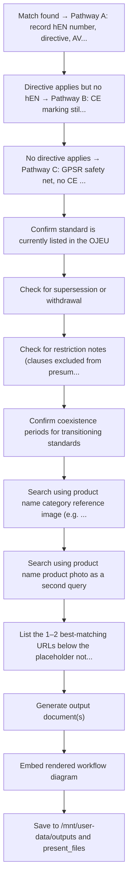

# QSD Generator (Verification-Driven) with Integrated hEN Lookup

> **Organisation Context**: A.R.E.N.A. Vietnam is a **sourcing office**, not a manufacturer. It sources non-food consumer products from suppliers (factories) and connects them to retail partners (HAGEBAU, ITM, BCM, DEDEMAN, JUMBO/Coop) across EU-27, EEA-3, Switzerland, Canada, and US markets. Any references to manufacturing or production processes in this skill refer to **supplier/factory operations** that A.R.E.N.A. oversees, specifies, audits, and validates as part of its Supply Chain Quality & Compliance function.

## Purpose

Generate a complete, inspection-ready Quality Single Document (QSD) for any product category. Output is verification-driven: every requirement maps to evidence, validity windows, and acceptance criteria. The QSD serves as the single reference document that QA engineers, inspectors, and compliance officers use to verify a product is market-ready.

**Integrated hEN Lookup**: This skill automatically identifies applicable harmonised European standards (hEN), determines the correct conformity declaration (DoC or DoP), conformity assessment module, AVCP system (for CPR products), and Notified Body requirements — feeding these directly into the QSD's regulatory requirements, special requirements, marking, and watch-out sections.

## When to Use

Trigger this skill when the user:
- Asks for a QSD or Quality Single Document
- Requests quality requirements or a quality specification for a product
- Needs a combined regulatory + inspection + verification document
- Wants to know what compliance and quality checks apply to a product category
- Asks for an inspection-ready quality document for EU, Canadian, US, and/or Swiss markets
- Mentions "QSD", "quality single document", "quality specification", "quality document"
- Requests supplier quality briefs or quality agreements for a specific product
- Asks for production control and inspection requirements for a product range
- References "Arena quality document", "Asia One quality", or project-specific quality documents (e.g., "Christmas range QSD")
- Asks which harmonised standard or hEN applies AND wants the full quality document
- Needs a QSD that includes DoC/DoP determination, AVCP system, or conformity module identification

## Workflow

```
User Request
     │
     ▼
Step 1: Collect Product & Market Inputs
     │
     ▼
Step 2: hEN Identification & Directive Stack ──► Read the embedded reference data in this SKILL.md
     │
     ├── hEN found → Pathway A (Harmonised + hEN) → DoC or DoP
     ├── Directive but no hEN → Pathway B (Harmonised, no hEN) → DoC
     └── No directive → Pathway C (GPSR Safety Net) → No CE / no DoC/DoP
     │
     ▼
Step 3: Assemble Regulatory Building Blocks (horizontal + sector-specific)
     │
     ▼
Step 4: Build QSD Sections (A through L) ──► Read /mnt/skills/public/docx/SKILL.md
     │
     ▼
Step 5: Generate .docx → Validate → Deliver
```

### Step 1: Collect Product & Market Inputs

Gather the following from the user (ask if not provided):

| Input | Description | Example |
|-------|-------------|---------|
| **Product name** | Full category name | CERAMIC SANITARYWARE |
| **Department** | One of the 5 A.R.E.N.A. departments | GARDEN / DIY / DECO / AUTO / BUILDING |
| **Product Family** | **QSD is generated at this level** — one family per QSD; look up in Product Category Master Reference | Outdoor Furniture |
| **Product Sub-Families covered** | List all sub-families that fall under this family (from Master Reference); these identify which QCPs will be linked to this QSD | Metal outdoor furniture · Wooden outdoor furniture · Wicker outdoor furniture · Resin Outdoor Furniture · Other outdoor furniture · Outdoor cushions · Spare parts outdoor furniture |
| **Risk category** | 1 (Low), 2 (Medium), 3 (High) | 2 (MEDIUM) |
| **Description / comments** | Regulatory definition and scope notes | WC pans + wash basins under CPR |
| **Power source** | None / Mains / Battery / Gas / Solar / Pneumatic | None |
| **Construction use?** | Permanently incorporated into construction works? | Yes |
| **Wireless/RF?** | Wi-Fi, Bluetooth, NFC, RF control? | No |
| **Markets** | Target markets (EU, specific member states, Canada, US, Switzerland) | EU; Croatia; Slovenia |
| **Retailers** | Which retail partners | HAGEBAU, DEDEMAN, JUMBO/Coop |
| **Revised by** | Author name | [Author] |
| **Ally validation** | Ally validator name (if applicable) | [Validator] |

> **⚠ DO NOT collect supplier/manufacturer/factory name.** The QSD is product-level, not supplier-specific. All manufacturer identification fields in the output document must remain as blank placeholders `[___]`.

Also collect **toggles** (defaults shown):
- Customer = HAGEBAU? → creates "REQUIREMENTS FOR ALL HAGEBAU" section + ally validation column
- Customer = JUMBO/Coop? → creates "REQUIREMENTS FOR ALL JUMBO / COOP" section
- Customer = ITM? → creates "REQUIREMENTS FOR ALL ITM" section
- Customer = BCM? → creates "REQUIREMENTS FOR ALL BCM" section
- Customer = DEDEMAN? → creates "REQUIREMENTS FOR ALL DEDEMAN" section
- Market = France? → triggers VOC A+ label + mineral oil packaging requirements
- Market = Switzerland? → triggers PrSG / Cassis de Dijon / MRA checks
- Market = US? → triggers CPSC / CPSIA / Prop 65 / state-level requirements
- Market = Canada? → triggers CCPSA / bilingual / CSA requirements
- Trigger in-line inspection? → only for Cat. 3 or big promo
- Include SPECIAL REQUIREMENTS section? → YES if hEN identified (auto-trigger)

### QSD → QCP Cross-Link Rule

Every QSD generates a **QCP obligation** for each product sub-family in its scope:

```
QSD-[DEPT]-[FAMILY]-NNN  →  QCP-[DEPT]-[SUBFAM-CODE]-NNN  (one per sub-family)
```

- Record the QSD reference number in the QSD header
- State in the QSD footer: "QCPs required for each sub-family listed in scope"
- When a QCP is later generated, it must cite this QSD number as its authority document
- If the user asks for a QCP after receiving a QSD, the QSD reference is pre-filled

### Step 2: hEN Identification & Directive Stack

**Read the embedded reference data in this SKILL.md** to identify applicable harmonised standards.

#### 2a. Directive Scope Decision Matrix

Match the product to applicable EU directives based on product characteristics. A product may fall under multiple directives simultaneously.

| Directive / Regulation | Scope Trigger | CE Marking | Declaration |
|------------------------|---------------|------------|-------------|
| **CPR** 305/2011 | Construction products with hEN or ETA | YES | **DoP** |
| **LVD** 2014/35/EU | Electrical equipment 50–1000V AC / 75–1500V DC | YES | DoC |
| **EMC** 2014/30/EU | Equipment with electrical/electronic components | YES | DoC |
| **MD** 2006/42/EC (until 19 Jan 2027) → **MR** (EU) 2023/1230 (from 20 Jan 2027) | Machinery, power tools, manual lifting assemblies (e.g. hand pallet trucks, jacks) | YES | DoC |
| **RED** 2014/53/EU | Radio equipment (Wi-Fi, Bluetooth, NFC, RF) | YES | DoC |
| **RoHS** 2011/65/EU | Electrical and electronic equipment | YES | DoC |
| **TSD** 2009/48/EC → Reg (EU) 2025/2509 (from 1 Jan 2030) | Toys — products for play by children <14 | YES | DoC |
| **PPE Reg** (EU) 2016/425 | Personal protective equipment | YES | DoC |
| **PED** 2014/68/EU | Pressure equipment PS > 0.5 bar | YES | DoC |
| **GAR** (EU) 2016/426 | Gas-burning appliances and fittings | YES | DoC |
| **ATEX** 2014/34/EU | Equipment for explosive atmospheres | YES | DoC |
| **Ecodesign** 2009/125/EC | Energy-related products per implementing regulation — lighting: **SLR (EU) 2019/2020** (battery-only exempt, Art. 2(44)) | YES | DoC |
| **Energy labelling** (EU) 2017/1369 | Lighting: **ELR (EU) 2019/2015** — light sources; containing products carry no label | n/a | EPREL + label |
| **Batteries** (EU) 2023/1542 | Battery-containing products (from 2027) | YES | DoC |

**Critical DoC/DoP Rule**: CPR = DoP (Declaration of Performance). All other CE directives = DoC (Declaration of Conformity). If a product falls under CPR AND another directive (e.g., electric radiator: CPR + LVD + EMC + RoHS), the CPR part requires DoP and the other directives each require DoC.

#### 2b. hEN Database Search

Search the embedded reference data in this SKILL.md by product name, EN standard number, or product category:
1. **Match found** → Pathway A: record hEN number, directive, AVCP/module, NB requirement, declaration type
2. **Directive applies but no hEN** → Pathway B: CE marking still required, DoC mandatory, higher documentation burden
3. **No directive applies** → Pathway C: GPSR safety net, no CE marking, no DoC/DoP

#### 2c. Build Directive Stack Table

For every product, create the directive stack showing each applicable directive and its hEN:

| Directive | hEN | Standard Title | Module / AVCP | NB? | Declaration |
|-----------|-----|----------------|---------------|-----|-------------|
| _Per product_ | _From database_ | | | | DoC or DoP |

This table feeds directly into Section E (REQUIREMENTS FOR ALL ALLIES), Section F (SPECIAL REQUIREMENTS), and Section H (MARKING).

#### 2d. Web Search Verification

**Always verify** the hEN database results with web search:
1. Confirm standard is currently listed in the OJEU
2. Check for supersession or withdrawal
3. Check for restriction notes (clauses excluded from presumption of conformity)
4. Confirm coexistence periods for transitioning standards

### Step 3: Assemble Regulatory Building Blocks

Select blocks based on the product category, target markets, and directive stack from Step 2.

#### EU Regulatory Building Blocks

| Block | Regulation / Standard | Trigger | Key Requirement Summary |
|-------|----------------------|---------|------------------------|
| GPSR | (EU) 2023/988 | ALL consumer products | General safety obligation; risk assessment; traceability; EU responsible person; incident reporting; Art. 9 economic operator obligations |
| REACH-SVHC | REACH 1907/2006 Art. 33 | ALL products | SVHC > 0.1% w/w → communicate down supply chain; check ECHA Candidate List at each update |
| REACH-Annex XVII | REACH 1907/2006 Annex XVII | Product-specific restrictions | Entries 23 (Cd), 27 (Ni release), 43 (azo dyes), 47 (Cr VI), 50 (PAH), 51 (phthalates), 63 (Pb), 68 (PFOA), 72 (CMR in textiles), 76 (tattoo inks) — select entries by product |
| POPs | (EU) 2019/1021 | Plastic/textile-containing products | PFOS, PFOA, PFHxS, DecaBDE, SCCP limits; check Annex I for current substance list |
| PFAS | Proposed EU PFAS restriction (ECHA) | Awareness — monitor for adoption | Universal PFAS restriction under REACH; not yet adopted but risk-flagged for textiles, coatings, non-stick |
| CPR | Regulation (EU) 305/2011 | Construction products under hEN | **DoP** mandatory; CE marking; AVCP system (1+/1/2+/3/4); notified body where required; hEN determines essential characteristics |
| LVD | Directive 2014/35/EU | Electrical 50–1000V AC / 75–1500V DC | Safety objectives Annex I; risk assessment; test to harmonised standard; **DoC**; CE marking |
| EMC | Directive 2014/30/EU | Electrical/electronic products | Emission + immunity; test to harmonised standard; **DoC**; CE marking |
| RoHS | Directive 2011/65/EU + delegated acts | EEE | 10 restricted substances (Pb, Hg, Cd, Cr VI, PBB, PBDE + 4 phthalates); exemptions in Annex III/IV; **DoC** |
| RED | Directive 2014/53/EU | Wireless/radio products | Essential requirements Art. 3; notified body for Art. 3(3); CE marking; **DoC** |
| Machinery | Directive 2006/42/EC (until 19 Jan 2027) → Regulation (EU) 2023/1230 (from 20 Jan 2027; regime by EU placing-on-market date) | Machines with moving parts; assemblies lifting loads by directly applied human effort | EHSR Annex I (MR Annex III); risk assessment EN ISO 12100; technical file; **DoC** (MR Art. 21: in box or URL); CE marking; Module A → no NB number, never "CE certificate". **No hEN cited under MR yet (Sep 2026)** → no Art. 20 presumption. Lifting machinery: static 1.5×/dynamic 1.1× rated load (4.1.2.3), tests on all units (4.1.3), rated-load marking (4.3.3). MR Art. 10(7) instructions (paper for DIY channel), MR Art. 13 importer marking |
| Toys | Directive 2009/48/EC → Regulation (EU) 2025/2509 (from 1 Jan 2030) | Products for/attractive to children <14 | EN 71 series; third-party testing; CE marking; **DoC**; new regulation adds digital product passport |
| PPE | Regulation (EU) 2016/425 | Personal protective equipment | Cat I (self-cert), Cat II (EU-type exam), Cat III (EU-type exam + ongoing); **DoC**; CE marking |
| Packaging | **Regulation (EU) 2025/40 (PPWR)** — applicable since 12 Aug 2026 (replaces Directive 94/62/EC; never cite PPWD as the applicable act) | ALL products (packaging) | Art. 5(4) Pb+Cd+Hg+Cr(VI) ≤ 100 mg/kg + packaging EU DoC/technical documentation (Art. 38–39) since 12 Aug 2026; Art. 12 harmonised labelling from the later of 12 Aug 2028 or 24 months after implementing acts; recyclability grades and recycled content per delegated acts / 2030+; EPR producer registration (national schemes until Art. 44 registers exist) |
| Candle | EN 15493/15494/15426 | Wax and LED candles | Safety, labelling, and specification; soot/flame behaviour; warning labels |
| CLP | Regulation (EC) 1272/2008 | Scented/chemical products | Classification, labelling, packaging of hazardous substances/mixtures; GHS pictograms; SDS |
| Food Contact | Regulation (EC) 1935/2004 + (EU) 10/2011 (plastic) | Articles with foreseeable food contact | Migration limits (OML/SML); DoC; traceability; GMP |
| Textile Label | Regulation (EU) 1007/2011 | Textile articles | Fibre composition %; harmonised fibre names; care labelling (ISO 3758 voluntary but expected by retailers) |
| Battery | Regulation (EU) 2023/1542 | Battery-containing products | Due diligence; carbon footprint (phased); collection/recycling; labelling with capacity, chemistry, collection symbol; QR code (from 2027) |
| WEEE | Directive 2012/19/EU | EEE | Producer registration; crossed-out wheelie bin marking; collection/recycling obligations |
| ErP / Ecodesign — lighting (SLR) | Regulation (EU) 2019/2020 as am. (EU) 2021/341; framework 2009/125/EC → ESPR (EU) 2024/1781 (transitional) | Products containing a light source that are **not** battery-operated per Art. 2(44) | Max. on-mode power; CRI, flicker, SVM, displacement factor, lumen maintenance; standby ≤ 0.5 W; replaceability in containing products; information requirements; DoC |
| Energy labelling — lighting (ELR) | Delegated Reg (EU) 2019/2015 under (EU) 2017/1369 | Same trigger as SLR | Light source sold alone: A–G label on packaging + EPREL before placing on market; containing product: no label, class of contained light source in user documentation |
| ESPR | (EU) 2024/1781 | Energy-related and other products as delegated acts are adopted | Product passport (phased); repairability; recyclability |
| Phytosanitary | Regulation (EU) 2016/2031 + ISPM 15 | Plant-based / natural material products | Phytosanitary certificate; ISPM 15 for SWPM; heat treatment / methyl bromide |
| Anti-dumping | Various Council Implementing Regulations | Product + origin specific | Candles ex-China ~60%; check EU AD register by CN code + country of origin |
| DWD | (EU) 2020/2184 | Materials in contact with drinking water | Positive list compliance for metals/polymers; migration limits |

#### Lighting products — SLR / ELR screen

*Added 2026-09-30 · aligned with `cptp-generator` rev 1.6 §7.3a. Applies to every
product that contains a light source: string lights, lanterns, luminaires,
illuminated décor, garden and solar lights, lit mirrors, products with an
integrated torch.*

**Instruments**
- **SLR** — Commission Reg (EU) 2019/2020, ecodesign for light sources and
  separate control gears, as amended by (EU) 2021/341. Implementing measure under
  Directive 2009/125/EC; remains in force under the ESPR (EU) 2024/1781
  transitional provisions. CE legislation — cited on the DoC.
- **ELR** — Delegated Reg (EU) 2019/2015, energy labelling of light sources,
  under Framework Reg (EU) 2017/1369. Not CE — evidence is EPREL registration and
  the label.
- Both applied from 1 Sep 2021. Exemptions: SLR Annex III · ELR Annex IV.

**Supply-mode rule — SLR Art. 2(44).** *Battery-operated* = operates **only** on
DC from a source contained in the same product, without being connected directly
or indirectly to the mains.

| Supply mode (confirm from P.I. / spec / sample) | SLR / ELR |
|---|---|
| Primary cells only, battery box integral to the product | **Exempt** — SLR Annex III 1(c) · ELR Annex IV 1(c) |
| Solar panel + integral rechargeable cell | **Exempt** — solar-powered garden lamps named in Annex III 1(c) |
| Rechargeable cell, product cannot light while charging | Exempt — keep the charging-mode check as evidence |
| USB / rechargeable product that can light while connected | **In scope** — indirect mains connection |
| External adapter / transformer (e.g. 24 V / 31 V strings) | **In scope** — indirect mains connection |
| Direct mains (plug or hard-wired) | **In scope** |

If the supply mode is not stated, **ask** — never default to exempt. The product
title ("battery string light") does not decide it.

**When in scope**
- **SLR Annex II** — maximum on-mode power (efficacy); functional requirements
  (CRI ≥ 80 unless excepted, flicker P<sub>st</sub>LM ≤ 1.0, stroboscopic SVM ≤ 0.4,
  displacement factor, lumen maintenance and survival factor); standby and
  networked standby ≤ 0.5 W; information requirements on product, packaging and
  website. Headline values are for LED mains light sources at full load — confirm
  against the consolidated Annex II. Verification tolerances: Annex IV.
- **Containing product** — light sources and separate control gear replaceable
  with commonly available tools without permanent damage, **or** a justification
  in the technical documentation; replaceability statement in user instructions.
- **ELR** — a light source sold on its own carries the A–G label on its packaging,
  a product information sheet and an **EPREL registration before placing on the
  market**. A containing product (string light with integrated LEDs, luminaire)
  carries **no energy label**; the energy class of the contained light source(s)
  is declared in the user documentation.

**When exempt** — record the exemption basis (Annex point), the supplier's
supply-mode declaration and, for rechargeables, the charging-mode check. The
exemption covers **SLR/ELR only**: GPSR, RoHS 2011/65/EU (CE + DoC), WEEE,
EMC where electronic controls are present, RED where radio is present, and
Battery Reg (EU) 2023/1542 still apply.

**Counterparts** — CH: Energy Efficiency Ordinance EnEV SR 730.02. GB: GB
lighting ecodesign and energy information regulations (SI 2021/1095 — verify
before citing); GB-format label; EPREL does not serve GB. NI: EU SLR/ELR and
EPREL apply. CA / US: screen NRCan Energy Efficiency Regulations 2016 and DOE
10 CFR 430 for regulated lamp types; for decorative and containing products
record "no equivalent obligation identified".

**Common errors**
1. Treating "battery-powered" in the title as exempt — USB, rechargeable-while-
   connected and adapter-fed products are in scope.
2. Raising a non-conformity for a missing energy label on a containing product —
   none is required.
3. Treating the exemption as "no CE" — RoHS, and EMC where applicable, still
   require CE marking and a DoC.

**Application in this skill**
- Directive stack (Section D2): list SLR + ELR as separate rows, **or** one exemption row citing SLR Annex III 1(c) / ELR Annex IV 1(c) — never both, never neither.
- Record the supply mode in the Step 1 inputs; ask if missing.
- Watch-out intelligence: carry common errors 1–3 into the QSD for every lighting family (Indoor lighting, Outdoor light, Lighting Fixtures, Xmas lights, solar/battery décor).

---

#### Canada Regulatory Building Blocks

| Block | Regulation / Standard | Trigger | Key Requirement Summary |
|-------|----------------------|---------|------------------------|
| CCPSA | S.C. 2010, c.21 | ALL consumer products | General safety prohibition; mandatory incident reporting; recall powers; traceability |
| CSA/cUL | CSA C22.2 series | Electrical products | Mandatory third-party certification by accredited body (CSA, cUL, cETL); certification mark on product |
| Surface Coating Pb | SOR/2016-302 | Coatings accessible to children | Pb ≤ 90 mg/kg total in surface coating materials |
| Glazed Ceramics | SOR/2016-175 | Glazed ceramic food-contact | Pb and Cd migration limits for flatware, hollowware, cups/mugs |
| TLA | Textile Labelling Act (R.S.C., 1985, c. T-10) | Textile articles | Fibre content % in EN + FR; generic fibre names per schedule; country of origin; dealer identification |
| CCCR | Consumer Chemicals and Containers Regulations | Hazardous consumer chemicals | Classification, container standards, labelling (English + French), child-resistant closures |
| ISED | RSS standards (ISED) | Wireless equipment | Radio Standards Specifications; certification or declaration |
| Bilingual | CPLA; OLA; Bill 96 (QC) | ALL — EN/FR mandatory | All consumer information, warnings, instructions, labels must be bilingual English + French |
| CFIA Plant | Plant Protection Act | Plant-based materials | Import permits; phytosanitary certificate; ISPM 15 for SWPM |
| Toys (CA) | SOR/2011-17 (Toys Regulations) | Toys | Mechanical, chemical (Pb, Hg, Cd, Sb, As, Ba, Se, total Pb), flammability, electrical; bilingual warnings |
| Phthalates | SOR/2016-188 (Phthalates Regulations) | Vinyl children's products | 6 phthalates ≤ 1000 mg/kg each in soft vinyl; products for children under 4 mouthing |

#### US Regulatory Building Blocks

| Block | Regulation / Standard | Trigger | Key Requirement Summary |
|-------|----------------------|---------|------------------------|
| CPSA | Consumer Product Safety Act (15 USC §2051) | ALL consumer products | General safety; substantial product hazard reporting (§15(b)); recall authority |
| CPSIA | Consumer Product Safety Improvement Act 2008 | Children's products (≤12 yrs) | Total Pb ≤ 100 ppm (substrate), Pb in paint ≤ 90 ppm; phthalates (8P ≤ 1000 ppm); mandatory third-party testing; CPC; tracking labels |
| ASTM F963 | ASTM F963 (Toy Safety) | Toys (mandatory via CPSIA §106) | Mechanical/physical, flammability, chemical (soluble elements); mandatory third-party testing |
| GCC | General Certificate of Conformity (16 CFR 1110) | Non-children's consumer products | Self-certification to applicable rules; GCC issued by importer/domestic manufacturer |
| CPC | Children's Product Certificate (16 CFR 1107) | Children's products (≤12 yrs) | Must be based on third-party testing by CPSC-accepted lab; 8 required elements |
| Prop 65 | California Proposition 65 | ALL products sold in California | Warning label for listed chemicals above NSRL/MADL; safe harbor warnings |
| TSCA | Toxic Substances Control Act (15 USC §2601) | Chemical substances in products | EPA authority; PFAS reporting; formaldehyde emission standards for composite wood (Title VI) |
| UL/ETL | UL standards | Electrical products | Voluntary but effectively required by US retailers and AHJs; NRTL certification mark |
| FCC | FCC Part 15/18 | Electronic/radio devices | EMC compliance; FCC ID or SDoC; labelling |
| FHSA | Federal Hazardous Substances Act | Hazardous household products | Labelling; banned hazardous substances; children's articles restrictions |
| Lacey Act | 16 USC §3371 | Plant-based/wood products | Declaration of plant species, country of harvest; due diligence on legal sourcing |
| State chemicals | Various (CA Prop 65, WA CHCC, ME PFAS, etc.) | State-specific chemical restrictions | Monitor state-level emerging restrictions |

#### Switzerland Regulatory Building Blocks

| Block | Regulation / Standard | Trigger | Key Requirement Summary |
|-------|----------------------|---------|------------------------|
| PrSG | Product Safety Act (SR 930.11) | ALL consumer products | General safety obligation; presumption of conformity if EU harmonised standards applied |
| MRA | CH–EU Mutual Recognition Agreement | Products covered by MRA chapters | Chapters cover machinery, LVD, EMC, PPE, construction products; check chapter currency |
| Cassis de Dijon | Federal Act on Technical Barriers to Trade (SR 946.51, Art. 16a–16g) | Products lawfully marketed in EU/EEA | Products compliant in one EU/EEA state may be placed on Swiss market; exceptions apply |
| ChemRRV | Chemical Risk Reduction Ordinance (SR 814.81) | Chemical restrictions | Swiss REACH-equivalent; may diverge from EU REACH on transposition timing |
| VGV | Ordinance on Electrical Equipment (SR 734.26) | Electrical products | Aligned with EU LVD; ESTI oversight; Swiss importer obligations |
| Swiss Importer | PrSG Art. 6a–6g | ALL — if no EU responsible person acceptable | Swiss importer/representative may be required |

### Step 4: Build QSD Sections

Assemble the document following the **Required Output Structure** exactly. The QSD has **9 mandatory sections** plus optional retailer-specific and special requirements sections:

| Section | Title | Header Style | Description |
|---------|-------|-------------|-------------|
| **A** | Version / Revision Table | No coloured header | 4-column revision control table |
| **B** | PRODUCT | Heading 1 — Orange `#ED7D31` | Product metadata table with identifiers |
| **C** | PRODUCT EXAMPLE PICTURES | Heading 1 — Orange `#ED7D31` | Placeholder area for product images + 1–2 web-searched image reference URLs (auto-searched at generation time using product name and category keywords; embed URLs as clickable references below the placeholder note) |
| **D** | REQUIREMENTS | Heading 2 — Blue `#2E74B5` | Section header only + note about accredited labs |
| **D2** | hEN DIRECTIVE STACK | Heading 2 — Blue `#2E74B5` | **NEW** — Directive stack table from Step 2 showing hEN, module, NB?, DoC/DoP |
| **E** | REQUIREMENTS FOR ALL ALLIES | Heading 1 — Orange `#ED7D31` | 2-column: REGULATIONS & STANDARDS / REQUIREMENTS |
| **F** | SPECIAL REQUIREMENTS — [hEN Topic] | Heading 1 — Orange `#ED7D31` | Product-specific hEN essential characteristics (auto-populated from Step 2) |
| **G** | REQUIREMENTS FOR ALL [RETAILER] | Heading 1 — Orange `#ED7D31` | One section per retailer — 2-column table |
| **H** | MARKING & MARKET REQUIREMENTS | Heading 1 — Orange `#ED7D31` | Mandatory markings per regulation, market, and retailer — **DoC/DoP auto-populated** |
| **I** | PRODUCTION CONTROL | Heading 2 — Blue `#2E74B5` | In-line inspection triggers, AQL levels, authorized 3rd parties; **FPC for CPR products** |
| **J** | GENERAL INSPECTION | Heading 1 — Orange `#ED7D31` | 3-column: Check item / Description contents / Sample size |
| **K** | SHIPMENT RELEASE CERTIFICATE | Heading 1 — Orange `#ED7D31` | SRC conditions and policy |
| **L** | WATCH OUT !!! | Heading 2 — Blue `#2E74B5` | Historical issues, CE/DoC/DoP/technical file requirements, classification guidance, **hEN status warnings** |
| **M** | LAB TESTING REPORTS — TCF VALIDATION CALL | Heading 2 — Blue `#2E74B5` | Auto-generated summary table of ALL required accredited-lab test reports derived from the regulatory building blocks; serves as the formal TCF document gate trigger and pre-SRC blocking condition — **INCOMPLETE TCF = SRC BLOCKED** |

#### Section D2 — hEN DIRECTIVE STACK (NEW)

This section is populated automatically from Step 2 and provides the foundation for Sections E, F, H, and L. Table format:

| Directive / Regulation | hEN | Standard Title | Module / AVCP | NB Required? | Declaration | Pathway |
|------------------------|-----|----------------|---------------|-------------|-------------|---------|
| _Auto from Step 2_ | | | | | DoC / DoP / None | A / B / C |

Include a summary paragraph below the table:
- **Pathway A products**: "[Product] is covered by [directive] with hEN [EN XXXXX:YYYY]. [DoC/DoP] is mandatory. Conformity module [X] applies. [NB required / not required]."
- **Pathway B products**: "[Product] falls under [directive] but no product-specific hEN exists. [DoC] is still mandatory. Manufacturer must justify compliance route through alternative standards."
- **Pathway C products**: "[Product] is not covered by any sector-specific CE directive. No CE marking required. GPSR 2023/988 applies as the safety net."

#### Section C — PRODUCT EXAMPLE PICTURES (Updated)

Insert a note paragraph: *"[ Insert product reference photographs here ]"*

Then add 1–2 image reference URLs obtained via web search at generation time:
1. Search using `{product name} {category} reference image` (e.g. "wood pellets 15kg bag retail")
2. Search using `{product name} product photo` as a second query
3. List the 1–2 best-matching URLs below the placeholder note as a labelled reference row in the section table: **"Web Image Reference 1:"** `[URL]` and optionally **"Web Image Reference 2:"** `[URL]`
4. These URLs serve as visual reference anchors for QC inspectors and artwork review — they are NOT embedded images; they are clickable text references

#### Section M — LAB TESTING REPORTS / TCF VALIDATION CALL

This section is the **TCF gate trigger**. It consolidates every test report obligation derived from Sections D2, E, and F into a single actionable checklist. An inspector or QS officer uses this section as the master document gate before issuing any SRC.

**Table format** (5 columns):

| # | REPORT / DOCUMENT | STANDARD / BASIS | VALIDITY | TCF STATUS |
|---|---|---|---|---|
| _Auto from Sections D2 + E + F_ | | | | ☐ Pending / ✓ Received / ✗ Expired |

**Build rules:**
1. One row per distinct test report or certificate type — do NOT collapse multiple standards into one row
2. Derive rows automatically from every requirement in Section E and Section F that specifies "test report", "certificate", "CoA", or "accredited lab"
3. Validity column: use "2 years from issue date" as default unless the standard or retailer requirement specifies otherwise (e.g. OEKOTEX = 1 year; ENplus = annual audit; batch CoA = per lot)
4. Status column: leave as "☐ Pending" — to be updated order-by-order in the SRC workflow
5. Final mandatory row: **GPSR Art. 9 Product Safety Information File** — always include regardless of pathway
6. Mandatory footer note below the table (bold red): **"INCOMPLETE TCF = SRC BLOCKED. All ☐ Pending rows must be resolved before Shipment Release Certificate (SRC) can be issued."**

**Example rows for a Pathway A CE product (LED lighting):**
- EN 60598-2-20 Safety Test Report — 2 years
- EN 55015 EMC Test Report — 2 years
- EN IEC 63000 RoHS Test Report — 2 years
- REACH SVHC Declaration — Annual / on candidate list update
- Azo Dye Test Report (if applicable) — 2 years
- GPSR Art. 6 Risk Assessment — On change
- EU DoC (signed) — On change / per shipment
- GPSR Art. 9 Product Safety Information File — Ongoing

**Example rows for a Pathway C GPSR-only product (wood pellets):**
- EN ISO 17225-2:2021 Batch CoA (moisture, ash, durability, bulk density, fines, NCV) — Per lot
- EN ISO 16968 Heavy Metals CoA — Quarterly or on source change
- ENplus A1 / DINplus Certificate — Annual renewal
- REACH SVHC Declaration — Annual
- PPWR Packaging DoC — On change
- GPSR Art. 6 Risk Assessment — On change
- GPSR Art. 9 Product Safety Information File — Ongoing

#### Sections A–C, E–L — As Per Original Structure

See the embedded reference data in this SKILL.md for the complete section-by-section build instructions including:
- Section A (Version/Revision), B (Product), C (Pictures), D (Requirements header)
- Section E (Requirements for All Allies) — now enhanced with hEN-derived regulations
- Section F (Special Requirements) — now auto-triggered when hEN is identified, populated with essential characteristics per the hEN Annex ZA (for CPR) or directive essential requirements
- Section G (Retailer-specific) — per original structure
- Section H (Marking) — now auto-includes DoC or DoP row based on directive stack, with correct declaration type and content requirements
- Section I (Production Control) — now includes FPC requirements for CPR System 4 products
- Section J (General Inspection) — enhanced with hEN-specific test checks
- Section K (SRC) — enhanced with DoP/DoC as release condition
- Section L (Watch Out) — now includes hEN supersession warnings, restriction notes, coexistence periods

### Step 5: Generate .docx Output

Read the docx skill (`/mnt/skills/public/docx/SKILL.md`) FIRST, then produce the document. Format specifications:

- **Page**: US Letter (12240 x 15840 DXA) with margins: top 1440, right 1440, bottom 851, left 1440 DXA
  → **Printable content width = 12240 − 1440 − 1440 = 9360 DXA. Every table's `width` AND its `columnWidths` must sum to exactly 9360 DXA — never more.** Do not use a wider "bleed" table width (e.g. ~11520 DXA) without also setting a matching negative `indent` on the *same* `Table` object (`indent: { size: -X, type: WidthType.DXA }` in docx-js) — a table wider than 9360 DXA with no `indent` set will overflow past the right edge of the page. The simplest and safest approach is to always size tables to exactly 9360 DXA and skip `indent` entirely.
- **Font**: Arial throughout; body 10pt (sz=20); table text 10pt; section headers bold
- **Header**: 3-column table spanning the full 9360 DXA content width (columns must sum to 9360, e.g. 1000 / 7360 / 1000):
  - Column 1 (~1000 DXA): A.R.E.N.A. logo placeholder (or bold text "ARENA")
  - Column 2 (~7360 DXA): "QUALITY SINGLE DOCUMENT – [PRODUCT NAME]" — cell background `#5B9BD5`, bold 16pt (sz=32) Calibri, product name in red `#FF0000`
  - Column 3 (~1000 DXA): "VERSION [X.X]" — cell background `#5B9BD5`, bold Calibri
- **Tables**: Full borders (TableGrid style); table width 9360 DXA (matches content width exactly, no indent needed); use `WidthType.DXA` always; set both `columnWidths` and cell `width`, and confirm every `columnWidths` array sums to 9360 before rendering
- **Section header format**: Each section header is the first row of its table, full-width merged cell with coloured background, containing the section title in bold white uppercase text
- **Section header colours** (white bold text on coloured cell background):
  - Heading 1 sections (Orange `#ED7D31`): PRODUCT, PRODUCT EXAMPLE PICTURES, REQUIREMENTS FOR ALL ALLIES, SPECIAL REQUIREMENTS, REQUIREMENTS FOR ALL [RETAILER], MARKING & MARKET REQUIREMENTS, GENERAL INSPECTION, SHIPMENT RELEASE CERTIFICATE
  - Heading 2 sections (Blue `#2E74B5`): REQUIREMENTS, hEN DIRECTIVE STACK, PRODUCTION CONTROL, WATCH OUT !!!
- **Column header rows** (where applicable): Bold text, no special background shading
- **Body text**: Arial 10pt (w:sz val="20"); cell margins 50/80 DXA; use `ShadingType.CLEAR`
- **Bullet lists inside cells**: Use proper numbering config with `LevelFormat.BULLET`, never unicode bullets
- **After generation**: Validate with `python scripts/office/validate.py [filename].docx`

### Output Checklist

Before delivering, verify:
- [ ] Version/Revision table present with author, validator, dates
- [ ] PRODUCT section has all metadata rows
- [ ] PRODUCT EXAMPLE PICTURES placeholder present **+ 1–2 web image reference URLs listed below placeholder**
- [ ] REQUIREMENTS header (blue) with accredited lab note
- [ ] **hEN DIRECTIVE STACK section (blue) with directive/hEN/module/NB/declaration table — auto-populated from Step 2**
- [ ] REQUIREMENTS FOR ALL ALLIES populated from regulatory building blocks with 2-column format
- [ ] **SPECIAL REQUIREMENTS populated with hEN essential characteristics when Pathway A (auto-triggered)**
- [ ] One "REQUIREMENTS FOR ALL [RETAILER]" section per requested retailer
- [ ] **MARKING section includes DoC row (for non-CPR CE products) or DoP row (for CPR products) — auto-determined**
- [ ] CE marking row present whenever product is subject to EU harmonised legislation
- [ ] EU Responsible Person marking row present for all EU-market products (GPSR 2023/988)
- [ ] Market-specific markings included
- [ ] PRODUCTION CONTROL section with AQL levels; **FPC requirements for CPR products**
- [ ] GENERAL INSPECTION table with standard + product-specific checks
- [ ] SHIPMENT RELEASE CERTIFICATE section; **DoP/DoC listed as release condition**
- [ ] **WATCH OUT section includes hEN status warnings (supersession, restrictions, coexistence)**
- [ ] **Section M present: LAB TESTING REPORTS / TCF VALIDATION CALL table with one row per required test report/certificate; validity column populated; status column as ☐ Pending; mandatory footer "INCOMPLETE TCF = SRC BLOCKED" present**
- [ ] Header shows "QUALITY SINGLE DOCUMENT – [PRODUCT]" with blue background
- [ ] All tables extend full page width
- [ ] **Every table's `columnWidths` array sums to exactly 9360 DXA (US Letter content width) — no table wider than the page without a matching negative `indent`**
- [ ] **Rendered to PDF and visually checked (`soffice.py --headless --convert-to pdf` then `pdftoppm`) to confirm no table is clipped or overflowing off the right edge of the page**
- [ ] .docx validated successfully

## Reference Files

| File | When to Read | Content |
|------|-------------|---------|
| the embedded reference data in this SKILL.md | **Always at Step 2** — before identifying regulations | Complete harmonised standard database by directive: EN number, title, product scope, AVCP system, conformity module, declaration type (DoC/DoP), NB requirement, A.R.E.N.A. department mapping |
| the embedded reference data in this SKILL.md | **Always at Step 4** — before building sections | Detailed section-by-section build instructions for Sections A–L including content templates, retailer requirements, marking building blocks, inspection checks, SRC text, watch-out guidance |

## Key Principles

1. **Verification-driven**: Every requirement must specify: What evidence? What validity? What acceptance criteria?
2. **Regulation-anchored**: Every requirement row cites a specific regulation or standard — never "best practice" alone
3. **hEN-first**: Always identify the applicable harmonised standard BEFORE building the QSD. The hEN drives the directive stack, declaration type, conformity module, essential characteristics, and testing roadmap
4. **CPR = DoP, everything else = DoC**: Construction products under CPR 305/2011 declare performance (DoP). All other CE directives require a Declaration of Conformity (DoC). Never confuse the two
5. **hEN ≠ EN**: Not all EN standards are harmonised. Only standards published in the OJEU under a specific directive give presumption of conformity. Always verify OJ listing via web search
6. **Inspection-ready**: An inspector with only this document should be able to verify compliance at the factory
7. **Ally-then-retailer separation**: Common requirements go in "FOR ALL ALLIES"; retailer-specific extras go in dedicated retailer sections
8. **Evidence lifecycle**: All test reports and certificates must come from accredited labs; standard validity is 2 years unless otherwise specified
9. **Multi-directive stacking**: A single product may require multiple hEN across different directives. Each directive's hEN is independent and must be listed separately in the directive stack
10. **Always verify hEN currency**: Check for supersession, withdrawal, restriction notes, and coexistence periods via web search. Include warnings in the WATCH OUT section
11. **Quad-market awareness**: Even when generating for a single market, flag divergences for other markets
12. **Regulatory currency**: Flag transitional provisions (CPR 2024, Toys Reg 2025/2509, Machinery Reg 2023/1230, PPWR staging). Run the Step 0 regulatory cross-check of `master-quality-compliance-guidelines` before generating: never cite repealed acts as applicable (GPSD 2001/95/EC → GPSR; PPWD 94/62/EC → PPWR); verify hEN citation status under MR; log open items as "verify"
13. **Supplier/manufacturer name NOT required**: The QSD is a product-level quality reference document — it is NOT supplier-specific. NEVER ask for or collect supplier/manufacturer/factory names as inputs. Where EU regulations require manufacturer identification fields (CE marking, DoC, DoP, technical file), always leave these as blank placeholders: `[___]`. The QSD defines WHAT is required; the specific supplier identity is populated later in order-specific documents (SRC, DoC, DoP, artwork). This ensures the QSD remains reusable across multiple suppliers for the same product category
14. **Bilingual EN/VI on request**: when the QSD is for Vietnamese factory/QC use, apply the *Bilingual EN/VI Mode* of `master-quality-compliance-guidelines` (VI beneath EN, references untranslated, shared glossary)

## Retailer-Specific Requirements Quick Reference

| Retailer | Key Requirements |
|----------|-----------------|
| **HAGEBAU** | OEKOTEX Standard 100 (babies); DIN 53160 colour resilience; EN ISO 6330 washing; German-language; DOP download note on packaging; ally validation sign-off GS mark (ProdSG) when ordered — GS body test incl. AfPS GS 2019:01 PAK, factory inspection, § 24 importer record (process in `master-quality-compliance-guidelines`) |
| **ITM** | French-language; Intermarché/Bricomarché artwork specs; VOC A+ if applicable |
| **BCM** | Market-specific per destination country |
| **DEDEMAN** | Romanian-language; Romanian market regulatory specifics |
| **JUMBO/Coop** | Swiss trilingual (DE/FR/IT); PrSG compliance; Swisstec OEM arrangements; Swiss importer identification; product-specific annexes |

## Example Interactions

**User**: "Create a QSD for ceramic sanitaryware WC pans and wash basins, Risk 2, EU, HAGEBAU + DEDEMAN"

**Claude**:
1. Reads this skill → reads the embedded reference data in this SKILL.md
2. **hEN identification**: WC pans → EN 997:2018 under CPR 305/2011, AVCP System 4, no NB, **DoP required**. Wash basins → EN 14688:2015+A1:2018 under CPR 305/2011, AVCP System 4, no NB, **DoP required**
3. Builds directive stack table with both hEN entries
4. Assembles regulatory blocks: CPR, GPSR, REACH (Pb in glazes Entry 63), DWD (drinking water contact), PPWR
5. SPECIAL REQUIREMENTS: EN 997 essential characteristics (flush volume, flushing solids, bowl washing, static load 4kN, water absorption ≤0.5%); EN 14688 essential characteristics (static load 1.5kN, overflow, thermal shock, chemical resistance, Mohs hardness)
6. MARKING: CE marking + **DoP** reference (NOT DoC) + manufacturer + EU RP
7. PRODUCTION CONTROL: FPC requirements for AVCP System 4 (raw material, kiln, in-process, type testing, calibration)
8. WATCH OUT: CPR 2024 transition; Pb in glazes; DWD compliance; rimless WC test methodology; **hEN status: EN 997:2018 active, supersedes EN 997:2012+A1:2015**

**User**: "QSD for LED string lights, Risk 2, EU + Canada + US, HAGEBAU"

**Claude**:
1. Reads this skill → reads the embedded reference data in this SKILL.md
2. **hEN identification**: String lights → EN 60598-2-20 under LVD, Module A, no NB, **DoC**; EN 55015 under EMC, Module A, **DoC**; EN IEC 63000 under RoHS, Module A, **DoC**. Multi-directive → combined DoC
3. Directive stack: LVD + EMC + RoHS + WEEE + ErP + GPSR + CCPSA/CSA (CA) + CPSC/UL/FCC (US)
4. SPECIAL REQUIREMENTS: EN 60598-2-20 test requirements (insulation, IP rating, temperature rise, mechanical, abnormal)
5. MARKING: CE marking + **DoC** (combined for LVD + EMC + RoHS) + CSA mark (CA) + UL mark (US) + FCC (US)
6. WATCH OUT: EU/CA/US electrical certifications NOT interchangeable; **hEN status verification**

**User**: "QSD for garden hand tools, Risk 1, EU + Switzerland, JUMBO/Coop"

**Claude**:
1. Reads this skill → reads the embedded reference data in this SKILL.md
2. **hEN identification**: Garden hand tools → no CE directive applies → **Pathway C (GPSR Safety Net)**. No hEN, no CE marking, no DoC/DoP
3. Directive stack table shows: No sector-specific directive; GPSR as primary
4. Assembles blocks: GPSR, REACH (PAH Entry 50 for rubber grips, Ni Entry 27 for metal), PPWR, PrSG (Switzerland)
5. NO SPECIAL REQUIREMENTS section (no hEN)
6. MARKING: No CE marking; EU RP; manufacturer; Swiss importer
7. WATCH OUT: PAH limits for rubber grips; anti-dumping check; **no hEN = Pathway C confirmed**

---

## Product Category Master Reference

> **Source**: A.R.E.N.A. Vietnam canonical product taxonomy (Product_Category.xlsx).
> Use this table to validate user inputs and resolve ambiguous product names.

### Hierarchy Rule — QSD vs QCP scope

```
Department  →  Product Family          →  Product Sub-Family
(context)      (QSD generated here)       (QCP generated here)
               one QSD per family          one QCP per sub-family
```

When the user names a **sub-family**, look up its parent **Product Family** in this
table and generate the QSD at the family level, listing all sub-families as the scope.

---
#### Department: **AUTO** — doc-code `AUTO`

**Product Family: Automotive** ← *QSD scope*

Sub-Families (each → QCP): Automotive personal protection · Bikes & Bicycle accessories · Car Batteries · Car Bulbs · Car Wiper · Car mats · Jack stand and trolley jack · Lubricants · Other car accessories · Windshield Washer Fluid (Lave Glace)

---
#### Department: **BUILD** — doc-code `BUILDING`

**Product Family: Construction** ← *QSD scope*

Sub-Families (each → QCP): Bricks, Cinder Blocks · Building aggregate · Cement fencing · Concrete Glue / Binding Powder · Concrete Mixers & masonry & Wheelbarrows · Crackfiller · Custom cut isolation · Glass · Glass block · Insulation · Mortar & Concrete · Other construction · Plaster board and tiles · Powder Base Glue · Rebar · Roof covering · Sanitation and piping · Shingles & access. · Stone / Granit · Tiles glue · Timber

**Product Family: Joinery** ← *QSD scope*

Sub-Families (each → QCP): Ceiling windows · Edge bands · Metal Doors & frames · Metal gate · Plastic lattice · Plastic lattice paneling · Spare parts Outdoor woodwork · Treatment · Windows · Wooden Doors & frames · Wooden gate · indoor woodwork · outdoor woodwork

**Product Family: Ladder** ← *QSD scope*

Sub-Families (each → QCP): Folding staircases · Ladders & Step Ladders · Other ladder · Scafolding

**Product Family: Lumber** ← *QSD scope*

Sub-Families (each → QCP): Custom cut lattice · Floor Slabs · Moulds · Other wooden pannels · Outdoor timber · Plywood · Saw Horses Wood/Metal · Staircases

---
#### Department: **DECO & ARRANGMENT** — doc-code `DECO`

**Product Family: Creative arts** ← *QSD scope*

Sub-Families (each → QCP): Creative arts

**Product Family: Decoration access.** ← *QSD scope*

Sub-Families (each → QCP): Blinds & curtains · Curtain rods & accessories · Decoration wood & accessories · Handles · Indoor cushions · Mirrors, picture frames · Other decoration accessories

**Product Family: Exterior paint** ← *QSD scope*

Sub-Families (each → QCP): Paint Facade

**Product Family: Floor & Wall Covering** ← *QSD scope*

Sub-Families (each → QCP): Bar threshold · Baseboard · Carpet and rug · Ceramic tiles wall and floor · Hardwood Flooring · Interior wood · Laminated Flooring · Other wall and floor covering · Vinyl

**Product Family: Household** ← *QSD scope*

Sub-Families (each → QCP): Brooms & brushes · Doormat · Drying Rack & Ironing Board (Séchoir et Table à repasser · Garbage bags (Sacs poubelle) · Indoor candles · Moving boxes (Carton de déménagement) · Other household

**Product Family: Indoor furniture** ← *QSD scope*

Sub-Families (each → QCP): Closet Door, Arrangements & Wardrobe · Counter Tops · Furniture · Kitchen and bathroom furniture · Melamine Boards (Tablettes Mélaminées) · Metal Shelves · Other storage · Plastics Shelves (Etagères Plastiques) · Woodden shelves

**Product Family: Interior paint** ← *QSD scope*

Sub-Families (each → QCP): Other Paint · Paint All in one · Paint PL Interior · Paint PL White · Paint Underlay · Paint Wood and ground

**Product Family: Lighting** ← *QSD scope*

Sub-Families (each → QCP): Indoor lighting · Light bulbs · Lighting Fixctures · Outdoor light

**Product Family: Material Treatment** ← *QSD scope*

Sub-Families (each → QCP): Cleaning and care product · Glue · Glue Support preparations · PU Foam and silicon · Tape · Wood protection & Finishing

**Product Family: Paint Accessories** ← *QSD scope*

Sub-Families (each → QCP): Colorant · Other paint accessories · Paint brushes & rollers · Spray paint · Tint machine · Wallpaper table

**Product Family: Sanitary** ← *QSD scope*

Sub-Families (each → QCP): Bathroom and toilet accessories · Faucets & taps · Garborator/griding · Kitchen Sinks · Kitchen accessories · Shower · Shower enclosure and cabin · Sinks, basin, bath tube, toilet block · Spare parts sanitary

**Product Family: Specific paint** ← *QSD scope*

Sub-Families (each → QCP): Paint Iron&Metal Underlay

---
#### Department: **DIY** — doc-code `DIY`

**Product Family: Cooling** ← *QSD scope*

Sub-Families (each → QCP): Air conditioner · Ceiling fan · Fan · Humidifier / dehumidifier · Other cooling & ventilation · Spare parts cooling

**Product Family: Electricity** ← *QSD scope*

Sub-Families (each → QCP): Alarm & Home automation · Batteries & accessories · Cable Reels / Cords / Socket Sets · Cable and winding · Camping lights, flash lights · Electrical Conduits (Gaines) · Electrical modular equipement · Other electricity · Switch and socket · Video, Audio, & telephone accessories

**Product Family: Hand Tools** ← *QSD scope*

Sub-Families (each → QCP): Caulking tools · Clamps · Hammer · Masonry tools · Measuring · Other hand tool · Personal protection · Pliers · Plumbing tools · Saws · Screwdriver & bit boxes · Staplers staples · Storage / Moving · Tiling tools · Wrenches & keys

**Product Family: Hardware** ← *QSD scope*

Sub-Families (each → QCP): Anchors/Plugs · Builder hardware · Cellar Items · Chain & Ropes · Fixing hardware (screws, nails, nuts…) · Locks & padlocks · Lumber Connecters (Connecteurs) · Mails boxes · Metal storage · Other hardware · Profil system(Systeme Profilé) · Safe · Security signs · Wheels & Castors (Roues Et Roulettes)

**Product Family: Heating** ← *QSD scope*

Sub-Families (each → QCP): Boilers (Gas&Electric) · Combustibles · Convector and radiators · Cooker hood · Fan heater · Fire place · Fire place accessories · Gaz patio heater · Isolation · Oil filled radiator · Other heaters · Pellet (Pellet) · Radiating panel · Smoke pipes · Steel & Aluminium Heaters · Stoves (Wood, Gaz, Fuel, pellet, …)

**Product Family: Plumbing** ← *QSD scope*

Sub-Families (each → QCP): Construction Faucets · Copper&brass · Gas fittings · PVC & PE Fittings · Sanitary piping, mecanism & waist · Sleeves & Piping Fixtures · Various Plumbing Accessories (Washing…) · Water Heaters · Water treatment

**Product Family: Power tools** ← *QSD scope*

Sub-Families (each → QCP): Abrasive · Air powered tool · Angle grinder, router · Battery Angle grinder, router · Battery Pneumatic rotary hammer · Compressor and accessories · Cord drill & impact drill · Cordless drill, cordless tools · Drill bits · Generator · Guns (Glue, hot air, staples …) · High pressure cleaner · One battery · Other power tool · Pneumatic rotary hammer · Power tool accessories · Sander (finishing, belt, delta ..), planer · Saws (jig, Mitre circular) and tile cuter · Spare parts power tool · Stationary power tool (Table saw, bench drill, bench grinder) · Vaccum cleaner (wet & dry) · Welding tools and access.

---
#### Department: **GARDEN** — doc-code `GARDEN`

**Product Family: Barbecue** ← *QSD scope*

Sub-Families (each → QCP): BBQ accessories · Charcoal BBQ · Electrical BBQ · Gas BBQ · Stone / cement BBQ

**Product Family: Camping** ← *QSD scope*

Sub-Families (each → QCP): Camping

**Product Family: Garden Equipment** ← *QSD scope*

Sub-Families (each → QCP): Anti-pest · Composter · Fences & accessories · Fencing · Garden hand tools · Garden personal protection · Green houses · Hatchet & Axes · Heavy garden hand tool · Horticultural products · Other garden equipment · Plants protection · Pole anchors · Sprayers · Tarpaulins · Watering Accessories & connectors · Watering hoses

**Product Family: Garden decoration** ← *QSD scope*

Sub-Families (each → QCP): Arrangements / accessories water treated · Composite wood · Garden Plastic shed · Garden tile · Metal garden sheds · Other garden decoration · Other wood · Outdoor candles and torch · Ponds · Pots, support and accessories plastic · Stone Furniture · Synthetic grass · Terracota and glazed Pots & supports · Treated wood · Wooden pots & accessories · Wooden sheds and carport

**Product Family: Gardend Power tools** ← *QSD scope*

Sub-Families (each → QCP): Cordless garden power tool · Electrical Garden power tool · Garden power tool accessories · Gasoline garden power tool · Spare parts garden power tool · Water pumps

**Product Family: Gifts - Flowers** ← *QSD scope*

Sub-Families (each → QCP): Gifts - Artificial Flowers

**Product Family: Outdoor Furniture** ← *QSD scope*

Sub-Families (each → QCP): Metal outdoor furniture · Other outdoor furniture · Outdoor cushions · Resin Outdoor Furniture · Spare parts outdoor furniture · Wicker outdoor furniture · Wooden outdoor furniture

**Product Family: Pet** ← *QSD scope*

Sub-Families (each → QCP): Live animals · Pet food · Pet items

**Product Family: Phytosanitary & fertilizers** ← *QSD scope*

Sub-Families (each → QCP): Fertilizer · Soil

**Product Family: Plants** ← *QSD scope*

Sub-Families (each → QCP): Plants

**Product Family: Playset & recreation** ← *QSD scope*

Sub-Families (each → QCP): Outdoor game

**Product Family: Pools** ← *QSD scope*

Sub-Families (each → QCP): Electrical pools accessories · Non electrical pool accessories · Pools · Spare parts pools

**Product Family: Sun protection** ← *QSD scope*

Sub-Families (each → QCP): Awning · Gazebo · Umbrella · other sun protection · spare parts sun protection

**Product Family: Xmas decorations** ← *QSD scope*

Sub-Families (each → QCP): Battery operated moving characters, train · Indoor Electrical X'mas decoration · Non elec. Xmas deco · Outdoor Electrical Xmas decoration

> **hEN verification preflight (v-note):** the former `references/hen-database.md` is superseded — always verify standard versions via `/mnt/skills/user/harmonised-standard-lookup/SKILL.md` (VERSION_DB v2.0, OJ-anchored) before embedding any hEN citation.

---

## Workflow Diagram



### Rendering the Workflow Diagram into Output

1. Save the diagram block above to a `.mmd` file.
2. Render to PNG via `mmdc` (mermaid-cli):
   `mmdc -i workflow.mmd -o workflow.png -b white -w 1400 -s 2`
   (if Chrome isn't found by default, pass `-p puppeteer_config.json` with
   `{"executablePath":"<path to chrome>","args":["--no-sandbox"]}` — locate a
   Chrome/Chromium binary already on the system first, e.g. under
   `~/.cache/puppeteer/chrome/`).

3. **.docx** — insert the PNG with `ImageRun` (docx-js), sized to the available
   page width, as its own "Workflow Overview" section directly after the cover.

**Fallback when `mmdc` is not installed** (e.g. cloud sessions): build the chart as SVG
(programmatic layout — activity boxes, gate diamonds, NO-GO boxes to the right, legend) and
screenshot it with Playwright/Chromium at deviceScaleFactor 2 (`page.setContent(svg)` →
`locator('svg').screenshot()`). Always view the PNG before embedding and fix overlapping or
overflowing text. Layout rules and the three standard MCG figures are defined in
`master-quality-compliance-guidelines` → *Process Flowcharts*.

4. **.xlsx** — insert the PNG on a dedicated "Workflow" (or Cover/Dashboard) sheet
   using `openpyxl.drawing.image.Image`:
   ```python
   from openpyxl.drawing.image import Image as XLImage
   img = XLImage("workflow.png")
   img.width, img.height = 300, int(300 * <png_h>/<png_w>)
   ws.add_image(img, "A3")
   ```

---

## Change Log

| Date | Change |
|---|---|
| 2026-09-30 | Lighting: SLR (EU) 2019/2020 and ELR (EU) 2019/2015 split into separate building blocks with Art. 2(44) battery-operated exemption; directive scope matrix updated; new sub-section "Lighting products — SLR / ELR screen". |
| 2026-10-14 | Machinery rows: MD until 19 Jan 2027, manual lifting assemblies in scope, no MR hEN citations yet, lifting-machinery tests, MR Art. 10(7)/13/21, Module A wording. Packaging row rewritten for PPWR (applicable 12 Aug 2026, staged obligations; PPWD no longer cited). Principle 12 links Step 0 cross-check; principle 14 bilingual EN/VI; HAGEBAU GS note; rendering fallback without mmdc. |
